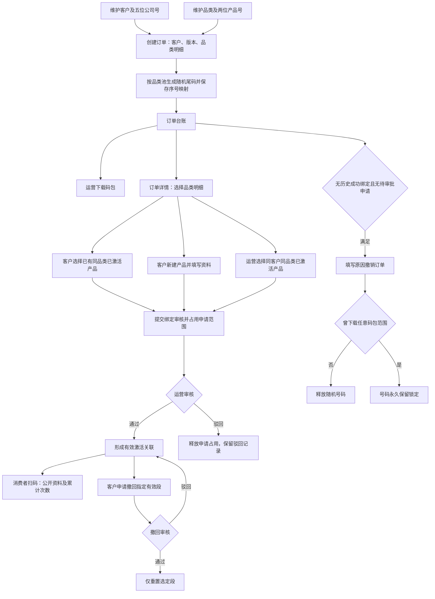
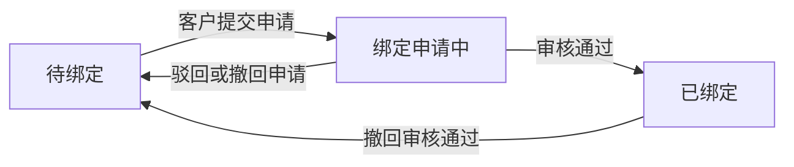

# 业务流程

核对日期：2026-10-29。适用项目：`prototype-copy-20261022`。以当前运行页面和代码为依据；浏览器原型、测试数据与正式后端能力分别说明。

## 主业务流程

## 数量流转

撤回后的单码显示已重置，之后存在更晚有效绑定时可展示新产品。订单撤销与产品绑定撤回是两套不同操作。

## 关联依据

- [当前系统基线](../current-system-baseline.md)
- [页面需求说明](../../prototype-annotator/specs/README.md)
- [完整产品说明书](../../输出/说明文件包/溯源质控码平台产品说明书_v1.1.md)
- [系统规则说明](../current-system-baseline.md)
