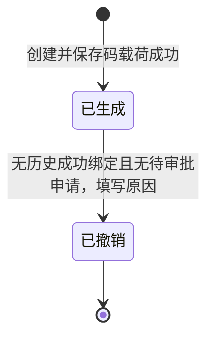
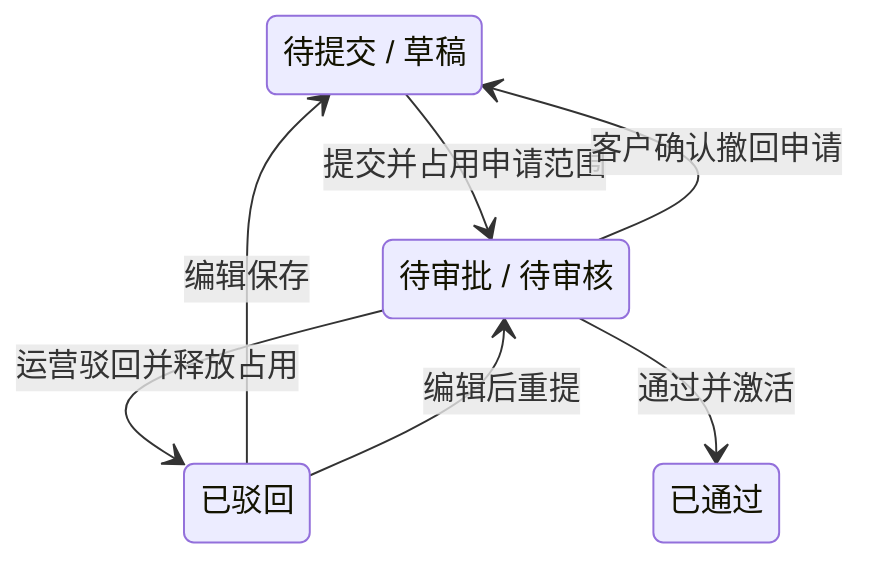

# 状态流转

核对日期：2026-10-29。适用项目：`prototype-copy-20261022`。以当前运行页面和代码为依据；浏览器原型、测试数据与正式后端能力分别说明。

## 订单状态

订单显示状态只有已生成、已撤销；尚未绑定、绑定审核中、已绑定产品等是单码或申请层状态，不能直接替代订单状态。

- 订单历史上有过成功绑定记录即不可撤销；后续全部产品撤回、已绑定变为 0，也不会恢复撤销资格。
- 存在待审核绑定申请时不可撤销。首次绑定申请被驳回，且从未成功绑定、无其他待审核申请时，可以撤销。
- 撤销必须填写原因；已撤销订单不能重复撤销或继续绑定，记录仍保留在运营端。
- 从未下载码包的订单撤销后释放全部号码；下载过任意范围后，撤销仍保留整单号码锁定，二维码失效且订单不可恢复。

## 申请与产品状态

- 产品本身使用草稿、待审核、已驳回、已激活等状态；绑定申请使用草稿、待审批、已通过、已驳回等状态。
- 绑定记录将草稿显示为待提交，将有效激活显示为已激活；不能混为一个不可区分的枚举。
- 审核结论保留历史；撤回后的当前绑定状态可为部分撤回或已撤回，原通过结论不变。
- 草稿无申请时间；直接绑定没有申请时间；处理时间、处理人仅在发生处理后显示。
- 正常订单运营记录默认展示待审批、已激活和已驳回；客户记录还保留待提交和已重置。
- 产品所有有效关联均重置后恢复草稿，部分撤回时仍保持已激活。

## 客户绑定记录操作

| 绑定记录状态 | 操作 | 前置条件或结果 |
| --- | --- | --- |
| 待提交 | 编辑、预览码、提交审核 | 尚未提交，不显示申请时间；提交校验通过后进入待审批。 |
| 已驳回 | 编辑、预览码 | 修改后重新提交；原驳回结果保留在记录中。 |
| 待审批 | 查看、预览码、撤回申请 | 资料只读；撤回需确认，释放申请占用。 |
| 已激活 | 查看、预览码、撤回产品 | 仅当前订单、当前范围和数量仍完整有效时提供撤回产品。 |
| 已重置 | 查看撤回 | 有关联撤回单时显示；不再提供编辑或再次撤回。 |
| 已撤销订单中的记录 | 无写操作 | 绑定记录入口仍可点击；可以查看历史驳回等记录，不意味着有成功绑定。 |

## 运营绑定记录操作

| 当前记录状态 | 操作规则 |
| --- | --- |
| 待审批 / 待审核 | 审核；进入详情后核对资料、通过并激活或填写原因驳回。 |
| 已激活 / 已通过 | 查看；符合资料编辑入口条件时显示编辑，不重复提供审核。 |
| 已驳回 | 查看原申请资料和结果；客户修改后重提。 |
| 已重置 | 存在关联撤回单时可查看撤回；正常有效订单的运营绑定记录默认只展示待审批、已激活和已驳回。 |
| 已撤销订单 | 历史可读，移除记录中的写操作。 |

## 单码判定

查码状态依次判断：订单已撤销 → 产品绑定已撤回 → 已绑定产品 → 绑定审核中 → 尚未绑定。

扫码页显示已激活、未激活、已重置以及无效码反馈；对 16 位真实码必须查实际映射，不能通过 URL 状态参数强行展示另一个产品。

## 关联依据

- [当前系统基线](../current-system-baseline.md)
- [页面需求说明](../../prototype-annotator/specs/README.md)
- [完整产品说明书](../../输出/说明文件包/溯源质控码平台产品说明书_v1.1.md)
- [系统规则说明](../current-system-baseline.md)
