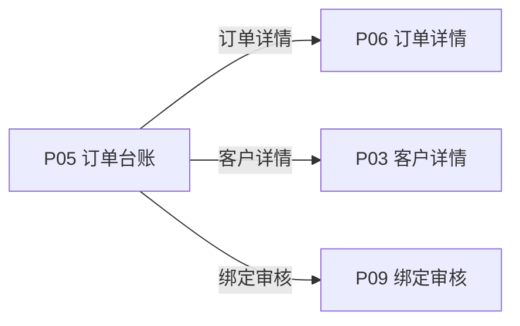
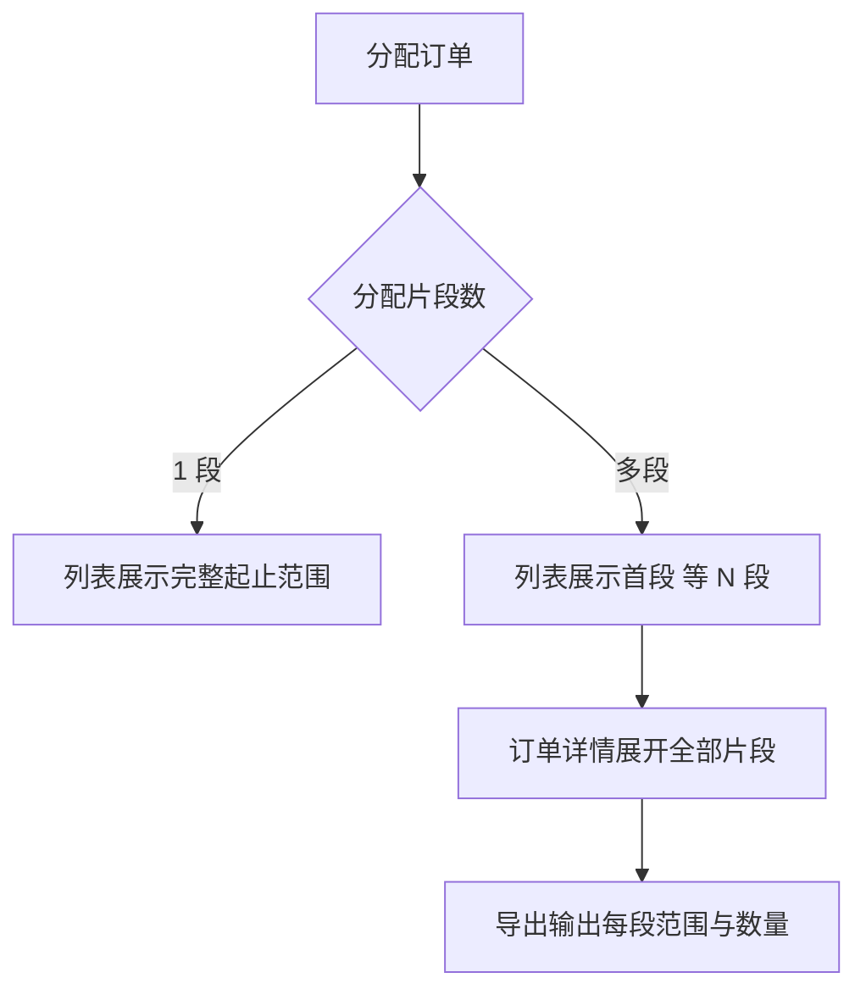
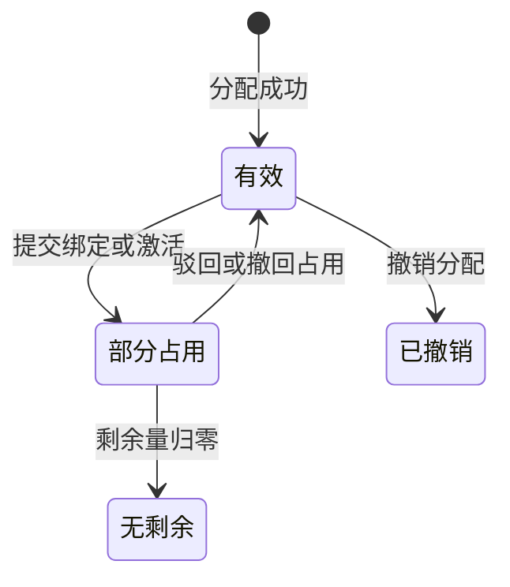

# 《页面功能规格说明书》

> 页面名称：订单台账  
> 页面编号：P05  
> 文档类型：页面级功能规格

## 01 页面基本信息

| 项目 | 内容 |
| --- | --- |
| 页面名称 | 订单台账 |
| 页面编号 | P05 |
| 所属模块 | 运营端 / 订单管理 |
| 使用角色 | 启用状态的运营人员 |
| 页面入口 | `/prototype-multipage/pages/ops/orders.html`；从运营端主导航进入“订单台账”，或从订单详情返回。 |

## 02 页面业务说明

### 页面目标

按分配订单查看客户码量、已激活量、绑定申请占用量和剩余可用量。

### 业务场景

码段分配后形成订单，后续产品绑定、激活、撤回和剩余可用量均以订单及其连续码段为基础。

- 按客户、订单号和分配日期筛选
- 查看绑定申请中明细
- 进入订单详情
- 保留撤销分配操作并按条件置灰禁用

### 业务对象

| 业务对象 | 页面内职责 | 数据来源与落地要求 |
| --- | --- | --- |
| 分配订单 | 页面初始化、关联查询或状态计算 | 当前原型为 localStorage / 页面上下文；正式接口待后端契约确认 |
| 客户 | 页面初始化、关联查询或状态计算 | 当前原型为 localStorage / 页面上下文；正式接口待后端契约确认 |
| 激活记录 | 页面初始化、关联查询或状态计算 | 当前原型为 localStorage / 页面上下文；正式接口待后端契约确认 |
| 绑定申请 | 页面初始化、关联查询或状态计算 | 当前原型为 localStorage / 页面上下文；正式接口待后端契约确认 |

### 业务关系

## 03 页面功能

### 查询

- 按客户、订单号和分配日期筛选

### 查看

- 查看绑定申请中明细
- 进入订单详情

### 其他操作

- 直接绑定客户已有已激活产品
- 撤销分配
- 导出台账

## 04 数据定义

| 字段 | 类型 | 必填 | 唯一性 | 默认值 | 可修改性 | 数据来源 |
| --- | --- | --- | --- | --- | --- | --- |
| 订单号 | 字符串 | 是 | 全局唯一 | — | 否（系统维护） | 分配订单 |
| 客户名称 | 字符串 | 是 | 否 | — | 否（系统维护） | 客户 |
| 分配时间 | 日期时间 | 是 | 否 | — | 否（系统维护） | 分配订单 |
| 序列号范围 | 字符串/数组 | 是 | 片段范围不可重叠 | — | 否（系统维护） | 分配订单 |
| 分配码段片段 | 数组 | 否 | 片段范围不可重叠 | — | 否（系统维护） | 分配订单 |
| 订单码量 | 整数 | 是 | 否 | 0 | 否（系统维护） | 分配订单 |
| 已激活 | 整数 | 是 | 否 | 0 | 否（系统维护） | 激活记录 |
| 绑定申请中 | 整数 | 是 | 否 | 0 | 否（系统维护） | 绑定申请 |
| 剩余可用 | 整数 | 是 | 否 | 0 | 否（系统维护） | 分配订单 |

> “必填”表示业务记录或提交动作必须具备该字段；“可修改性”由后端根据当前业务状态最终校验。

## 05 业务规则

### 数据校验规则

- 直接绑定须再次校验连续可用范围
- 一笔分配订单允许包含多个不连续码段片段；单个片段必须连续，片段之间不可重叠
- 分配订单总码量必须等于所有分配码段片段数量之和

### 计算规则

- 剩余可用 = 订单码量 - 已激活 - 绑定申请中，最小为 0
- 订单剩余量为 0 时禁用继续绑定
- 订单码段由运营端分配时按未分配序号从小到大自动生成；若库存存在碎片，订单详情应展示完整片段列表

### 操作规则

- 列表默认按分配时间倒序排列，最新记录在前。
- 按客户、订单号和分配日期筛选
- 查看绑定申请中明细
- 进入订单详情
- 直接绑定客户已有已激活产品
- 撤销分配按钮在操作列中始终保留；不满足撤销条件时置灰、不可点击，并通过提示说明原因
- 导出台账
- 已撤销分配的订单不在有效台账展示
- 订单号和码段按字符串处理
- 列表空间不足时可展示“首段 等 N 段”，详情和导出必须展示完整多段明细
- 无绑定申请时绑定申请中为 0
- 筛选和分页状态应保持一致

### 数据一致性规则

- 四项码量同排展示且计算一致
- 点击记录能进入对应订单而非错误示例
- 导出结果遵循当前筛选条件
- 撤销分配时释放订单下全部分配片段，并同步刷新码段库存剩余量和空闲区间
- 页面数据以后端当前有效业务关系为准，关联页面使用同一数据口径。

### 多段订单展示规则图

## 06 状态管理

### 状态定义

| 状态 | 定义 |
| --- | --- |
| 有效 | 订单码段可用于绑定 |
| 部分占用 | 存在激活或待审批绑定 |
| 无剩余 | 全部码量已占用 |
| 已撤销 | 整笔分配已撤销 |

### 状态转换图

### 转换条件

| 当前状态 | 目标状态 | 转换条件 |
| --- | --- | --- |
| 初始 | 有效 | 分配成功 |
| 有效 | 部分占用 | 提交绑定或激活 |
| 部分占用 | 无剩余 | 剩余量归零 |
| 部分占用 | 有效 | 驳回或撤回占用 |
| 有效 | 已撤销 | 撤销分配 |

### 禁止转换

- 状态转换图中未定义的转换一律禁止。
- 前端不得直接指定目标状态，后端必须根据当前状态和业务条件执行转换。
- 后续业务过程不得覆盖历史审核或操作状态。

## 07 权限管理

### 页面权限

- 仅启用状态的运营人员可访问。

### 操作权限

- 操作权限按当前账号状态、数据权限和业务前置条件判断；本页涉及：按客户、订单号和分配日期筛选、查看绑定申请中明细、进入订单详情、直接绑定客户已有已激活产品、撤销分配、导出台账。

### 数据权限

- 运营端可访问平台业务数据；涉及账号管理、审核和撤销的操作必须记录操作人及时间。

## 08 系统交互

### 内部系统交互

| 交互对象 | 交互内容 | 调用时机 | 成功处理 | 失败处理 |
| --- | --- | --- | --- | --- |
| 分配订单 | 页面初始化、关联查询或状态计算 | 页面初始化或关联数据变更后 | 返回最新数据并刷新相关区域 | 保留当前上下文并允许重试 |
| 客户 | 页面初始化、关联查询或状态计算 | 页面初始化或关联数据变更后 | 返回最新数据并刷新相关区域 | 保留当前上下文并允许重试 |
| 激活记录 | 页面初始化、关联查询或状态计算 | 页面初始化或关联数据变更后 | 返回最新数据并刷新相关区域 | 保留当前上下文并允许重试 |
| 绑定申请 | 页面初始化、关联查询或状态计算 | 页面初始化或关联数据变更后 | 返回最新数据并刷新相关区域 | 保留当前上下文并允许重试 |
| 查询服务 | 按客户、订单号和分配日期筛选。查询参数和分页条件应由正式接口统一接收。 | 查询、筛选或分页时 | 返回匹配数据和总数 | 保留查询条件并允许重试 |
| 直接绑定客户已有已激活产品 | 提交当前业务对象标识、操作字段、操作人和客户端请求标识；后端重新校验业务前置条件。 | 用户确认提交时 | 返回最新状态并刷新关联数据 | 不写入成功状态，返回明确原因 |
| 撤销分配 | 提交订单号、撤销原因、操作人和客户端请求标识；后端重新校验该订单已激活数量和绑定申请中数量均为 0。 | 用户确认撤销时 | 释放该订单全部分配片段并刷新库存、订单和客户详情 | 不写入成功状态，返回明确原因 |
| 导出台账 | 提交当前业务对象标识、操作字段、操作人和客户端请求标识；后端重新校验业务前置条件。 | 用户确认提交时 | 返回最新状态并刷新关联数据 | 不写入成功状态，返回明确原因 |

> 当前原型使用浏览器 localStorage 模拟数据存取；正式接口路径、请求方法、错误码和超时阈值由前后端联调时确认。

## 09 异常与边界

### 重复操作

- 写操作必须携带客户端请求标识并保证幂等；重复提交不得重复创建记录、扣减数量或发送通知。

### 并发处理

- 后端在提交时重新校验记录版本、当前状态及数量；发生冲突时拒绝本次操作并返回最新数据。

### 超时处理

- 请求超时时保留当前查询或表单上下文，不得预先写入成功状态；重试时沿用原幂等标识。

### 数据异常

- 查询成功但无记录时展示明确空状态，保留可用的新增、返回或重试入口。
- 未登录、账号禁用、越权访问或数据不属于当前主体时终止操作，并返回无权限或安全的空结果。

## 10 前端交互补充

### 页面结构

| 页面区域 | 内容与职责 |
| --- | --- |
| 页面标题区 | 页面名称及主要新增、导出操作 |
| 查询筛选区 | 搜索、枚举筛选、日期筛选和重置 |
| 数据列表区 | 业务记录、状态和行操作 |
| 分页区 | 总数、页码和每页条数 |
| 弹窗区 | 新增、编辑、审核或确认操作 |

### 页面元素

| 元素 | 说明 |
| --- | --- |
| 订单号 | 展示或维护订单号 |
| 客户名称 | 展示或维护客户名称 |
| 分配时间 | 展示或维护分配时间 |
| 序列号范围 | 展示或维护序列号范围 |
| 订单码量 | 展示或维护订单码量 |
| 已激活 | 展示或维护已激活 |
| 绑定申请中 | 展示或维护绑定申请中 |
| 剩余可用 | 展示或维护剩余可用 |

### 按钮与弹窗

| 类型 | 操作 | 前端要求 |
| --- | --- | --- |
| 查询 | 按客户、订单号和分配日期筛选 | 按业务状态与操作权限决定显示和可用性 |
| 查看 | 查看绑定申请中明细 | 按业务状态与操作权限决定显示和可用性 |
| 查看 | 进入订单详情 | 按业务状态与操作权限决定显示和可用性 |
| 其他操作 | 直接绑定客户已有已激活产品 | 按业务状态与操作权限决定显示和可用性 |
| 其他操作 | 撤销分配 | 操作项始终保留；不满足条件时置灰禁用并显示原因 |
| 其他操作 | 导出台账 | 按业务状态与操作权限决定显示和可用性 |

### 交互反馈

- 列表首次加载或重置筛选后，恢复默认的时间倒序。
- 序列号范围列优先完整展示起止序列号；多段订单可紧凑展示首段和段数汇总，详情、弹窗和导出必须展示完整片段。
- 操作列需使用独立底色并预留足够宽度，保证“绑定产品 / 撤销分配 / 详情”等操作项完整覆盖在同一操作区域内。
- 页面在桌面和窄屏下无内容重叠，长列表支持分页，宽表支持横向滚动。
- 页面区域、字段名称、状态、权限和数据口径与关联页面保持一致。
- 加载中、成功、失败和空数据状态必须给出明确反馈。
