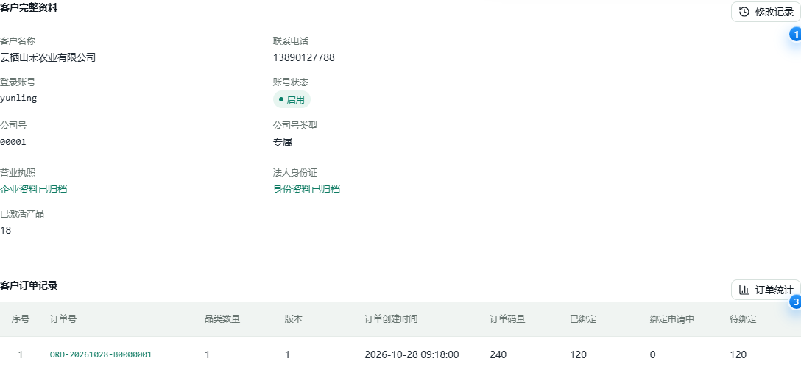
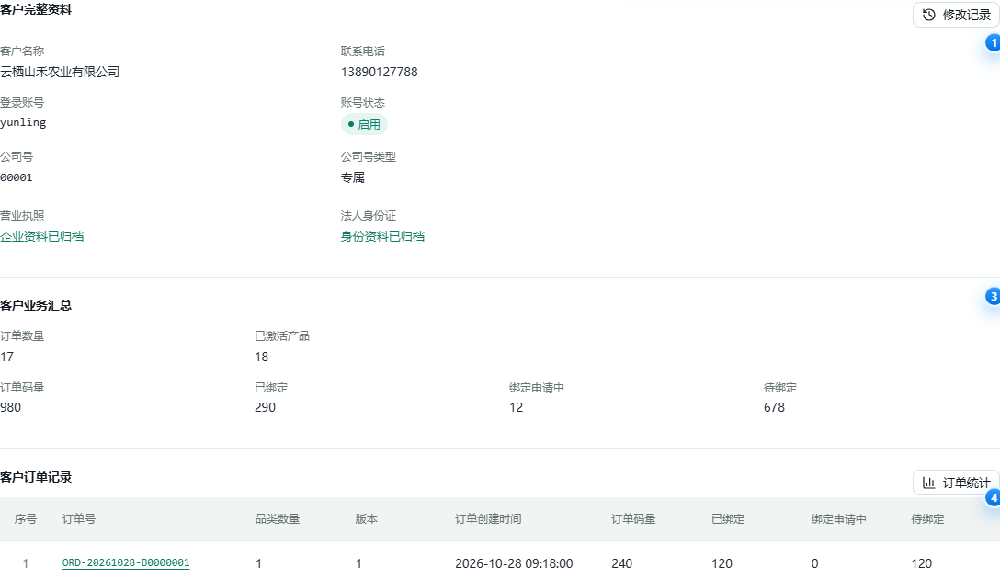

# 客户详情改动对比

2026 年 11 月 26 日 · 测试问题 Q9 · 运营端「客户管理 → 客户详情」

客户详情新增「客户业务汇总」。运营人员打开客户资料后，可以直接查看该客户共有多少订单、多少已激活产品，以及各类码量的合计。下方的「客户订单记录」仍可逐笔核对。

## 修改前

「已激活产品」位于「客户完整资料」末行。截图中的 `18` 表示该客户当前已激活的产品数。下方表格展示逐笔订单的码量，页面没有客户级合计。

## 修改后

「客户完整资料」到证照为止。新增的「客户业务汇总」与前后的两个标题同级。第一行显示订单数量和已激活产品，第二行显示四项码量。每个字段只显示数值。

## 两端核对

以下截图均取自本地原型的同一演示客户「云栖山禾农业有限公司」。表中的数字是本次截图时的读数。

| 字段 | 运营端客户详情 | 客户端数据概览 |
| --- | ---: | ---: |
| 订单数量 | 17 | 17 |
| 已激活产品 | 18 | 此页无此指标 |
| 订单码量 | 980 | 980 |
| 已绑定 | 290 | 290 |
| 绑定申请中 | 12 | 12 |
| 待绑定 | 678 | 678 |

订单数量统计该客户的全部未撤销订单。每笔订单计一次，包含多个品类也只计一次。四项码量覆盖同一批订单；详情列表翻页和客户端「最近订单」的十笔显示上限均不影响汇总。已激活产品沿用当前客户名下已激活产品的计数。
