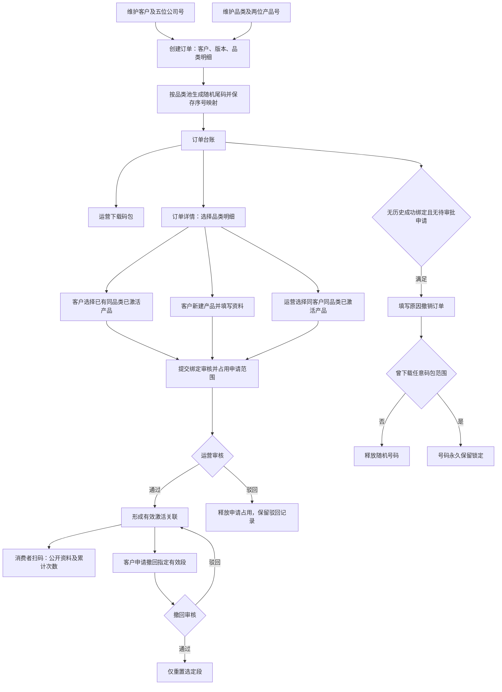
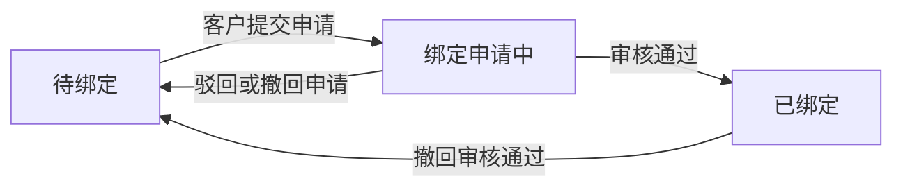
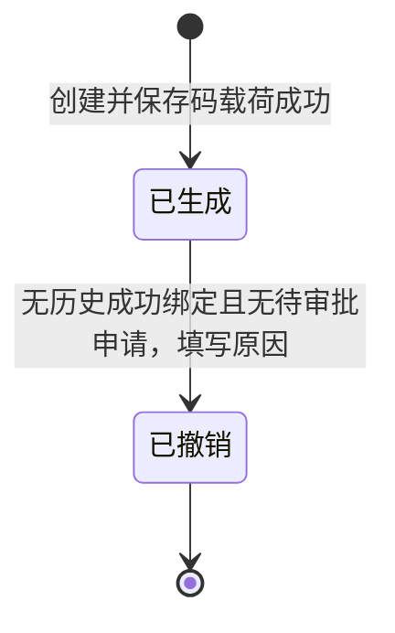
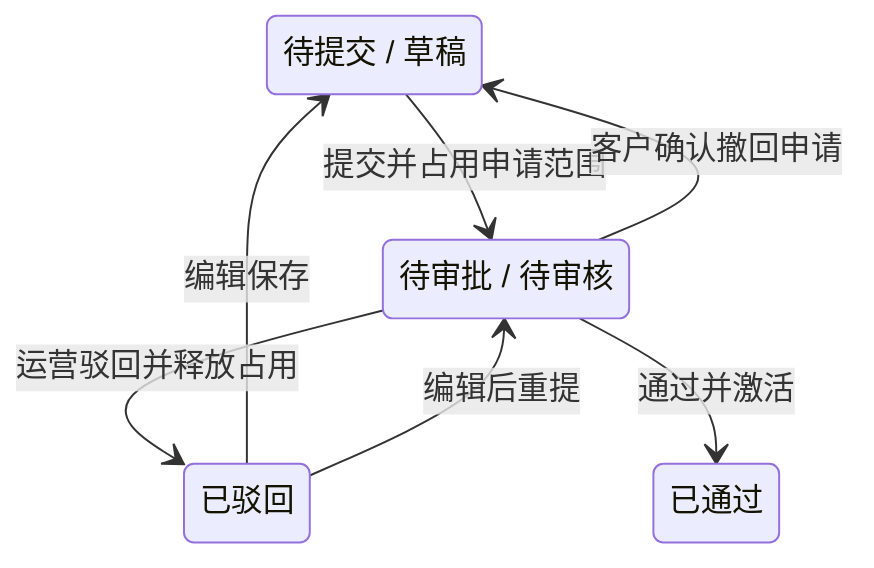

# 溯源质控码平台产品说明书

文档版本：V1.3（2026-11-02 当前系统核对版）。为保持既有引用，沿用 v1.1 文件路径。

适用项目：prototype-copy-20261022；适用端：运营端、客户端、扫码端。本文根据当前运行页面和业务代码编写，替代旧库存分配流程的产品基线。

## 1. 阅读范围与实现级别

- 页面需求说明的唯一当前内容源是 prototype-annotator/specs/current，每页有稳定编号；P 标注读取整篇 Markdown，元素标注解释局部业务规则。
- 以当前运行行为为事实；历史资料、早期说明和测试样例不能覆盖本次基线。
- 明确区分已实现的浏览器交互、模拟测试数据以及正式后端待接入能力。本文不将建议技术栈、估算容量或 IP 测试数据写成已上线能力。

## 2. 产品定位

平台为客户产品建立二维码与产品资料的关联。运营人员维护客户及品类，创建随机码订单并交付码包；客户从订单品类明细录入或选择产品并申请绑定；运营审核后，消费者扫码查看公开资料。客户可申请撤回具体有效关联，运营通过后重置选定码。

当前主流程是“创建客户订单并直接生成码”，不再是“先生成平台库存再向客户分配连续溯源码”。库存旧地址仅保留访问兼容。

### 2.1 目标用户与场景

| 用户 | 主要任务 | 完成标志 |
| --- | --- | --- |
| 运营人员 | 客户及品类建档、创建订单、码包交付、审核、查码与统计 | 订单码载荷可用、数量一致、状态和处理记录可追溯。 |
| 客户资料人员 | 维护产品五模块资料、预览、提交绑定、申请撤回 | 申请在对应明细可见，资料与码量关联正确。 |
| 消费者 | 扫码读取有效产品公开资料 | 按真实单码状态呈现信息与次数，不展示已撤回资料。 |

### 2.2 范围

包含三端页面、资料附件、预览、站内信、账号维护、码包导出、订单/品类/公司统计和查码。合同、支付、物流、印刷、防伪刮层、消费者会员、GPS、区块链或外部邮件短信不在已实现范围内。

## 3. 角色与权限

| 能力 | 运营人员 | 客户人员 | 消费者 |
| --- | --- | --- | --- |
| 客户、公司号、品类维护 | 可操作 | 不可操作 | 不可见 |
| 创建订单、生成随机码 | 启用客户和启用品类 | 不可操作 | 不可见 |
| 下载码包、下载记录 | 运营台账下载；运营详情看记录 | 无入口 | 无入口 |
| 撤销订单 | 满足历史绑定和申请限制时操作 | 不可操作 | 不可见 |
| 客户订单台账 | 全平台含撤销记录 | 仅本人且排除已撤销 | 不可见 |
| 新建产品并申请绑定 | 无独立新建产品入口 | 当前订单及品类上下文 | 不可操作 |
| 绑定已有已激活产品 | 同客户同品类提交审核 | 同客户同品类提交审核 | 不可操作 |
| 产品资料审核与受限编辑 | 依审核状态处理 | 草稿/驳回可编辑，待审只读 | 不可操作 |
| 撤回待审批绑定申请 | 不代客户撤回 | 本人待审批记录可确认撤回 | 不可操作 |
| 发起已激活产品撤回 | 不代客户发起 | 当前有效关联段 | 不可操作 |
| 审批产品撤回 | 依待审批状态通过或驳回 | 只查看进度 | 不可操作 |
| 查码、查看扫码记录 | 运营台账内查码 | 无后台查码入口 | 无后台记录入口 |
| 查看公开产品信息 | 预览 | 预览 | 对真实有效码扫码查看 |
| 运营账号维护 | 当前运营业务权限一致 | 不可见 | 不可见 |
| 修改本人密码和站内信 | 本人账号/收件范围 | 本人账号/收件范围 | 不适用 |

所有运营账号当前业务权限一致；账户姓名不意味着具备不同岗位权限。客户的数据访问受所属客户限制；正式后端必须再次校验，不能依赖页面过滤。

### 3.1 登录及本人设置

运营和客户页面在无会话时显示账号密码登录。账号为 4～20 位字母、数字或下划线，登录密码长度 8～20 位；创建/修改密码需包含字母和数字。锁定或禁用账号不能登录，失败有对应提示。

新建与编辑账号校验账号唯一。当前登录运营账号不能禁用自身；禁用其他运营账号、重置其密码需要验证当前登录密码。修改本人密码后当前实现提示成功并保持会话，没有实现强制退出全部设备的承诺。

## 4. 端到端流程

## 主业务流程



## 数量流转



撤回后的单码显示已重置，之后存在更晚有效绑定时可展示新产品。订单撤销与产品绑定撤回是两套不同操作。


### 4.1 典型场景

1. 客户建档：维护五位公司号、类型、账号和真实证照。公司号一旦创建过订单即锁定。
2. 订单创建：选客户和版本，添加一个或多个品类行及数量，系统从产品号池去重抽号，建立订单内位置映射。
3. 首次绑定：客户在品类行选择新建产品，填写资料及绑定设置，预览后确认提交；审核通过才真正激活。
4. 追加绑定：选择本客户同品类的已激活产品；当前运营和客户入口都生成待审批申请，通过后才激活。历史直接绑定处理函数不等于当前入口仍具备此能力。
5. 退回与撤销：首次申请驳回保留申请历史；无成功绑定、无待审批可撤销订单，是否释放号码由下载历史决定。
6. 产品撤回：客户选择具体有效段，运营通过后仅重置这些段；剩余有效段继续展示。
7. 运维排查：在运营台账查码，核对归属、状态和扫码记录；在统计页按公司、品类、版本排序和下钻。

## 5. 页面目录

| 编号 | 页面 | 实际入口 | 需求文件 |
| --- | --- | --- | --- |
| P02 | 客户管理 | `pages/ops/customers.html` | [需求说明](../../prototype-annotator/specs/current/P02-客户管理.md) |
| P03 | 客户详情 | `pages/ops/customer-detail.html` | [需求说明](../../prototype-annotator/specs/current/P03-客户详情.md) |
| P02A | 品类管理 | `pages/ops/categories.html` | [需求说明](../../prototype-annotator/specs/current/P02A-品类管理.md) |
| P04 | 创建订单 | `pages/ops/create-order.html` | [需求说明](../../prototype-annotator/specs/current/P04-创建订单.md) |
| P05 | 运营订单台账 | `pages/ops/orders.html` | [需求说明](../../prototype-annotator/specs/current/P05-运营订单台账.md) |
| P06 | 运营订单详情 | `pages/ops/order-detail.html` | [需求说明](../../prototype-annotator/specs/current/P06-运营订单详情.md) |
| P14 | 数据统计 | `pages/ops/statistics.html` | [需求说明](../../prototype-annotator/specs/current/P14-数据统计.md) |
| P08 | 绑定审核详情 | `pages/ops/bind-request-detail.html` | [需求说明](../../prototype-annotator/specs/current/P08-绑定审核详情.md) |
| P09 | 绑定审核 | `pages/ops/bind-requests.html` | [需求说明](../../prototype-annotator/specs/current/P09-绑定审核.md) |
| P10 | 撤回审核 | `pages/ops/withdrawals.html` | [需求说明](../../prototype-annotator/specs/current/P10-撤回审核.md) |
| P11 | 运营账号管理 | `pages/ops/operators.html` | [需求说明](../../prototype-annotator/specs/current/P11-运营账号管理.md) |
| P12 | 运营端站内信 | `pages/ops/messages.html` | [需求说明](../../prototype-annotator/specs/current/P12-运营端站内信.md) |
| P27 | 客户端站内信 | `pages/customer/messages.html` | [需求说明](../../prototype-annotator/specs/current/P27-客户端站内信.md) |
| P13 | 运营端修改登录密码 | `pages/ops/settings.html` | [需求说明](../../prototype-annotator/specs/current/P13-运营端修改登录密码.md) |
| P28 | 客户端修改登录密码 | `pages/customer/settings.html` | [需求说明](../../prototype-annotator/specs/current/P28-客户端修改登录密码.md) |
| P21 | 客户端数据概览 | `pages/customer/overview.html` | [需求说明](../../prototype-annotator/specs/current/P21-客户端数据概览.md) |
| P22 | 客户端订单台账 | `pages/customer/orders.html` | [需求说明](../../prototype-annotator/specs/current/P22-客户端订单台账.md) |
| P23 | 客户端订单详情 | `pages/customer/order-detail.html` | [需求说明](../../prototype-annotator/specs/current/P23-客户端订单详情.md) |
| P25 | 产品编辑与查看 | `pages/customer/editor.html` | [需求说明](../../prototype-annotator/specs/current/P25-产品编辑与查看.md) |
| P26 | 客户端撤回申请 | `pages/customer/withdrawals.html` | [需求说明](../../prototype-annotator/specs/current/P26-客户端撤回申请.md) |
| P31 | 已激活扫码页 | `pages/scan/active.html` | [需求说明](../../prototype-annotator/specs/current/P31-已激活扫码页.md) |
| P32 | 扫码预览 | `pages/scan/preview.html` | [需求说明](../../prototype-annotator/specs/current/P32-扫码预览.md) |
| P33 | 未激活扫码页 | `pages/scan/inactive.html` | [需求说明](../../prototype-annotator/specs/current/P33-未激活扫码页.md) |
| P34 | 已重置扫码页 | `pages/scan/reset.html` | [需求说明](../../prototype-annotator/specs/current/P34-已重置扫码页.md) |

当前目录只列本版本业务页面；已取消的库存页面说明移至历史归档，查码规则归入 P05 运营订单台账的弹窗说明。入口导航 index.html 是演示三端导航；三个 import-*.html 页面是测试数据导入工具，不属于业务导航和普通用户功能。

## 6. 页面功能与交互

### P02 客户管理

# 客户管理

#### 页面摘要

运营人员维护客户账号、证照和公司号，并从客户行直接为该客户创建订单。

| 项目 | 当前实现 |
| --- | --- |
| 页面编号 / 所属端 | P02 / 运营端 |
| 使用角色 | 启用的运营人员 |
| 页面地址 | `/pages/ops/customers.html` |
| 入口与上下文 | 关联页面：[P03](../../prototype-annotator/specs/current/P03-客户详情.md)、[P04](../../prototype-annotator/specs/current/P04-创建订单.md)；详情按实际对象参数定位。 |
| 核对依据 | `js/core/customer-management.js`、`js/views/business.js`、`js/core/enhanced-runtime.js` |
| 核对日期 / 边界 | 2026-11-02；当前可运行浏览器原型，不代表已接入正式后端。 |

#### 二级承载面

- 新建客户账号：填写账号资料、公司号类型与证照，校验通过后创建启用客户。
- 编辑客户账号：登录账号只读，客户资料和证照可更新；重置密码进入确认，不直接显示原密码。
- 设置共享号：维护可供多个客户复用的 5 位共享公司号，显示使用客户数。

#### 功能操作

- **客户筛选**：客户名称、账号、联系电话、公司号使用文本搜索，叠加状态与号码类型筛选；重置清空条件。
- **客户行操作**：详情查看客户完整资料；编辑维护资料；创建订单打开创建页并自动带入该客户。
- **客户列表导出**：导出客户名称、账号、联系电话、状态及四项码量。

#### 【客户筛选】规则说明

- 客户名称、账号、联系电话、公司号使用文本搜索，叠加状态与号码类型筛选；重置清空条件。
- 筛选后按匹配记录分页，不能只隐藏本页行而保留错误的总数。

#### 【客户行操作】规则说明

- 详情查看客户完整资料；编辑维护资料；创建订单打开创建页并自动带入该客户。
- 禁用客户不能创建新订单；禁用/启用需确认，禁用后不能登录客户端。
- 订单码量、已绑定、绑定申请中、待绑定来自该客户订单汇总，不是可手工改动的额度。

#### 【客户列表导出】规则说明

- 导出客户名称、账号、联系电话、状态及四项码量。
- 当前导出处理读取客户全集；不能把当前筛选条件自动限制导出范围当作已实现能力。

#### 【字段】规则说明

##### 字段说明

| 字段 | 格式与约束 |
| --- | --- |
| 客户名称 | 必填，2～20 位中文、字母或数字。 |
| 登录账号 | 必填，4～20 位字母、数字、下划线；跨运营账号和客户账号检查重复；创建后不可修改。 |
| 联系电话 | 必填，校验 11 位手机号。 |
| 初始密码 | 8～20 位，包含字母和数字。 |
| 公司号 | 00001～99999 的 5 位字符串；保留前导零，分专属和共享。 |
| 营业执照、法人身份证 | 新建必填；图片或 PDF，单文件不超过 10 MB；编辑可保留原件或替换。 |

#### 【列表】显示规则说明

- 当前表格列序：序号、客户名称、账号、联系电话、公司号、号码类型、状态、订单码量、已绑定、绑定申请中、待绑定、操作。
- 上述列序取自当前运行页面；序号、分页和横向滚动以当前表格配置为准。无匹配记录时显示空状态，不插入其他对象的样例记录。

#### 【新建客户账号】交互规则说明

- 填写账号资料、公司号类型与证照，校验通过后创建启用客户。
- 新建专属号不得使用已设共享号、其他专属客户使用的号或不可重新发放的历史号。

##### 公司号类型和锁定规则

- 公司号类型可选专属公司号或共享公司号。新建专属公司号默认填入最小可用的未使用号码，允许修改；共享公司号须从已登记号码中选择。
- 客户已创建过订单后，公司号及类型不可更换；编辑显示只读字段。

#### 【编辑客户账号】交互规则说明

- 登录账号只读，客户资料和证照可更新；重置密码进入确认，不直接显示原密码。
- 客户改名按固定客户 ID 维持归属；日常列表、搜索和统计使用当前名称，订单创建快照及已发布产品资料保留原值。每次改名记录前后名称、时间和操作人。

#### 【设置共享号】交互规则说明

- 维护可供多个客户复用的 5 位共享公司号，显示使用客户数。
- 重复、格式错误或已被专属占用的号码不能添加；有关联使用时不能随意移除。

#### 客户改名规则（2026-11-02）

本节为 2026-11-02 确认的目标规则，本次仅更新说明。当前台账搜索和统计名称仍有旧名称读取路径，待后续统一。

- 客户名称可修改，客户 ID 固定；改名不改变登录账号、公司号、归属和业务状态。
- 日常列表、客户选择、搜索、统计和查码归属采用当前名称；订单详情保留创建时名称快照，已发布产品及扫码企业资料不自动改写。
- 修改记录与快照分别保留。业务主体更换应另建账号，不能通过改名转移订单。

完整口径和历史兼容见[客户改名规则](../../docs/customer-rename-rules.md)。

#### 公司号默认值与校验

- 选择专属公司号时，从 00001 起查找最小可用号，排除共享号、其他客户专属号和仍被订单占用的历史号。默认值可手工修改，保存时重新检查格式、重复占用及历史锁定。
- 客户名称、账号、手机号和密码按各字段规则校验。已有订单时，公司号和类型只读。

### P03 客户详情

# 客户详情

#### 页面摘要

按一个客户核对完整账号资料、证照、修改历史和该客户的订单汇总。

| 项目 | 当前实现 |
| --- | --- |
| 页面编号 / 所属端 | P03 / 运营端 |
| 使用角色 | 启用的运营人员 |
| 页面地址 | `/pages/ops/customer-detail.html` |
| 入口与上下文 | 关联页面：[P02](../../prototype-annotator/specs/current/P02-客户管理.md)、[P04](../../prototype-annotator/specs/current/P04-创建订单.md)、[P06](../../prototype-annotator/specs/current/P06-运营订单详情.md)、[P14](../../prototype-annotator/specs/current/P14-数据统计.md)；详情按实际对象参数定位。 |
| 核对依据 | `js/core/customer-management.js`、`js/views/business.js`、`js/core/order-statistics.js` |
| 核对日期 / 边界 | 2026-11-02；当前可运行浏览器原型，不代表已接入正式后端。 |

#### 二级承载面

- 本页没有额外的独立业务弹窗；查看附件、全局登录和修改密码按共用规则处理。

#### 功能操作

- **客户资料与修改记录**：通过 customer 参数定位客户；不存在的客户显示缺省提示，不能用其他客户数据替代。
- **创建该客户订单**：创建订单按钮位于页面右上角，进入创建页并自动选中当前客户。
- **客户订单记录**：品类数量是订单内不同品类数，不展示产品大类列表；本页仍保留版本列。

#### 【客户资料与修改记录】规则说明

- 通过 customer 参数定位客户；不存在的客户显示缺省提示，不能用其他客户数据替代。
- 展示公司号及类型、账号、电话、证照和码量汇总；证照可预览。
- 修改记录展示修改时间、操作人、变更字段及修改前后值。

#### 【创建该客户订单】规则说明

- 创建订单按钮位于页面右上角，进入创建页并自动选中当前客户。
- 客户禁用时该入口禁用，并说明原因。

#### 【客户订单记录】规则说明

- 品类数量是订单内不同品类数，不展示产品大类列表；本页仍保留版本列。
- 订单号采用系统绿色可点击链接进入对应订单详情。
- 显示订单创建时间、订单码量、已绑定、绑定申请中和待绑定。
- 订单统计按钮进入公司范围统计，自动带入客户信息。

#### 【列表】显示规则说明

- 当前表格列序：序号、订单号、品类数量、版本、订单创建时间、订单码量、已绑定、绑定申请中、待绑定。
- 上述列序取自当前运行页面；序号、分页和横向滚动以当前表格配置为准。无匹配记录时显示空状态，不插入其他对象的样例记录。

#### 客户改名规则（2026-11-02）

本节为 2026-11-02 确认的目标规则，本次仅更新说明。当前台账搜索和统计名称仍有旧名称读取路径，待后续统一。

- 客户资料显示当前名称；修改记录保留改名前后名称、时间和操作人，不替代订单快照。
- 客户订单记录按客户 ID 汇总，改名前后订单仍属于同一客户；新订单读取当前名称并保存快照。
- 未绑定、部分绑定、全部绑定及已撤销订单的状态、码量和绑定关系不因改名变化。

完整口径和历史兼容见[客户改名规则](../../docs/customer-rename-rules.md)。

#### 客户信息排布

- 桌面端按三列排布：第一行客户名称、联系电话、登录账号；第二行账号状态、公司号、公司号类型；证照随后展示，已激活产品置于最后一行左侧。
- 订单号和证照链接使用系统绿色。窄屏时按字段顺序换行。

### P02A 品类管理

# 品类管理

#### 页面摘要

运营人员维护品类和两位产品号，查看历史生成量、余额、修改记录及品类统计。

| 项目 | 当前实现 |
| --- | --- |
| 页面编号 / 所属端 | P02A / 运营端 |
| 使用角色 | 启用的运营人员 |
| 页面地址 | `/pages/ops/categories.html` |
| 入口与上下文 | 关联页面：[P04](../../prototype-annotator/specs/current/P04-创建订单.md)、[P14](../../prototype-annotator/specs/current/P14-数据统计.md)；详情按实际对象参数定位。 |
| 核对依据 | `js/core/category-management.js`、`js/core/order-statistics.js`、`js/core/order-management.js` |
| 核对日期 / 边界 | 2026-11-02；当前可运行浏览器原型，不代表已接入正式后端。 |

#### 二级承载面

- 新建与编辑品类：名称和产品号必填；重号、范围外号码、名称长度或重复校验失败时就地提示。
- 品类修改记录：显示修改时间、操作人、产品大类、变更字段、修改前和修改后；支持分页，默认每页 20 条，可选 10、20、50、100 条。
- 品类生命周期确认：确认前说明品类停用或启用对新订单的影响，不改变历史订单绑定关系。

#### 功能操作

- **品类筛选**：产品大类和产品号使用文本搜索，叠加启用/停用状态；重置恢复全部。
- **品类指标**：关联订单数统计匹配品类的历史订单；已生成码量累计历史明细数量，包含已撤销订单。
- **品类生命周期**：未生成过订单的启用品类可删除；已使用品类只能停用，产品号继续保留。

#### 【品类筛选】规则说明

- 产品大类和产品号使用文本搜索，叠加启用/停用状态；重置恢复全部。
- 表头、筛选标签和新建/编辑表单字段统一使用产品大类；新建按钮使用新建产品大类。

#### 【品类指标】规则说明

- 关联订单数统计匹配品类的历史订单；已生成码量累计历史明细数量，包含已撤销订单。
- 本页剩余可用码量 = 99,999,999 − 历史已生成码量，最低为 0。
- 本页余额与统计页当前号码占用口径不同：未下载撤销虽释放随机号码，本页仍保留历史生成数量。
- 订单统计进入该品类的公司排行及关联订单。

#### 【品类生命周期】规则说明

- 未生成过订单的启用品类可删除；已使用品类只能停用，产品号继续保留。
- 停用后不能创建新订单，不影响历史订单的后续绑定和撤回；启用后恢复新订单选用。
- 删除、停用、启用均需确认，保留修改记录。

#### 【字段】规则说明

##### 字段说明

| 字段 | 格式与约束 |
| --- | --- |
| 产品大类 | 必填，2～20 个字符，去除首尾空格后名称不重复。 |
| 产品号 | 必填，01～99 的两位字符串，不重复；生成过订单后不可修改。 |
| 备注 | 选填文本，最多 20 个字符。 |

#### 【列表】显示规则说明

- 当前表格列序：序号、产品大类、产品号、状态、关联订单数、已生成码量、剩余可用码量、备注、操作。
- 上述列序取自当前运行页面；序号、分页和横向滚动以当前表格配置为准。无匹配记录时显示空状态，不插入其他对象的样例记录。

#### 【新建与编辑品类】交互规则说明

- 备注选填，最多 20 个字符；新建和编辑使用相同限制。输入框限制长度，保存时再次校验；超限显示“备注最多 20 个字符”，保留输入并聚焦备注。已有备注不自动截断，超限时需修改后保存。

- 名称和产品号必填；重号、范围外号码、名称长度或重复校验失败时就地提示。
- 编辑已使用品类时锁定产品号；保存写入品类及修改记录，存储失败回退并提示。

##### 产品号校验

- 必须输入两位 01～99；保留前导零；历史使用的产品号不能改派。

#### 【品类修改记录】交互规则说明

- 显示修改时间、操作人、产品大类、变更字段、修改前和修改后；支持分页，默认每页 20 条，可选 10、20、50、100 条。
- 删除品类后修改记录继续保留。

#### 【品类生命周期确认】交互规则说明

- 确认前说明品类停用或启用对新订单的影响，不改变历史订单绑定关系。

#### 品类改名规则（2026-10-30）

- 允许纠错改名；改变业务含义须新建品类，不改派历史产品号。
- 订单、统计和选择项显示最新名称；已绑定产品及扫码资料不自动修改。
- 品类 ID 和产品号保持不变。同品类绑定按 ID 校验，不能比较名称决定归属。
- 修改记录保存前后名称、操作人和时间，订单快照不覆盖。业务含义由运营人员判断，本版不增加语义自动识别。
- 完整规则见[品类改名规则](../../docs/category-rename-rules.md)。

### P04 创建订单

# 创建订单

#### 页面摘要

运营人员选择客户和版本，填写品类明细，创建订单并生成码包。页面包含订单信息、品类明细、订单备注和提交操作。

| 项目 | 当前实现 |
| --- | --- |
| 页面编号 / 所属端 | P04 / 运营端。 |
| 使用角色 | 已登录且启用的运营人员。 |
| 页面地址 | `/pages/ops/create-order.html`。 |
| 入口 | [客户管理](../../prototype-annotator/specs/current/P02-客户管理.md)、[客户详情](../../prototype-annotator/specs/current/P03-客户详情.md)和[订单台账](../../prototype-annotator/specs/current/P05-运营订单台账.md)的创建订单入口。 |
| 核对依据 | 实际运行页面；`js/core/order-management.js`、`js/core/category-management.js`、`js/core/customer-management.js` 和 `css/features.css`。 |
| 核对日期 / 边界 | 2026-11-02；当前浏览器原型，生成与持久化不代表正式服务端实现。 |

#### 二级承载面

- 客户搜索候选区：按客户名称、公司号或账号查找，只显示启用客户。包含“新建客户”入口。
- 品类搜索候选区：按名称或产品号查找，只显示启用品类。包含“新建产品类别”入口。
- 新建客户账号弹窗：复用[客户管理](../../prototype-annotator/specs/current/P02-客户管理.md)的字段与校验。保存成功后回到订单表单并选中新增客户。
- 新建品类弹窗：复用[品类管理](../../prototype-annotator/specs/current/P02A-品类管理.md)的字段与校验。保存成功后自动带回发起新增的明细行。
- 创建成功结果区：替换原表单，展示订单号、客户名称、明细行数和总码量。提供下载码包、查看订单和继续创建订单。

#### 功能操作

- 客户与订单信息：选择真实客户，自动带入公司号，选择版本号。
- 品类明细与容量：搜索品类，填写码数量和备注，增加或删除明细行。
- 创建订单并生成码包：先校验，再生成并保存；处理中不显示进度条。

#### 【客户与订单信息】规则说明

- “客户名称”为搜索选择框，提示“输入名称、公司号或账号”。默认未选客户。客户行或客户详情入口可自动带入对应客户。
- 无关键词时显示最近使用客户；没有最近记录时显示可选启用客户，最多 8 条。有关键词时最多显示 10 条匹配结果。
- 必须选中有效客户，输入任意名称不能代替选择。无结果时显示“未找到匹配的客户”，仍保留新建客户入口。
- “公司号”只读，选择客户后自动带入。创建时检查 5 位数字格式，保留前导零。
- “版本号”必选，选项为 1～9，默认 1。
- 生成时保存客户 ID、名称和公司号快照。客户改名的目标规则及实现差异见[客户改名规则](../../docs/customer-rename-rules.md)，不能把尚待统一的行为当作本页已实现功能。

#### 【品类明细与容量】规则说明

- 当前列序：序号、产品大类、产品号、码数量、备注和操作。“产品大类”是本页现有表头；本次只更新说明，不修改业务页面文案。
- 初始保留一行空明细。“添加品类”位于表格底部，新增空行并聚焦品类搜索框。
- 品类按名称或两位产品号搜索。无关键词时展示最近使用的启用品类，最多 5 条；有关键词时最多显示 10 条结果。
- 选中品类后带入名称和只读产品号。输入内容与已有名称或产品号完全匹配时，也可识别为该品类。未匹配时显示选择提示，创建校验不通过。
- “码数量”必须为正整数。输入控件设置最小值 1、步长 1；同一产品号各行合计不超过 99,999,999，且不能超过该品类剩余可用码量。
- 允许同品类多行。同产品号共用号码池，不按行分别计算余额。输入上限会扣除其他同品类行已填的码数量，超量时提示“超出剩余可用量”。
- “备注”为单行选填项，最多 20 个字符。删除行后重排序号并更新码量；只剩一行时提示“至少保留一条明细”。
- 明细增减和码数量修改实时更新订单码量、中文大写。两项显示在明细表下方右侧，初始为 0 和“零”。表格不分页。
- 草稿按品类 ID 关联，展示当前名称。创建时保存品类 ID、固定产品号和名称快照；后续规则见[品类改名规则](../../docs/category-rename-rules.md)。

#### 【创建订单并生成码包】规则说明

- “订单备注”独立显示在明细之后，选填，输入框最多 500 个字符。
- 顶部“返回订单台账”和底部“取消”均返回台账，不创建订单。当前表单由页面状态维护，不承诺刷新或离开后恢复草稿。
- 点击“创建订单并生成码包”先检查客户、公司号、版本、有效明细、码数量、备注和品类容量。失败时显示具体错误，保留输入。
- 校验通过后禁用表单的按钮、输入框、选择框和备注框；提交按钮显示“正在创建…”。不显示进度条或百分比，处理中阻止重复操作。
- 完整码由 1 位版本、5 位公司号、2 位产品号和 8 位随机尾码组成，共 16 位；尾码为 00000001～99999999。
- 随机尾码按产品号池全局去重。跨公司、跨版本也不能再次分配仍占用的同产品号尾码。
- 序号从 1 开始，按明细行累计，保存序号与随机尾码的对应关系。序号区间不等于连续溯源码区间。
- 生成前复核历史码包和实际号码池余额。历史码包缺失、不完整或余额不足时停止，不跳过检查继续取号。
- 先保存码包载荷，再登记订单。登记前再次检查登录资格、客户状态及公司号、品类状态及产品号。
- 成功后展示“订单创建成功”和结果信息。码包需点击“下载码包”按下载流程获取，不因创建成功自动下载。
- “查看订单”进入该订单详情；“继续创建订单”重置表单，开始下一单。
- 创建失败时显示错误，恢复表单操作和提交按钮。当前生成在浏览器执行，需要支持本地事务锁及码包存储的浏览器环境。

#### 【字段】规则说明

| 字段 | 形态与默认值 | 格式与约束 |
| --- | --- | --- |
| 客户名称 | 搜索选择；默认空，可由入口带入。 | 必选启用客户，保存客户 ID。 |
| 公司号 | 只读；随客户带入。 | 5 位数字，保留前导零。 |
| 版本号 | 下拉选择；默认 1。 | 必选，1～9。 |
| 序号 | 明细行号；从 1 开始。 | 增删后连续显示，不可编辑。 |
| 产品大类 | 搜索选择；默认空。 | 选择启用品类，按名称或产品号匹配。 |
| 产品号 | 只读；未选品类显示“—”。 | 品类的两位产品号。 |
| 码数量 | 数字输入；默认空。 | 正整数，按同产品号合计校验容量。 |
| 备注 | 单行输入；默认空。 | 选填，最多 20 个字符。 |
| 订单码量 / 中文大写 | 只读合计；默认 0 / 零。 | 实时汇总各行码数量，显示在明细右下方。 |
| 订单备注 | 多行输入；默认空。 | 选填，输入框最多 500 个字符。 |

### P05 运营订单台账

# 运营订单台账

#### 页面摘要

运营人员查询订单，创建订单、导出台账、下载码包、撤销符合条件的订单，并在台账内查码。

| 项目 | 当前实现 |
| --- | --- |
| 页面编号 / 所属端 | P05 / 运营端 |
| 使用角色 | 启用的运营人员 |
| 页面地址 | `/pages/ops/orders.html` |
| 入口与上下文 | 关联页面：[P04](../../prototype-annotator/specs/current/P04-创建订单.md)、[P06](../../prototype-annotator/specs/current/P06-运营订单详情.md)、[P14](../../prototype-annotator/specs/current/P14-数据统计.md)、[P31](../../prototype-annotator/specs/current/P31-已激活扫码页.md)、[P32](../../prototype-annotator/specs/current/P32-扫码预览.md)；详情按实际对象参数定位。 |
| 核对依据 | `js/core/order-management.js`、`js/core/code-query.js` |
| 核对日期 / 边界 | 2026-11-02；当前可运行浏览器原型，不代表已接入正式后端。 |

#### 二级承载面

- 下载码包：选择整单、前 N 个码或某一品类明细；N 为 1～订单总量的整数；文件格式选项为 TXT 和 Excel（.xlsx）；默认 TXT。Excel 下载生成标准 .xlsx 工作簿，不再生成 HTML 表格形式的 .xls 码包。
- 撤销订单：仅限从未成功绑定产品且无待审核绑定申请的订单。有下载记录的，撤销后保留整单号码占用；无下载记录的，撤销后释放整单号码，供后续创建订单复用。
- 查码：在当前台账上打开查码弹窗，不切换独立模块；输入前后各 8 位数字查询。

#### 功能操作

- **订单筛选与分页**：可按订单号、客户名称、公司号、版本、订单状态和订单创建起止日期组合查询。
- **订单码量和状态**：订单码量是本订单全部品类明细的数量之和；已绑定是当前有效产品关联覆盖的数量。
- **订单行操作**：详情打开该订单品类明细；下载码包仅在运营台账行提供。
- **导出台账**：导出当前筛选订单，保留完整订单号、公司号等文本的原格式和前导零。

#### 【订单筛选与分页】规则说明

- 可按订单号、客户名称、公司号、版本、订单状态和订单创建起止日期组合查询。
- 输入条件后点击查询应用；重置清空条件；最新订单创建时间在前。
- 从统计页进入时保留统计限定提示，可返回数据统计或清除统计限定。

#### 【订单码量和状态】规则说明

- 订单码量是本订单全部品类明细的数量之和；已绑定是当前有效产品关联覆盖的数量。
- 绑定申请中只统计待审批申请占用；草稿、已驳回和已撤回申请不占用待审批码量。
- 有效订单的待绑定 = 订单码量 − 已绑定 − 绑定申请中，最低为 0；撤销订单的待绑定为 0。
- 品类明细的序号按行数量累计编排，与 8 位随机尾码不是同一字段。
- 状态仅为已生成、已撤销，使用不同颜色。状态不是按剩余码量另造的状态。
- 列表表头为品类数量，按订单内不同品类计算，不等同于明细行数或产品 SKU 数量。

#### 【订单行操作】规则说明

- 详情打开该订单品类明细；下载码包仅在运营台账行提供。
- 撤销资格：订单从未成功绑定产品、无待审核绑定申请，且尚未撤销。曾经绑定后再全部撤回的订单，即使当前已绑定为 0，也不可撤销。
- 有下载记录：允许符合上述资格的订单撤销，但整单码段继续占用，后续创建订单不可复用其中任何号码。
- 无下载记录：符合上述资格的订单撤销后，释放整单码段，后续创建订单可以重新分配其中的号码。
- 撤销必须填写原因；已撤销订单不能重复撤销或继续绑定，记录仍保留在运营端。
- 下载记录的判定、部分下载和号码复用边界，见下方“【撤销订单】交互规则说明”。

#### 【导出台账】规则说明

- 导出当前筛选订单，保留完整订单号、公司号等文本的原格式和前导零。
- 导出包含品类及明细数量；不要把 Excel 自动转数值造成的前导零丢失当作正确输出。

#### 【列表】显示规则说明

- 当前表格列序：序号、订单号、客户名称、公司号、版本、品类数量、订单码量、已绑定、绑定申请中、待绑定、订单状态、订单创建时间、操作。
- 上述列序取自当前运行页面；序号、分页和横向滚动以当前表格配置为准。无匹配记录时显示空状态，不插入其他对象的样例记录。

#### 【下载码包】交互规则说明

- 选择整单、前 N 个码或某一品类明细；N 为 1～订单总量的整数；文件格式选项为 TXT 和 Excel（.xlsx）；默认 TXT。Excel 下载生成标准 .xlsx 工作簿，不再生成 HTML 表格形式的 .xls 码包。
- 下载前提示：任意范围成功下载并产生下载记录后，即使后续撤销订单，整单涉及号码也不再释放用于创建其他订单。
- 下载内容保留 16 位码、序号及扫码地址；成功后登记范围、格式、数量、操作人和时间。

##### Excel 码包格式（2026-11-02）

- 文件名为“订单号_起始序号-结束序号.xlsx”。工作表按序号升序展示“序号”“16位溯源码”和“扫码链接”。
- 16 位溯源码按文本保存，完整保留编码和前导零，不转换为数值或科学计数法。超出单张工作表容量时按原顺序拆分到多张工作表，每张最多 1,048,575 条码记录，另占一行表头。
- 整单、前 N 个码和品类明细均可下载 .xlsx。TXT 仍为 .txt，每行按“序号,16位溯源码,扫码链接”输出，下载范围和号码锁定规则不变。
- 新的 Excel 下载记录显示“Excel（.xlsx）”，并保存扩展名 xlsx。历史下载记录保持原值，不将旧 Excel 记录重新标为 .xlsx。
- Excel 组件从项目本地加载；加载、生成失败或码包不完整时显示错误，不生成成功下载记录，可重试。

##### 下载范围

- 整单、前 N 或指定明细；选前 N 才展示数量输入。

#### 【撤销订单】交互规则说明

撤销仅针对从未成功绑定产品的订单。符合撤销资格后，再按有无下载记录决定是否释放整单码段。

**撤销资格**

- 订单尚未撤销，历史上从未成功绑定产品，且当前无待审核绑定申请。
- 曾经成功绑定过的订单不可撤销。后续全部产品撤回、当前已绑定为 0，也不会恢复撤销资格。
- 仅有已驳回或已撤回的绑定申请，且从未成功绑定、无其他待审核申请时，可以撤销。
- 有无下载记录不影响撤销资格，只影响撤销后的号码占用。

**撤销后的号码处理**

| 下载情况 | 撤销后的号码占用 | 后续创建订单能否复用 | 占号统计 |
| --- | --- | --- | --- |
| 有至少 1 条成功下载记录 | 整单码段继续占用，不释放任何号码。 | 不可复用整单中的任何号码。 | 继续计入当前占用号码的订单及码量。 |
| 没有成功下载记录 | 释放整单码段，解除该订单对全部号码的占用。 | 可以复用已释放且符合新订单编码规则的号码。 | 不再计入当前占用号码的订单及码量。 |

- 下载记录以系统登记的成功码包下载记录为准。仅打开下载弹窗、取消操作或生成失败且未产生成功记录，不算下载过。
- 下载整单、前 N 个码或任意一条产品大类明细，均按“有下载记录”处理。即使只下载 1 个码，撤销后也保留整单号码，未下载部分同样不释放。
- “释放后可复用”表示号码重新进入可分配范围。下次创建订单时可以使用，但不保证一定分配到原号码，也不表示恢复原订单或沿用原订单的序号。
- 例如：一笔 100 个码的订单，未下载就撤销，释放全部 100 个码；若已下载前 10 个码再撤销，全部 100 个码仍占用。
- 两种撤销均须填写原因，并保留订单及撤销记录。原订单不可恢复、重复撤销或继续绑定；有下载记录的原订单二维码失效。

##### 撤销原因

- 必填，最多 500 字符；确认时再次校验历史绑定及当前待审批占用。

#### 【查码】交互规则说明

- 在当前台账上打开查码弹窗，不切换独立模块；输入前后各 8 位数字查询。
- 显示归属、绑定状态和扫码记录；查询局部刷新，保留弹窗外壳、输入焦点和滚动位置。
- 状态优先级为订单已撤销、产品绑定已撤回、已绑定产品、绑定审核中、尚未绑定。
- 信息包含溯源码、客户、公司号、产品大类、产品号、版本号、订单号、序号、绑定产品、当前状态。
- 底部有订单详情；存在产品时有预览码，打开预览二维码弹窗；使用右上角关闭。

##### 查码输入与结果

- 前 8 位是版本、公司号、产品号，后 8 位是随机码；两段都必须完整。
- 回车或查询发起查找；先匹配版本、公司号、产品号，再读取随机尾码映射得到序号。不使用相似码或演示码替代查询结果。
- 未找到、码包缺失分别提示；加载时禁用重复查询并保留旧结果，重置与关闭阻止旧异步结果回写。

##### 扫码记录字段

| 字段 | 格式与约束 |
| --- | --- |
| 序号 | 扫码记录的显示行号，跨页连续；与订单内的码序号分别计算。 |
| 扫码时间 | 记录该次真实已激活码访问时间，最新在前。 |
| IP地址 | 支持 IPv4/IPv6 文本，缺失显示 —；当前原型未接入真实 IP 采集。 |
| 累计扫码次数 | 位于二维码信息区；历史数据可能只有时间和次数。 |

#### 【扫码记录】实现边界

真实已激活码访问及刷新会记录次数和时间；预览、演示页不累计真实扫码。列表兼容只有 `times` 的旧记录。当前前端新增记录的 IP 和地区为空，不能将测试地区当作已集成 IP 定位服务。查码弹窗已移除“生成与绑定记录”区块。旧查码地址只作为兼容入口，自动进入订单台账并打开查码弹窗。

#### 客户改名规则（2026-11-02）

本节为 2026-11-02 确认的目标规则，本次仅更新说明。当前台账搜索和统计名称仍有旧名称读取路径，待后续统一。

- 台账、客户名称搜索及台账导出采用当前名称；新名称可查询改名前后的订单，仍受原有权限和筛选限制。
- 查码归属显示当前名称；进入订单详情后采用创建时名称快照。码号、扫码记录及绑定状态不变。

完整口径和历史兼容见[客户改名规则](../../docs/customer-rename-rules.md)。

#### 下载范围及查码布局

- 范围选项依次为“整单（总数量个码）”“前N个码”和每条品类明细。有备注时显示“产品大类 · 备注（数量个码）”，无备注时显示“产品大类（数量个码）”。同品类多行按明细分别选择。
- 运营台账第一行使用公司号搜索，产品大类搜索已移除；从统计页进入的品类限定仍保留。
- 二维码信息依次按码与状态、客户归属、订单与序号、绑定产品与品类排布。累计扫码次数与当前状态同组，不放在记录列表标题中。
- 扫码记录只有序号、扫码时间和 IP地址三列，使用紧凑行高、固定列宽和长地址换行。默认每页 10 条，可选 10、20、50、100 条；支持翻页及页码跳转，重新查询回到第一页。

### P06 运营订单详情

# 运营订单详情

#### 页面摘要

查看订单资料和品类明细，在对应明细提交已有产品绑定申请、查看申请与绑定记录及下载历史。

| 项目 | 当前实现 |
| --- | --- |
| 页面编号 / 所属端 | P06 / 运营端 |
| 使用角色 | 启用的运营人员 |
| 页面地址 | `/pages/ops/order-detail.html` |
| 入口与上下文 | 关联页面：[P05](../../prototype-annotator/specs/current/P05-运营订单台账.md)、[P08](../../prototype-annotator/specs/current/P08-绑定审核详情.md)、[P09](../../prototype-annotator/specs/current/P09-绑定审核.md)、[P23](../../prototype-annotator/specs/current/P23-客户端订单详情.md)；详情按实际对象参数定位。 |
| 核对依据 | `js/core/order-management.js`、`js/views/business.js`、`js/components/application.js` |
| 核对日期 / 边界 | 2026-11-02；当前可运行浏览器原型，不代表已接入正式后端。 |

#### 二级承载面

- 运营绑定产品：只允许选择当前订单所属客户、与当前品类明细同品类的已激活产品；采用搜索后预选，不使用普通产品下拉列表。
- 品类绑定记录：列表按当前明细的序号范围筛选，合并申请和实际激活记录，避免同次通过显示两条。
- 撤销信息：撤销时间、撤销操作人、号码处理同一排；号码处理直接显示文字，不加状态标签。
- 下载记录：按最近下载在前展示下载范围、文件格式、序号、数量、操作人、时间。

#### 功能操作

- **订单信息与指标**：通过 order 参数定位真实订单；无权访问或订单不存在时展示缺省提示。
- **品类明细与绑定入口**：逐行展示产品大类、产品号、备注、数量、序号及三项绑定数量。

#### 【订单信息与指标】规则说明

- 通过 order 参数定位真实订单；无权访问或订单不存在时展示缺省提示。
- 订单码量是本订单全部品类明细的数量之和；已绑定是当前有效产品关联覆盖的数量。
- 绑定申请中只统计待审批申请占用；草稿、已驳回和已撤回申请不占用待审批码量。
- 有效订单的待绑定 = 订单码量 − 已绑定 − 绑定申请中，最低为 0；撤销订单的待绑定为 0。
- 品类明细的序号按行数量累计编排，与 8 位随机尾码不是同一字段。
- 订单备注单独占一行；详情页不提供下载码包按钮。
- 订单状态为已生成时显示普通文字；只有已撤销状态可点击，查看撤销时间、操作人、号码处理与原因。

#### 【品类明细与绑定入口】规则说明

- 逐行展示产品大类、产品号、备注、数量、序号及三项绑定数量。
- 绑定记录始终可点，已绑定为 0 也能打开；无历史则显示暂无绑定记录。
- 有可用量时可绑定产品，撤销订单只保留绑定记录入口，不允许继续绑定。

#### 【列表】显示规则说明

- 当前表格列序：序号、产品大类、产品号、备注、数量、序号、已绑定、绑定申请中、待绑定、操作。
- 上述列序取自当前运行页面；序号、分页和横向滚动以当前表格配置为准。无匹配记录时显示空状态，不插入其他对象的样例记录。

#### 【运营绑定产品】交互规则说明

- 只允许选择当前订单所属客户、与当前品类明细同品类的已激活产品；采用搜索后预选，不使用普通产品下拉列表。
- 绑定数量必须是正整数，不得超过剩余可用码量或单次连续可用序号的容量。
- 数量输入框下提示剩余可用码量，输入超限显示就地错误。弹窗标题下展示订单号和公司名。
- 增加只读的“序号”，按绑定数量预览首个容量足够的连续可用范围。数量无效时显示“—”，提交时重新计算范围。
- 提交前重新检查客户、订单、品类、产品状态和范围；不满足条件时保留错误提示，不写入成功结果。
- 点击下一步即创建待审批绑定申请并占用申请数量，当前运营入口也需要审核，不会直接激活；没有额外的绑定确认弹窗。

##### 绑定数量与产品校验

- 只允许选择当前订单所属客户、与当前品类明细同品类的已激活产品；采用搜索后预选，不使用普通产品下拉列表。
- 绑定数量必须是正整数，不得超过剩余可用码量或单次连续可用序号的容量。
- 数量输入框下提示剩余可用码量，输入超限显示就地错误。弹窗标题下展示订单号和公司名。
- “序号”只读，随有效绑定数量更新，不允许手工指定。
- 提交前重新检查客户、订单、品类、产品状态和范围；不满足条件时保留错误提示，不写入成功结果。

#### 【品类绑定记录】交互规则说明

- 列表按当前明细的序号范围筛选，合并申请和实际激活记录，避免同次通过显示两条。
- 显示产品名称、大类、批次、数量、序号、申请时间、状态、处理时间、操作人及操作；不再显示处理意见。
- 范围列在数量列之后，展示每条申请或实际绑定的范围，不以整条品类明细范围替代。
- 草稿申请时间为空，直接绑定没有申请时间。申请驳回记录可以保留，已绑定为 0 不等于记录必须为空。
- 不同状态对应审核、查看、编辑或查看撤回；已撤销订单中的历史记录移除写操作。

| 当前记录状态 | 操作规则 |
| --- | --- |
| 待审批 / 待审核 | 审核；进入详情后核对资料、通过并激活或填写原因驳回。 |
| 已激活 / 已通过 | 查看；符合资料编辑入口条件时显示编辑，不重复提供审核。 |
| 已驳回 | 查看原申请资料和结果；客户修改后重提。 |
| 已重置 | 存在关联撤回单时可查看撤回；正常有效订单的运营绑定记录默认只展示待审批、已激活和已驳回。 |
| 已撤销订单 | 历史可读，移除记录中的写操作。 |

#### 【撤销信息】交互规则说明

- 撤销时间、撤销操作人、号码处理同一排；号码处理直接显示文字，不加状态标签。
- 撤销原因单独一排；未撤销订单显示暂无撤销信息，不在详情正文额外添加撤销面板。

#### 【下载记录】交互规则说明

- 新 Excel 码包的文件格式显示“Excel（.xlsx）”，TXT 显示“TXT”；历史记录保留原始格式文字，不追溯改写。

- 按最近下载在前展示下载范围、文件格式、序号、数量、操作人、时间。
- 只在运营端展示；下载记录支持分页，默认每页 20 条，可选 10、20、50、100 条；无记录时显示暂无下载记录。

#### 【状态操作矩阵】规则说明

| 当前记录状态 | 操作规则 |
| --- | --- |
| 待审批 / 待审核 | 审核；进入详情后核对资料、通过并激活或填写原因驳回。 |
| 已激活 / 已通过 | 查看；符合资料编辑入口条件时显示编辑，不重复提供审核。 |
| 已驳回 | 查看原申请资料和结果；客户修改后重提。 |
| 已重置 | 存在关联撤回单时可查看撤回；正常有效订单的运营绑定记录默认只展示待审批、已激活和已驳回。 |
| 已撤销订单 | 历史可读，移除记录中的写操作。 |

#### 品类改名与绑定身份（2026-10-30）

- 订单明细显示当前产品大类，创建时名称快照保持不变。
- 同品类按 ID 校验；旧名称产品仍可追加绑定，异 ID 同名产品不能放行。
- 已绑定产品资料及扫码内容不因改名变化，未绑定草稿采用最新名称。
- 完整规则见[品类改名规则](../../docs/category-rename-rules.md)。

#### 客户改名规则（2026-11-02）

本节为 2026-11-02 确认的目标规则，本次仅更新说明。当前台账搜索和统计名称仍有旧名称读取路径，待后续统一。

- 本页客户名称采用订单创建时快照，改名不覆盖。新订单保存新名称；客户端隐藏客户名称，内部仍保留快照。
- 绑定、审核及权限按客户 ID 校验，不因新旧名称差异阻断同一客户的操作。
- 新建产品可使用当前客户名称预填企业资料；已发布产品及扫码资料不自动变化。

完整口径和历史兼容见[客户改名规则](../../docs/customer-rename-rules.md)。

### P14 数据统计

# 数据统计

#### 页面摘要

统计页以当前占用号码的订单为统计范围，包括有效订单和下载过码包的已撤销订单。每笔订单关联客户、产品大类和版本；公司、产品、版本三个视图共用前方的搜索条件，分别按对应维度汇总命中订单的笔数及明细码量。

| 项目 | 当前实现 |
| --- | --- |
| 页面编号 / 所属端 | P14 / 运营端 |
| 使用角色 | 启用的运营人员 |
| 页面地址 | `/pages/ops/statistics.html` |
| 入口与上下文 | 关联页面：[P02A](../../prototype-annotator/specs/current/P02A-品类管理.md)、[P03](../../prototype-annotator/specs/current/P03-客户详情.md)、[P05](../../prototype-annotator/specs/current/P05-运营订单台账.md)；详情按实际对象参数定位。 |
| 核对依据 | `js/core/order-statistics.js`、`js/core/order-management.js` |
| 核对日期 / 边界 | 2026-11-02；当前可运行浏览器原型，不代表已接入正式后端。 |

#### 二级承载面

- 下级统计明细：公司行的品类数量打开公司下各品类码量；品类行的关联客户数打开该品类下各公司码量。

#### 功能操作

- **统计筛选与视角**：客户名称与产品大类采用和管理页一致的文本搜索，实时模糊筛选；不使用直接下拉，不提供订单创建日期条件。
- **统计口径与总览**：统计当前占用号码的 random16 订单：有效订单以及下载过码包的撤销订单。
- **排行与关联订单**：默认按码量从高到低；点击码量表头切换升序/降序，同量按编号和名称稳定排列。
- **统计导出**：导出当前视角及筛选后的统计结果；明细弹窗不提供导出按钮。

#### 【统计筛选与视角】规则说明

统计页以当前占用号码的订单为统计范围，包括有效订单和下载过码包的已撤销订单。每笔订单关联客户、产品大类和版本；公司、产品、版本三个视图共用前方的搜索条件，分别按对应维度汇总命中订单的笔数及明细码量。

两个搜索框同时作用于三个视图。切换标签只改变分组方式，保留已输入条件，不为各标签分别保存搜索条件。

##### 搜索条件与生效方式

| 条件 | 匹配规则 | 统计范围 |
| --- | --- | --- |
| 客户名称 | 去除首尾空格后，按名称包含关键词匹配，英文字母不区分大小写；关键词为纯数字时，改为按公司号包含匹配。 | 先筛选订单所属客户；同一共享公司号下可命中多个客户，各客户仍分别统计。 |
| 产品大类 | 去除首尾空格后，按当前产品大类名称包含关键词匹配；区分英文字母大小写，不按具体产品名称、备注或产品号搜索。 | 只保留命中的订单明细；同一订单中的其他产品大类不计入码量。 |
| 两项同时填写 | 两项条件取交集，必须同时满足；空值表示该项不限。 | 只统计命中客户的订单内、命中产品大类的明细。 |

- 普通输入实时生效；中文输入法在组合输入完成后生效。回车也可应用当前条件，无需点击查询按钮。
- 每次应用搜索后，各统计列表和明细的分页回到第一页。无匹配记录时，列表显示空状态，四项总览均为 0。
- 当前不提供日期、订单状态或版本号搜索框。“版本统计”标签用于按版本分组，不是筛选某个版本。
- 客户名称目前读取订单保存的客户名称，产品大类读取当前名称。客户改名后的目标规则及实现差异见本文“客户改名规则”。

##### 三个视图的分组口径

| 视图 | 分组依据 | 筛选后的数量与码量 |
| --- | --- | --- |
| 公司统计 | 优先按客户 ID 分组，旧数据缺少 ID 时按现存客户标识兼容；不按公司号合并不同客户。 | 品类数量为该客户命中的不同产品大类数；订单笔数按订单号去重；码量为命中明细数量之和。 |
| 产品统计 | 按产品号分组，显示当前产品大类名称；不按具体产品资料或 SKU 分组。 | 关联客户数为命中该产品大类的不同客户数；订单笔数按订单号去重；同类多条明细的码量累加。 |
| 版本统计 | 按订单版本号分组。 | 订单笔数为该版本命中订单的去重数量；码量只累计这些订单内命中的明细。 |

例如，某客户的一笔版本 1 订单包含茶叶 20 个码、腊肉 10 个码。筛选该客户和“茶叶”后，公司视图显示 1 个品类、1 笔订单、20 个码；产品视图显示茶叶、1 个关联客户、1 笔订单、20 个码；版本视图显示版本 1、1 笔订单、20 个码。切换标签时条件不变，腊肉的 10 个码均不计入。

##### 总览、切换和重置

- 码总量、公司数、品类数和版本数均从同一份筛选结果计算。仅切换标签时，四项总览不变；修改筛选条件时一起更新。
- 公司数按客户身份去重，品类数按产品号去重，版本数按版本号去重，码总量为命中明细数量之和。同一订单可在多个产品大类行中出现，不能直接将产品视图各行订单笔数相加作为总订单数。
- 每个视图及其明细分别保留码量排序方向和分页状态。仅切换标签不会清空这些状态；筛选或重置会清空分页，使列表回到第一页。排序方向仍保留。
- 点击“重置”同时清空两个搜索框、客户 ID、产品号及入口带入的精确限定，恢复全部符合统计口径的数据。保留当前标签，不自动返回公司统计。
- 默认进入为公司统计，两个搜索条件为空。当前筛选保存在页面运行状态中；同一页面内切换视图时保留，不承诺刷新页面或新开标签后仍保留。

##### 从其他页面进入与后续操作

- 从客户行的统计入口进入时，清空旧条件，默认公司视图，带入客户名称及客户 ID 精确限定；从品类行进入时，默认产品视图，带入产品大类名称及产品号精确限定。精确标识优先于同一项显示的名称文本。
- 带入的精确限定同样作用于三个视图。仅切换标签不会解除限定；“查看全部”与“重置”均清空全部条件并保留当前标签。
- 手动修改客户搜索框时清除客户 ID，改用文本匹配；手动修改产品大类框时清除产品号，改用文本匹配。另一项尚未修改的精确标识继续保留。
- 下级明细使用当前共用筛选结果，不另外提供独立搜索条件。点击订单笔数跳转台账时，带入当前筛选及所点行的客户、产品大类或版本限定。
- 导出使用当前标签和共用条件，导出全部命中分组，包含其他分页中的记录；不只导出当前页。

#### 【统计口径与总览】规则说明

- 统计当前占用号码的 random16 订单：有效订单以及下载过码包的撤销订单。
- 未下载就撤销的订单不计入；下载后撤销仍占池，仍计入码量。
- 总览包含码总量、公司数、品类数、版本数。码量是生成占用量，不是已绑定量、扫码次数或销售量。
- 公司按客户身份聚合，不单纯按公司号合并；共享号下的不同客户保持独立。

#### 【排行与关联订单】规则说明

- 默认按码量从高到低；点击码量表头切换升序/降序，同量按编号和名称稳定排列。
- 公司统计显示客户号、公司名称、品类数量、订单笔数和码量；产品统计显示产品号、产品大类、关联客户数、订单笔数和码量。
- 版本统计按版本聚合订单与码量。此处产品视角按品类/产品号统计，不是单个产品名称排行。
- 点击订单笔数进入运营台账并保留限定；可返回统计或清除限定。

#### 【统计导出】规则说明

- 导出当前视角及筛选后的统计结果；明细弹窗不提供导出按钮。
- 编号作为文本保留前导零，导出不更改台账或号码资源。

#### 【列表】显示规则说明

- 当前表格列序：序号、客户号、公司名称、品类数量、订单笔数、码量。
- 上述列序取自当前运行页面；序号、分页和横向滚动以当前表格配置为准。无匹配记录时显示空状态，不插入其他对象的样例记录。

#### 【下级统计明细】交互规则说明

- 公司行的品类数量打开公司下各品类码量；品类行的关联客户数打开该品类下各公司码量。
- 明细含序号、产品号/客户号、品类/公司名称、订单数量和码量，并分页。
- 码量排序只更新表格数据及排序图标，保留弹窗位置、尺寸与滚动，不重新弹出窗口。
- 这里的公司下产品指产品类别；当前不提供具体产品 SKU 排行。

#### 品类改名统计口径（2026-10-30）

- 同一品类按固定产品号聚合，改名前后的订单不拆成两组。
- 标签及产品大类筛选使用最新名称，不覆盖订单创建快照，不改码量。
- 完整规则见[品类改名规则](../../docs/category-rename-rules.md)。

#### 客户改名规则（2026-11-02）

本节为 2026-11-02 确认的目标规则，本次仅更新说明。当前台账搜索和统计名称仍有旧名称读取路径，待后续统一。

- 统计、下级明细、客户名称搜索及导出采用当前名称，按客户 ID 聚合。
- 改名前后的订单归为同一客户；共享公司号及相同名称不能作为合并客户的依据。
- 改名不改变订单数、码量和排序口径，关联订单继续按客户 ID 限定。

完整口径和历史兼容见[客户改名规则](../../docs/customer-rename-rules.md)。

### P08 绑定审核详情

# 绑定审核详情

#### 页面摘要

运营人员在独立详情页查看或编辑产品资料，审核新建产品与追加绑定申请。

| 项目 | 当前实现 |
| --- | --- |
| 页面编号 / 所属端 | P08 / 运营端 |
| 使用角色 | 启用的运营人员 |
| 页面地址 | `/pages/ops/bind-request-detail.html` |
| 入口与上下文 | 关联页面：[P06](../../prototype-annotator/specs/current/P06-运营订单详情.md)、[P09](../../prototype-annotator/specs/current/P09-绑定审核.md)、[P25](../../prototype-annotator/specs/current/P25-产品编辑与查看.md)；详情按实际对象参数定位。 |
| 核对依据 | `js/views/business.js`、`js/core/enhanced-runtime.js`、`js/core/order-management.js` |
| 核对日期 / 边界 | 2026-11-02；当前可运行浏览器原型，不代表已接入正式后端。 |

#### 二级承载面

- 审核通过并激活：核对产品、订单、申请数量及序号范围，确认时再次校验范围仍属于同一品类明细且未占用。
- 驳回产品资料及绑定申请：填写具体驳回原因后确认；不填写不得处理。
- 驳回绑定申请：适用于已有产品追加绑定，要求申请仍待审批并填写驳回原因。

#### 功能操作

- **资料模块与阅读状态**：产品资料包含产品信息、企业信息、生产单位、质量信息、生产追溯五个模块。
- **编辑产品资料**：待审核或已激活上下文允许受限编辑材料；编辑时显示取消编辑、预览码和保存修改。
- **预览扫码效果**：预览码展示当前已保存/编辑上下文的产品资料，不占用订单码量。
- **审核通过与驳回**：待审核才显示通过并激活和驳回，处理前检查申请仍待审批、客户启用、所属品类和范围有效。

#### 【资料模块与阅读状态】规则说明

- 产品资料包含产品信息、企业信息、生产单位、质量信息、生产追溯五个模块。
- 默认只读，按实际填写内容展示；空字段不作为已有资料显示。
- 查看入口携带产品和绑定申请上下文，审核结论与当前绑定状态分别保存。

#### 【编辑产品资料】规则说明

- 待审核或已激活上下文允许受限编辑材料；编辑时显示取消编辑、预览码和保存修改。
- 资料修改不等于新增或改变订单绑定数量；绑定字段只读，保存修改后回到查看状态。

#### 【预览扫码效果】规则说明

- 预览码展示当前已保存/编辑上下文的产品资料，不占用订单码量。
- 预览页面不累计真实扫码；图片、PDF 和动态字段顺序与公开页保持一致。

#### 【审核通过与驳回】规则说明

- 待审核才显示通过并激活和驳回，处理前检查申请仍待审批、客户启用、所属品类和范围有效。
- 新建产品审核通过时建立该订单明细的激活关联；已有产品追加绑定只增加关联码量。
- 驳回必须填写原因，释放本次申请占用，客户可编辑重提；不把历史审核结果改为当前绑定状态。

#### 【审核通过并激活】交互规则说明

- 核对产品、订单、申请数量及序号范围，确认时再次校验范围仍属于同一品类明细且未占用。
- 成功后生成有效激活记录、更新订单及产品状态，并写入客户处理结果消息。

##### 审核激活数量

- 必须为有效正整数，不超订单及连续可用范围；不能跨品类明细合并范围。

#### 【驳回产品资料及绑定申请】交互规则说明

- 填写具体驳回原因后确认；不填写不得处理。
- 驳回解除待审批占用，不生成激活记录；客户收到结果并可修改。

#### 【驳回绑定申请】交互规则说明

- 适用于已有产品追加绑定，要求申请仍待审批并填写驳回原因。
- 只释放当前申请占用，不影响该产品其他有效绑定。

### P09 绑定审核

# 绑定审核

#### 页面摘要

在统一列表中处理新建产品并绑定及已有产品追加绑定，区分审核结论与当前有效关联。

| 项目 | 当前实现 |
| --- | --- |
| 页面编号 / 所属端 | P09 / 运营端 |
| 使用角色 | 启用的运营人员 |
| 页面地址 | `/pages/ops/bind-requests.html` |
| 入口与上下文 | 关联页面：[P08](../../prototype-annotator/specs/current/P08-绑定审核详情.md)、[P06](../../prototype-annotator/specs/current/P06-运营订单详情.md)；详情按实际对象参数定位。 |
| 核对依据 | `js/components/application.js`、`js/core/enhanced-runtime.js` |
| 核对日期 / 边界 | 2026-11-02；当前可运行浏览器原型，不代表已接入正式后端。 |

#### 二级承载面

- 本页没有额外的独立业务弹窗；查看附件、全局登录和修改密码按共用规则处理。

#### 功能操作

- **组合查询与扩展筛选**：客户名称、订单号、产品名称是独立文本条件；展开筛选可按批次、大类、申请日期、审核状态和当前绑定状态组合查询。
- **审核口径与历史**：列表合并新产品和已有产品申请，展示订单号、申请码段、数量和时间。
- **审核状态操作**：待审核显示审核，已通过/已驳回显示查看；待审核和已通过可编辑，其他状态的编辑入口禁用。

#### 【组合查询与扩展筛选】规则说明

- 客户名称、订单号、产品名称是独立文本条件；展开筛选可按批次、大类、申请日期、审核状态和当前绑定状态组合查询。
- 清空或重置恢复默认条件；列表按申请时间排序，支持数量及已配置列排序和分页。

#### 【审核口径与历史】规则说明

- 列表合并新产品和已有产品申请，展示订单号、申请码段、数量和时间。
- 审核状态映射为待审核、已通过、已驳回；当前绑定状态另行派生未绑定、已激活、部分撤回或已撤回。
- 审核通过后产品撤回不能篡改原已通过结论；列表不是只收集成功绑定。

#### 【审核状态操作】规则说明

- 待审核显示审核，已通过/已驳回显示查看；待审核和已通过可编辑，其他状态的编辑入口禁用。
- 订单号可点击进入关联订单详情；资料不存在时不绑定到其他同名产品。
- 具体通过、驳回、编辑和预览在绑定审核详情中完成。

#### 【列表】显示规则说明

- 当前表格列序：序号、产品名称、产品批次、产品大类、客户名称、订单号、申请码段、申请数量、申请时间、审核状态、当前绑定状态、操作。
- 上述列序取自当前运行页面；序号、分页和横向滚动以当前表格配置为准。无匹配记录时显示空状态，不插入其他对象的样例记录。

#### 【状态操作矩阵】规则说明

| 当前记录状态 | 操作规则 |
| --- | --- |
| 待审批 / 待审核 | 审核；进入详情后核对资料、通过并激活或填写原因驳回。 |
| 已激活 / 已通过 | 查看；符合资料编辑入口条件时显示编辑，不重复提供审核。 |
| 已驳回 | 查看原申请资料和结果；客户修改后重提。 |
| 已重置 | 存在关联撤回单时可查看撤回；正常有效订单的运营绑定记录默认只展示待审批、已激活和已驳回。 |
| 已撤销订单 | 历史可读，移除记录中的写操作。 |

### P10 撤回审核

# 撤回审核

#### 页面摘要

运营人员核对客户提交的产品绑定撤回申请，按选定序号范围解除关联或驳回。

| 项目 | 当前实现 |
| --- | --- |
| 页面编号 / 所属端 | P10 / 运营端 |
| 使用角色 | 启用的运营人员 |
| 页面地址 | `/pages/ops/withdrawals.html` |
| 入口与上下文 | 关联页面：[P26](../../prototype-annotator/specs/current/P26-客户端撤回申请.md)、[P31](../../prototype-annotator/specs/current/P31-已激活扫码页.md)、[P34](../../prototype-annotator/specs/current/P34-已重置扫码页.md)；详情按实际对象参数定位。 |
| 核对依据 | `js/components/application.js`、`js/views/business.js`、`js/core/enhanced-runtime.js` |
| 核对日期 / 边界 | 2026-11-02；当前可运行浏览器原型，不代表已接入正式后端。 |

#### 二级承载面

- 通过撤回申请：确认范围、数量、产品、订单和后果，确认通过后写入重置记录、处理人及时间。
- 驳回撤回申请：驳回原因必填，确认后保留原绑定，记录结果并通知客户。
- 撤回申请详情：展示申请范围及处理结果；已处理申请不再出现重复审批操作。

#### 功能操作

- **撤回申请查询**：按产品名称、客户名称、申请日期与待审批/已通过/已驳回状态筛选。
- **状态与行操作**：待审批才提供通过或驳回，已处理申请提供查看。

#### 【撤回申请查询】规则说明

- 按产品名称、客户名称、申请日期与待审批/已通过/已驳回状态筛选。
- 列表保留产品批次、撤回范围、数量、原因和申请时间，范围可跨同一产品的多个订单。

#### 【状态与行操作】规则说明

- 待审批才提供通过或驳回，已处理申请提供查看。
- 通过前核对每个申请段仍是该产品的有效激活范围；已变化时拒绝处理并提示刷新。
- 通过只重置申请覆盖范围，不修改其他有效关联；产品仍有有效码时保持已激活。
- 驳回要求原因，保留原绑定关系，不释放有效关联。

#### 【列表】显示规则说明

- 当前表格列序：序号、产品名称、产品批次、撤回数量、撤回序号、客户名称、撤回原因、申请时间、状态、操作。
- 上述列序取自当前运行页面；序号、分页和横向滚动以当前表格配置为准。无匹配记录时显示空状态，不插入其他对象的样例记录。

#### 【通过撤回申请】交互规则说明

- 确认范围、数量、产品、订单和后果，确认通过后写入重置记录、处理人及时间。
- 全部有效绑定清空后产品恢复草稿；部分撤回不影响剩余已激活码。

#### 【驳回撤回申请】交互规则说明

- 驳回原因必填，确认后保留原绑定，记录结果并通知客户。

#### 【撤回申请详情】交互规则说明

- 展示申请范围及处理结果；已处理申请不再出现重复审批操作。

#### 撤回列表排布

- 撤回数量列在前，撤回序号列在后；撤回序号使用紧凑列宽。多订单范围分别保留订单上下文。

### P11 运营账号管理

# 运营账号管理

#### 页面摘要

维护内部运营账号的姓名、账号和启用状态，处理密码重置与敏感操作确认。

| 项目 | 当前实现 |
| --- | --- |
| 页面编号 / 所属端 | P11 / 运营端 |
| 使用角色 | 启用的运营人员 |
| 页面地址 | `/pages/ops/operators.html` |
| 入口与上下文 | 关联页面：[P13](../../prototype-annotator/specs/current/P13-运营端修改登录密码.md)；详情按实际对象参数定位。 |
| 核对依据 | `js/views/business.js`、`js/core/enhanced-runtime.js` |
| 核对日期 / 边界 | 2026-11-02；当前可运行浏览器原型，不代表已接入正式后端。 |

#### 二级承载面

- 新建运营账号：姓名、账号、初始密码和确认密码校验通过才保存，默认启用。
- 编辑运营账号：账号只读；修改状态进入额外确认，不直接绕过敏感操作校验。

#### 功能操作

- **运营账号筛选**：按姓名、账号文本与启用/禁用状态组合筛选，重置恢复全部。
- **账号行操作与本人限制**：编辑姓名与状态，账号创建后不可修改。

#### 【运营账号筛选】规则说明

- 按姓名、账号文本与启用/禁用状态组合筛选，重置恢复全部。
- 表格当前字段为姓名、账号、状态、操作和自动序号，不包含未展示的创建时间或更新时间列。

#### 【账号行操作与本人限制】规则说明

- 编辑姓名与状态，账号创建后不可修改。
- 当前账号不能更改自身状态或由管理列表重置密码，应使用右上角修改密码。
- 禁用其他运营账号、重置其他账号密码需验证当前登录密码；启用需确认。
- 账号业务权限一致，当前没有细分角色或配置按钮权限的界面。

#### 【字段】规则说明

##### 字段说明

| 字段 | 格式与约束 |
| --- | --- |
| 姓名 | 2～20 位中文、字母或数字。 |
| 账号 | 4～20 位字母、数字或下划线；跨客户和运营账号不重复。 |
| 初始密码、确认密码 | 8～20 位，包含字母和数字，两次一致。 |
| 状态 | 启用或禁用，当前登录账号状态不能自行禁用。 |

#### 【列表】显示规则说明

- 当前表格列序：序号、姓名、账号、状态、操作。
- 上述列序取自当前运行页面；序号、分页和横向滚动以当前表格配置为准。无匹配记录时显示空状态，不插入其他对象的样例记录。

#### 【新建运营账号】交互规则说明

- 姓名、账号、初始密码和确认密码校验通过才保存，默认启用。

#### 【编辑运营账号】交互规则说明

- 账号只读；修改状态进入额外确认，不直接绕过敏感操作校验。
- 其他账号可重置为当前原型初始密码 Trace@2026；这是演示流程，不能推断正式系统的密码存储安全性。

### P12 运营端站内信

# 运营端站内信

#### 页面摘要

运营人员查看系统向客户发送的通知记录，核对客户阅读状态并管理记录。

| 项目 | 当前实现 |
| --- | --- |
| 页面编号 / 所属端 | P12 / 运营端 |
| 使用角色 | 启用的运营人员 |
| 页面地址 | `/pages/ops/messages.html` |
| 入口与上下文 | 关联页面：[P09](../../prototype-annotator/specs/current/P09-绑定审核.md)、[P10](../../prototype-annotator/specs/current/P10-撤回审核.md)；详情按实际对象参数定位。 |
| 核对依据 | `js/components/application.js`、`js/core/enhanced-runtime.js`、`js/views/business.js` |
| 核对日期 / 边界 | 2026-11-02；当前可运行浏览器原型，不代表已接入正式后端。 |

#### 二级承载面

- 消息详情：阅读通知展示完整信件内容，客户阅读状态保持不变。
- 删除站内信：至少选择一条消息后才允许打开删除确认；确认删除所选记录，取消保持原记录。

#### 功能操作

- **消息查询与范围**：标题和内容摘要分别搜索，展开筛选承载时间、消息类型及已读状态等当前可见条件。
- **通知选择与删除**：表头可勾选当前筛选通知，批量删除需二次确认；运营查看不会更改客户阅读状态。

#### 【消息查询与范围】规则说明

- 站内信仅通知产品绑定和撤回结果。绑定审核通过、驳回及运营端直接绑定统一归为“绑定审核结果”；撤回审核通过和驳回归为“撤回审核结果”。
- 创建订单不发送站内信。已有订单创建通知加载时清理，不出现在两端列表、消息类型筛选及未读计数中。
- 客户提交绑定、产品审核及撤回申请不产生结果通知，待办在对应审核页面处理。
- 标题和内容摘要分别搜索，展开筛选承载时间、消息类型及已读状态等当前可见条件。
- 运营端展示发给各客户的通知记录；展开筛选可限制接收方和客户阅读状态。
- 列表为消息标题、内容摘要、接收方、发送时间、消息类型和客户阅读状态；客户提交类消息不混入结果通知列表。

#### 【通知选择与删除】规则说明

- 表头可勾选当前筛选通知，批量删除需二次确认；运营查看不会更改客户阅读状态。
- 未选择记录时批量操作不可执行；选择与筛选结果同步。

#### 【列表】显示规则说明

- 当前表格列序：消息标题、内容摘要、接收方、发送时间、消息类型、客户阅读状态。
- 上述列序取自当前运行页面；序号、分页和横向滚动以当前表格配置为准。无匹配记录时显示空状态，不插入其他对象的样例记录。

#### 【消息详情】交互规则说明

- 阅读通知展示完整信件内容，客户阅读状态保持不变。
- 弹窗标题使用该消息的真实标题，正文有收件人、通知内容与平台署名，底部为知道了；不提供业务跳转按钮。

#### 【删除站内信】交互规则说明

- 至少选择一条消息后才允许打开删除确认；确认删除所选记录，取消保持原记录。
- 弹窗提示删除后无法恢复；删除不修改订单、产品审核结论或实际绑定关系。

#### 【补充边界】说明

运营端可批量删除通知；客户端只有已读管理，没有删除入口。当前通知保存在浏览器内，不代表外部邮件或短信服务已接入。

### P27 客户端站内信

# 客户端站内信

#### 页面摘要

当前客户查看本人业务处理结果通知，阅读详情并管理已读状态。

| 项目 | 当前实现 |
| --- | --- |
| 页面编号 / 所属端 | P27 / 客户端 |
| 使用角色 | 当前登录客户 |
| 页面地址 | `/pages/customer/messages.html` |
| 入口与上下文 | 关联页面：[P23](../../prototype-annotator/specs/current/P23-客户端订单详情.md)、[P26](../../prototype-annotator/specs/current/P26-客户端撤回申请.md)；详情按实际对象参数定位。 |
| 核对依据 | `js/components/application.js`、`js/core/enhanced-runtime.js`、`js/views/business.js` |
| 核对日期 / 边界 | 2026-11-02；当前可运行浏览器原型，不代表已接入正式后端。 |

#### 二级承载面

- 消息详情：阅读消息展示完整信件内容并标为已读，关闭后列表同步阅读状态。

#### 功能操作

- **消息查询与范围**：标题和内容摘要分别搜索，展开筛选承载时间、消息类型及已读状态等当前可见条件。
- **消息选择与已读**：表头勾选对应当前筛选消息，支持标记所选已读和全部标为已读。

#### 【消息查询与范围】规则说明

- 站内信仅通知产品绑定和撤回结果。绑定审核通过、驳回及运营端直接绑定统一归为“绑定审核结果”；撤回审核通过和驳回归为“撤回审核结果”。
- 创建订单不发送站内信。已有订单创建通知加载时清理，不出现在两端列表、消息类型筛选及未读计数中。
- 客户提交绑定、产品审核及撤回申请不产生结果通知，待办在对应审核页面处理。
- 标题和内容摘要分别搜索，展开筛选承载时间、消息类型及已读状态等当前可见条件。
- 只展示当前客户收件消息，不能通过切换筛选读取其他客户消息。
- 空列表保留查询和重置；列表字段为消息标题、内容摘要、接收时间和消息类型。

#### 【消息选择与已读】规则说明

- 表头勾选对应当前筛选消息，支持标记所选已读和全部标为已读。
- 未选择记录时批量操作不可执行；选择与筛选结果同步。

#### 【列表】显示规则说明

- 当前表格列序：消息标题、内容摘要、接收时间、消息类型。
- 上述列序取自当前运行页面；序号、分页和横向滚动以当前表格配置为准。无匹配记录时显示空状态，不插入其他对象的样例记录。

#### 【消息详情】交互规则说明

- 阅读消息展示完整信件内容并标为已读，关闭后列表同步阅读状态。
- 弹窗标题使用该消息的真实标题，正文有收件人、通知内容与平台署名，底部为知道了；不提供业务跳转按钮。

#### 【补充边界】说明

运营端可批量删除通知；客户端只有已读管理，没有删除入口。当前通知保存在浏览器内，不代表外部邮件或短信服务已接入。

### P13 运营端修改登录密码

# 运营端修改登录密码

#### 页面摘要

当前登录人验证原密码并修改自己的登录密码。

| 项目 | 当前实现 |
| --- | --- |
| 页面编号 / 所属端 | P13 / 运营端 |
| 使用角色 | 启用的运营人员 |
| 页面地址 | `/pages/ops/settings.html` |
| 入口与上下文 | 关联页面：[P11](../../prototype-annotator/specs/current/P11-运营账号管理.md)；详情按实际对象参数定位。 |
| 核对依据 | `js/views/business.js`、`js/core/enhanced-runtime.js` |
| 核对日期 / 边界 | 2026-11-02；当前可运行浏览器原型，不代表已接入正式后端。 |

#### 二级承载面

- 本页没有额外的独立业务弹窗；查看附件、全局登录和修改密码按共用规则处理。

#### 功能操作

- **修改密码校验**：当前密码、新密码、确认新密码必填；校验原密码正确。
- **保存本人密码**：保存成功更新当前账号密码并提示登录密码已更新，当前实现保持会话；错误时不登记成功。

#### 【修改密码校验】规则说明

- 当前密码、新密码、确认新密码必填；校验原密码正确。
- 新密码 8～20 位，包含字母和数字，确认值一致；密码输入默认遮蔽，可切换可见性。
- 失败保留明确提示，不修改其他账号密码；不能把前端校验等同于服务端安全保障。

#### 【保存本人密码】规则说明

- 保存成功更新当前账号密码并提示登录密码已更新，当前实现保持会话；错误时不登记成功。
- 可通过右上角修改密码打开同字段弹窗，页面和弹窗使用相同校验规则。

### P28 客户端修改登录密码

# 客户端修改登录密码

#### 页面摘要

当前登录人验证原密码并修改自己的登录密码。

| 项目 | 当前实现 |
| --- | --- |
| 页面编号 / 所属端 | P28 / 客户端 |
| 使用角色 | 当前登录客户 |
| 页面地址 | `/pages/customer/settings.html` |
| 入口与上下文 | 关联页面：[P21](../../prototype-annotator/specs/current/P21-客户端数据概览.md)；详情按实际对象参数定位。 |
| 核对依据 | `js/views/business.js`、`js/core/enhanced-runtime.js` |
| 核对日期 / 边界 | 2026-11-02；当前可运行浏览器原型，不代表已接入正式后端。 |

#### 二级承载面

- 本页没有额外的独立业务弹窗；查看附件、全局登录和修改密码按共用规则处理。

#### 功能操作

- **修改密码校验**：当前密码、新密码、确认新密码必填；校验原密码正确。
- **保存本人密码**：保存成功更新当前账号密码并提示登录密码已更新，当前实现保持会话；错误时不登记成功。

#### 【修改密码校验】规则说明

- 当前密码、新密码、确认新密码必填；校验原密码正确。
- 新密码 8～20 位，包含字母和数字，确认值一致；密码输入默认遮蔽，可切换可见性。
- 失败保留明确提示，不修改其他账号密码；不能把前端校验等同于服务端安全保障。

#### 【保存本人密码】规则说明

- 保存成功更新当前账号密码并提示登录密码已更新，当前实现保持会话；错误时不登记成功。
- 可通过右上角修改密码打开同字段弹窗，页面和弹窗使用相同校验规则。

### P21 客户端数据概览

# 客户端数据概览

#### 页面摘要

当前客户快速查看有效订单和四项码量、最近订单及绑定申请动态。

| 项目 | 当前实现 |
| --- | --- |
| 页面编号 / 所属端 | P21 / 客户端 |
| 使用角色 | 当前登录客户 |
| 页面地址 | `/pages/customer/overview.html` |
| 入口与上下文 | 关联页面：[P22](../../prototype-annotator/specs/current/P22-客户端订单台账.md)、[P23](../../prototype-annotator/specs/current/P23-客户端订单详情.md)；详情按实际对象参数定位。 |
| 核对依据 | `js/views/business.js`、`js/core/order-management.js` |
| 核对日期 / 边界 | 2026-11-02；当前可运行浏览器原型，不代表已接入正式后端。 |

#### 二级承载面

- 本页没有额外的独立业务弹窗；查看附件、全局登录和修改密码按共用规则处理。

#### 功能操作

- **概览指标**：订单数量、订单码量、已绑定、绑定申请中和待绑定均按当前客户可见有效订单汇总。
- **最近订单**：取最近创建的 10 笔订单，展示品类数量、订单创建时间及各码量。
- **最近申请动态**：新建产品、追加绑定及草稿等申请按处理/申请时间取最近记录，草稿显示待提交。

#### 【概览指标】规则说明

- 订单数量、订单码量、已绑定、绑定申请中和待绑定均按当前客户可见有效订单汇总。
- 已撤销订单不进入客户端订单汇总，点击指标进入订单台账。
- 订单码量是本订单全部品类明细的数量之和；已绑定是当前有效产品关联覆盖的数量。
- 绑定申请中只统计待审批申请占用；草稿、已驳回和已撤回申请不占用待审批码量。
- 有效订单的待绑定 = 订单码量 − 已绑定 − 绑定申请中，最低为 0；撤销订单的待绑定为 0。

#### 【最近订单】规则说明

- 取最近创建的 10 笔订单，展示品类数量、订单创建时间及各码量。
- 品类数量是不同品类/产品号数量；不显示版本列，不罗列产品大类名称。
- 点击行在订单台账定位该订单；查看全部进入台账。

#### 【最近申请动态】规则说明

- 新建产品、追加绑定及草稿等申请按处理/申请时间取最近记录，草稿显示待提交。
- 点击进入关联订单；订单不可用时按钮禁用，不能转到其他客户订单。

#### 【列表】显示规则说明

- 当前表格列序：序号、订单号、品类数量、订单创建时间、订单码量、已绑定、绑定申请中、待绑定。
- 上述列序取自当前运行页面；序号、分页和横向滚动以当前表格配置为准。无匹配记录时显示空状态，不插入其他对象的样例记录。

### P22 客户端订单台账

# 客户端订单台账

#### 页面摘要

客户查看本公司有效订单及品类数量、码量，进入订单详情申请绑定。

| 项目 | 当前实现 |
| --- | --- |
| 页面编号 / 所属端 | P22 / 客户端 |
| 使用角色 | 当前登录客户 |
| 页面地址 | `/pages/customer/orders.html` |
| 入口与上下文 | 关联页面：[P21](../../prototype-annotator/specs/current/P21-客户端数据概览.md)、[P23](../../prototype-annotator/specs/current/P23-客户端订单详情.md)；详情按实际对象参数定位。 |
| 核对依据 | `js/core/order-management.js` |
| 核对日期 / 边界 | 2026-11-02；当前可运行浏览器原型，不代表已接入正式后端。 |

#### 二级承载面

- 本页没有额外的独立业务弹窗；查看附件、全局登录和修改密码按共用规则处理。

#### 功能操作

- **客户订单筛选**：仅当前客户订单，且隐藏已撤销订单；筛选不能扩大数据归属。
- **客户台账显示与操作**：保留订单号、品类数量、订单码量、已绑定、绑定申请中、待绑定、订单创建时间、操作。
- **客户台账导出**：导出当前筛选范围中的本客户订单；导出台账是业务表格，不是下载码包。

#### 【客户订单筛选】规则说明

- 仅当前客户订单，且隐藏已撤销订单；筛选不能扩大数据归属。
- 订单号、订单创建起止日期和版本条件组合使用；时间筛选直接展示，不提供产品大类搜索及展开筛选。点击查询应用，重置清空。
- 列表按订单创建时间倒序并分页。

#### 【客户台账显示与操作】规则说明

- 保留订单号、品类数量、订单码量、已绑定、绑定申请中、待绑定、订单创建时间、操作。
- 公司号、版本和订单状态列已移除；版本仍可作为筛选条件。
- 行操作为订单详情；客户端不提供下载码包、下载记录或撤销订单。
- 绑定操作移入订单详情的品类明细，不再从整单列表直接选产品跨品类绑定。

#### 【客户台账导出】规则说明

- 导出当前筛选范围中的本客户订单；导出台账是业务表格，不是下载码包。
- 订单号、公司号及编码字段保持原字符串格式，不丢弃前导零。

#### 【列表】显示规则说明

- 当前表格列序：序号、订单号、品类数量、订单码量、已绑定、绑定申请中、待绑定、订单创建时间、操作。
- 上述列序取自当前运行页面；序号、分页和横向滚动以当前表格配置为准。无匹配记录时显示空状态，不插入其他对象的样例记录。

#### 客户改名规则（2026-11-02）

本节为 2026-11-02 确认的目标规则，本次仅更新说明。当前订单台账搜索及部分名称读取路径尚待统一，不能视为业务实现已完成。

客户归属及访问权限按固定客户 ID 校验。订单列表、客户名称搜索及新导出的台账使用当前客户名称，覆盖改名前后订单；进入订单详情后使用创建时名称快照。改名不改变订单状态、码量及绑定关系。

完整规则见[客户改名规则](../../docs/customer-rename-rules.md)。

### P23 客户端订单详情

# 客户端订单详情

#### 页面摘要

客户按品类明细申请新建产品绑定或已有产品绑定，并查看含草稿和驳回记录的绑定历史。

| 项目 | 当前实现 |
| --- | --- |
| 页面编号 / 所属端 | P23 / 客户端 |
| 使用角色 | 当前登录客户 |
| 页面地址 | `/pages/customer/order-detail.html` |
| 入口与上下文 | 关联页面：[P22](../../prototype-annotator/specs/current/P22-客户端订单台账.md)、[P25](../../prototype-annotator/specs/current/P25-产品编辑与查看.md)、[P26](../../prototype-annotator/specs/current/P26-客户端撤回申请.md)；详情按实际对象参数定位。 |
| 核对依据 | `js/core/order-management.js`、`js/views/business.js`、`js/core/enhanced-runtime.js` |
| 核对日期 / 边界 | 2026-11-02；当前可运行浏览器原型，不代表已接入正式后端。 |

#### 二级承载面

- 选择绑定方式：标题下方展示订单号和公司名；先选择已有产品或新建产品。
- 已有产品绑定申请：只允许选择当前订单所属客户、与当前品类明细同品类的已激活产品；采用搜索后预选，不使用普通产品下拉列表。
- 品类绑定记录：显示产品名称、产品大类、产品批次、数量、序号、申请时间、状态、处理时间、操作人和操作。
- 撤回绑定申请：仅待审批记录提供撤回申请；核对产品、批次、订单、范围及数量后二次确认。

#### 功能操作

- **订单及明细码量**：order 参数定位当前客户订单；不存在或无权查看时提供缺省提示。
- **品类明细与申请**：有可用码量时，当前行提供绑定产品，先选择新建产品还是绑定已有已激活产品。

#### 【订单及明细码量】规则说明

- order 参数定位当前客户订单；不存在或无权查看时提供缺省提示。
- 订单码量是本订单全部品类明细的数量之和；已绑定是当前有效产品关联覆盖的数量。
- 绑定申请中只统计待审批申请占用；草稿、已驳回和已撤回申请不占用待审批码量。
- 有效订单的待绑定 = 订单码量 − 已绑定 − 绑定申请中，最低为 0；撤销订单的待绑定为 0。
- 品类明细的序号按行数量累计编排，与 8 位随机尾码不是同一字段。
- 订单信息只展示订单号、订单创建时间、订单码量、已绑定、绑定申请中、待绑定；隐藏客户名称、公司号、版本号、操作人、订单状态和订单备注，也不提供下载码包或下载记录入口。

#### 【品类明细与申请】规则说明

- 有可用码量时，当前行提供绑定产品，先选择新建产品还是绑定已有已激活产品。
- 绑定记录入口始终可点击，包括已绑定为 0 的行；无历史显示空表。
- 草稿、待审批、已驳回、已激活、已重置分别提供不同操作，不按产品当前状态统一套用。

#### 【列表】显示规则说明

- 当前表格列序：序号、产品大类、产品号、备注、数量、序号、已绑定、绑定申请中、待绑定、操作。
- 上述列序取自当前运行页面；序号、分页和横向滚动以当前表格配置为准。无匹配记录时显示空状态，不插入其他对象的样例记录。

#### 【选择绑定方式】交互规则说明

- 标题下方展示订单号和公司名；先选择已有产品或新建产品。
- 已有产品文案为：选择该客户下同品类的已激活产品，提交后进入绑定审批。
- 新建产品进入五模块资料编辑，并增加绑定设置；固定关联当前订单及品类明细。

#### 【已有产品绑定申请】交互规则说明

- 只允许选择当前订单所属客户、与当前品类明细同品类的已激活产品；采用搜索后预选，不使用普通产品下拉列表。
- 绑定数量必须是正整数，不得超过剩余可用码量或单次连续可用序号的容量。
- 数量输入框下提示剩余可用码量，输入超限显示就地错误。弹窗标题下展示订单号和公司名。
- 增加只读的“序号”，按绑定数量预览首个容量足够的连续可用范围。数量无效时显示“—”，提交时重新计算范围。
- 提交前重新检查客户、订单、品类、产品状态和范围；不满足条件时保留错误提示，不写入成功结果。
- 点击下一步即提交待审批并占用申请数量，没有额外确认弹窗；原产品其他已激活码保持有效。

##### 绑定数量

- 绑定数量必须是正整数，不得超过剩余可用码量或单次连续可用序号的容量。
- 数量输入框下提示剩余可用码量，输入超限显示就地错误。弹窗标题下展示订单号和公司名。
- “序号”只读，随有效绑定数量更新，不允许手工指定。

#### 【品类绑定记录】交互规则说明

- 显示产品名称、产品大类、产品批次、数量、序号、申请时间、状态、处理时间、操作人和操作。
- 范围列在数量列之后，展示每条申请或实际绑定的范围，不以整条品类明细范围替代。
- 处理意见列已移除；待提交草稿没有申请时间，处理前没有处理时间与处理人。
- 首次绑定申请驳回后订单可撤销，但驳回记录仍保留，不能伪造为曾经成功绑定。
- 查看/编辑带入当前申请范围，防止误操作产品在其他订单中的绑定。

| 绑定记录状态 | 操作 | 前置条件或结果 |
| --- | --- | --- |
| 待提交 | 编辑、预览码、提交审核 | 尚未提交，不显示申请时间；提交校验通过后进入待审批。 |
| 已驳回 | 编辑、预览码 | 修改后重新提交；原驳回结果保留在记录中。 |
| 待审批 | 查看、预览码、撤回申请 | 资料只读；撤回需确认，释放申请占用。 |
| 已激活 | 查看、预览码、撤回产品 | 仅当前订单、当前范围和数量仍完整有效时提供撤回产品。 |
| 已重置 | 查看撤回 | 有关联撤回单时显示；不再提供编辑或再次撤回。 |
| 已撤销订单中的记录 | 无写操作 | 绑定记录入口仍可点击；可以查看历史驳回等记录，不意味着有成功绑定。 |

#### 【撤回绑定申请】交互规则说明

- 仅待审批记录提供撤回申请；核对产品、批次、订单、范围及数量后二次确认。
- 撤回释放待审批占用，恢复草稿编辑能力；不同于已激活产品的撤回审核。

#### 【状态操作矩阵】规则说明

| 绑定记录状态 | 操作 | 前置条件或结果 |
| --- | --- | --- |
| 待提交 | 编辑、预览码、提交审核 | 尚未提交，不显示申请时间；提交校验通过后进入待审批。 |
| 已驳回 | 编辑、预览码 | 修改后重新提交；原驳回结果保留在记录中。 |
| 待审批 | 查看、预览码、撤回申请 | 资料只读；撤回需确认，释放申请占用。 |
| 已激活 | 查看、预览码、撤回产品 | 仅当前订单、当前范围和数量仍完整有效时提供撤回产品。 |
| 已重置 | 查看撤回 | 有关联撤回单时显示；不再提供编辑或再次撤回。 |
| 已撤销订单中的记录 | 无写操作 | 绑定记录入口仍可点击；可以查看历史驳回等记录，不意味着有成功绑定。 |

#### 品类改名与绑定身份（2026-10-30）

- 订单明细显示最新产品大类，原名称快照不覆盖。
- 已绑定产品保持原资料；申请追加绑定按品类 ID 判断，不因名称不同而拦截。
- 草稿和已驳回申请保存、重提时重新校验品类身份与可用范围。
- 完整规则见[品类改名规则](../../docs/category-rename-rules.md)。

#### 客户改名规则（2026-11-02）

本节为 2026-11-02 确认的目标规则，本次仅更新说明。当前订单台账搜索及部分名称读取路径尚待统一，不能视为业务实现已完成。

客户端不展示客户名称；内部客户端不展示客户名称；内部客户端不展示客户名称；内部订单客户名称保留创建时快照，不随客户改名覆盖；新订单保存新名称。客户权限、绑定申请、审核及已有产品追加绑定按固定客户 ID 校验，新旧名称不同不阻断同一客户的操作。已发布产品及扫码企业资料独立保存，不因账号改名自动变化。

完整规则见[客户改名规则](../../docs/customer-rename-rules.md)。

#### 客户端信息边界

- 客户名称、公司号、版本号、操作人、订单状态和订单备注均不在客户端订单信息区展示。客户名称快照仍保留于内部数据，不影响归属校验。
- 明细行操作统一显示“绑定产品”。绑定弹窗及绑定记录的范围字段显示为“序号”，按本订单内位置解释。

### P25 产品编辑与查看

# 产品编辑与查看

#### 页面摘要

客户在订单和品类上下文内录入产品资料，保存草稿、生成预览码并提交统一绑定审核。

| 项目 | 当前实现 |
| --- | --- |
| 页面编号 / 所属端 | P25 / 客户端 |
| 使用角色 | 当前登录客户 |
| 页面地址 | `/pages/customer/editor.html` |
| 入口与上下文 | 关联页面：[P23](../../prototype-annotator/specs/current/P23-客户端订单详情.md)、[P09](../../prototype-annotator/specs/current/P09-绑定审核.md)、[P32](../../prototype-annotator/specs/current/P32-扫码预览.md)；详情按实际对象参数定位。 |
| 核对依据 | `js/core/domain.js`、`js/views/business.js`、`js/core/enhanced-runtime.js`、`js/core/order-management.js` |
| 核对日期 / 边界 | 2026-11-02；当前可运行浏览器原型，不代表已接入正式后端。 |

#### 二级承载面

- 提交绑定确认：核对产品、批次、订单、范围和数量；取消只返回检查，不产生申请。
- 预览码：预览码为非生产演示地址，不作为可交付随机码包。

#### 功能操作

- **五模块与绑定设置**：五个资料模块为产品信息、企业信息、生产单位、质量信息、生产追溯；关联订单时额外显示第六步绑定设置。
- **字段及附件编辑**：标准字段、自定义字段及附件按维护顺序展示，可调整字段和附件顺序；自定义字段先填写名称再上传。
- **保存草稿与预览**：保存保留当前资料和申请上下文，草稿不占用待审批码量，不生成申请时间。
- **提交绑定申请**：提交前校验资料和绑定设置，进入最终确认；确认后进入待审核/待审批，资料转为只读并占用申请范围。

#### 【五模块与绑定设置】规则说明

- 五个资料模块为产品信息、企业信息、生产单位、质量信息、生产追溯；关联订单时额外显示第六步绑定设置。
- 同品类由当前订单明细锁定，不允许通过修改产品大类绕过限制。
- 只读查看隐藏空字段并禁用修改；草稿和已驳回允许编辑，待审核和已激活按入口只读。

##### 公司名称默认值与修改

- 从订单新建产品时，企业信息中的“公司名称”默认带入该订单内的客户名称。
- 公司名称是必填文本字段，资料可编辑时允许修改，默认值不限制最终填写内容。
- 修改后的公司名称随本产品草稿及提交资料保存，预览和扫码展示使用对应产品资料中的值。
- 修改只影响本产品的企业资料，不回写客户账号名称、订单客户名称或其他产品，不改变订单归属和绑定关系。
- 再次打开已有产品草稿时，保留已填写的公司名称，不用默认值覆盖；只读状态仍按原有状态规则禁用修改。

#### 【字段及附件编辑】规则说明

- 标准字段、自定义字段及附件按维护顺序展示，可调整字段和附件顺序；自定义字段先填写名称再上传。
- 产品名称、品牌、批次、公司名称、生产单位是资料校验涉及的必填项；保存草稿与提交审核校验强度不同。
- 品牌、商标、营业执照、产品检测报告单字段最多 1 个附件；其余标准媒体及自定义媒体一般最多 10 个。
- 新建及编辑产品的标准媒体、自定义媒体和模块附件均只接受图片，不接受 PDF；按钮显示选择图片。错误类型、超量或读取失败给出提示；空字段不出现在扫码端。客户账号建档证照仍按客户管理规则接受图片或 PDF。
- 检测报告标题提示同批次六个月以内，但不能将这行说明等同于自动核验证书真实性或报告时效。

#### 【保存草稿与预览】规则说明

- 保存保留当前资料和申请上下文，草稿不占用待审批码量，不生成申请时间。
- 预览码使用已保存/当前可预览资料，不占码量、不累计真实扫码；可反复预览。

#### 【提交绑定申请】规则说明

- 提交前校验资料和绑定设置，进入最终确认；确认后进入待审核/待审批，资料转为只读并占用申请范围。
- 修改并重提时重新检查剩余量与连续范围，不能沿用已被其他申请占用的旧段。

#### 【字段】规则说明

##### 字段说明

| 字段 | 格式与约束 |
| --- | --- |
| 产品信息 | 产品大类、子类、名称、品牌、商标、图片、介绍、规格、产地、批次、生产日期、保质期、储存条件、执行标准。 |
| 企业信息 | 公司名称、地址、介绍、电话、营业执照、资质证明、生产环境。 |
| 生产单位 | 生产单位、地址、环境、资质证件、独特工艺、设备、许可证书及认证证书。 |
| 质量信息 | 荣誉证、认证证书、实地验证证书、产品检测报告。 |
| 生产追溯 | 追溯内容与自定义文字/媒体，按当前字段顺序呈现。 |
| 绑定设置 | 关联订单只读；申请绑定数量正整数；本次申请码段显示序号范围。 |

#### 【提交绑定确认】交互规则说明

- 核对产品、批次、订单、范围和数量；取消只返回检查，不产生申请。
- 确认后生成申请时间并进入待审批，运营在绑定审核页面处理；提交不产生站内信；重复或状态变化时拒绝失效操作。

#### 【预览码】交互规则说明

- 预览码为非生产演示地址，不作为可交付随机码包。
- 扫码预览动态显示已填写内容，不改变产品审核结论。

#### 品类改名与资料保留（2026-10-30）

- 未绑定产品的草稿和待审核资料采用最新产品大类，旧草稿保存或重提不比较名称字符串。
- 已绑定及曾绑定产品保留原品类文字和扫码资料，主数据改名不触发产品资料更新。
- 编辑与追加绑定仍锁定原品类 ID，不能借改名更换品类归属。
- 完整规则见[品类改名规则](../../docs/category-rename-rules.md)。

### P26 客户端撤回申请

# 客户端撤回申请

#### 页面摘要

客户选择某产品当前有效的一个或多个绑定段，提交解除关联申请并查看运营处理结果。

| 项目 | 当前实现 |
| --- | --- |
| 页面编号 / 所属端 | P26 / 客户端 |
| 使用角色 | 当前登录客户 |
| 页面地址 | `/pages/customer/withdrawals.html` |
| 入口与上下文 | 关联页面：[P23](../../prototype-annotator/specs/current/P23-客户端订单详情.md)、[P10](../../prototype-annotator/specs/current/P10-撤回审核.md)、[P34](../../prototype-annotator/specs/current/P34-已重置扫码页.md)；详情按实际对象参数定位。 |
| 核对依据 | `js/views/business.js`、`js/core/enhanced-runtime.js`、`js/core/domain.js` |
| 核对日期 / 边界 | 2026-11-02；当前可运行浏览器原型，不代表已接入正式后端。 |

#### 二级承载面

- 发起码段撤回申请：搜索并选择产品，勾选待撤回的有效段，展示订单号、序号范围和数量并填写原因。

#### 功能操作

- **撤回记录与筛选**：按产品名称、产品批次、申请日期和申请状态筛选，只查询当前客户记录。
- **发起撤回的资格**：只有存在有效激活段的当前客户产品可选，已重置或正在撤回的段不能重复申请。

#### 【撤回记录与筛选】规则说明

- 按产品名称、产品批次、申请日期和申请状态筛选，只查询当前客户记录。
- 列表字段为产品名称、产品批次、序号、撤回数量、撤回原因、申请时间、申请状态和处理说明；序号列采用紧凑宽度，表头及内容居中。
- 序号范围必须结合订单号理解，不是完整 16 位码尾号的连续区间。

#### 【发起撤回的资格】规则说明

- 只有存在有效激活段的当前客户产品可选，已重置或正在撤回的段不能重复申请。
- 列表页可勾选同一产品的多个有效段；从订单绑定记录进入时只针对该条指定段。
- 提交申请并不立刻重置二维码；在运营通过后才解除所选关联。

#### 【列表】显示规则说明

- 当前表格列序：序号、产品名称、产品批次、序号、撤回数量、撤回原因、申请时间、申请状态、处理说明。
- 上述列序取自当前运行页面；序号、分页和横向滚动以当前表格配置为准。无匹配记录时显示空状态，不插入其他对象的样例记录。

#### 【发起码段撤回申请】交互规则说明

- 搜索并选择产品，勾选待撤回的有效段，展示订单号、序号范围和数量并填写原因。
- 范围前明确标注序号；不能把同序号但不同订单的段合并为一个码段。
- 原因必填、至少选一段；提交前重新校验归属与有效性，成功生成待审批撤回单。

##### 撤回原因与范围

- 原因不能为空；只处理被勾选的段，不自动撤回该产品在其他订单的全部码。

### P31 已激活扫码页

# 已激活扫码页

#### 页面摘要

消费者查看该码对应已激活产品的公开信息和累计扫码次数。

| 项目 | 当前实现 |
| --- | --- |
| 页面编号 / 所属端 | P31 / 扫码端 |
| 使用角色 | 消费者 / 资料预览人 |
| 页面地址 | `/pages/scan/active.html` |
| 入口与上下文 | 关联页面：[P05](../../prototype-annotator/specs/current/P05-运营订单台账.md)、[P32](../../prototype-annotator/specs/current/P32-扫码预览.md)、[P33](../../prototype-annotator/specs/current/P33-未激活扫码页.md)、[P34](../../prototype-annotator/specs/current/P34-已重置扫码页.md)；详情按实际对象参数定位。 |
| 核对依据 | `js/views/scan.js`、`js/core/order-management.js` |
| 核对日期 / 边界 | 2026-11-02；当前可运行浏览器原型，不代表已接入正式后端。 |

#### 二级承载面

- 本页没有额外的独立业务弹窗；查看附件、全局登录和修改密码按共用规则处理。

#### 功能操作

- **扫码状态与公开边界**：正式地址使用 serial 参数中的完整 16 位随机码，按码载荷查到序号，再解析有效激活或重置记录。
- **公开资料模块**：产品、企业、生产、质量、追溯按已填写内容显示；空模块和空字段隐藏。
- **扫码记录数据**：访问记录保存时间和累计次数；当前前端未自动获取访问 IP 和地区。

#### 【扫码状态与公开边界】规则说明

- 正式地址使用 serial 参数中的完整 16 位随机码，按码载荷查到序号，再解析有效激活或重置记录。
- 数字码不能仅靠 URL 的 status 参数伪造激活结果；不匹配真实载荷时显示无效码反馈。
- 扫码不要求后台登录；只展示该码实际关联产品的公开资料，不公开客户账号证照管理信息。
- 展示 16 位码号及累计扫码次数；真实有效已激活码每次访问或刷新累计一次。
- 直接打开且未指定码号时，自动补入当前浏览器资料中的已激活完整码，展示关联订单和产品，并累计访问。预览及显式 demo=1 的旧样式演示不累计扫码。

#### 【公开资料模块】规则说明

- 产品、企业、生产、质量、追溯按已填写内容显示；空模块和空字段隐藏。
- 产品信息可展开更多，图片可放大，PDF 按附件打开预览。
- 产品大类与子类用于后台绑定控制，不作为扫码公开标准字段。

#### 【扫码记录数据】规则说明

- 访问记录保存时间和累计次数；当前前端未自动获取访问 IP 和地区。
- 运营查码记录只展示序号、扫码时间和 IP地址，最新在前，支持分页；IP 缺失显示 —，不展示 IP归属地。累计扫码次数显示在二维码信息区。

### P32 扫码预览

# 扫码预览

#### 页面摘要

在提交或正式使用前预览已保存产品资料，检查移动端公开内容、顺序与附件效果。

| 项目 | 当前实现 |
| --- | --- |
| 页面编号 / 所属端 | P32 / 扫码端 |
| 使用角色 | 消费者 / 资料预览人 |
| 页面地址 | `/pages/scan/preview.html` |
| 入口与上下文 | 关联页面：[P25](../../prototype-annotator/specs/current/P25-产品编辑与查看.md)、[P31](../../prototype-annotator/specs/current/P31-已激活扫码页.md)；详情按实际对象参数定位。 |
| 核对依据 | `js/views/scan.js`、`js/views/business.js` |
| 核对日期 / 边界 | 2026-11-02；当前可运行浏览器原型，不代表已接入正式后端。 |

#### 二级承载面

- 本页没有额外的独立业务弹窗；查看附件、全局登录和修改密码按共用规则处理。

#### 功能操作

- **预览与正式扫码差异**：通过 preview=1 与预览资料进入，使用五模块公开视图；页面标注预览。
- **预览内容与交互**：只呈现已填写字段，空内容隐藏；图片/PDF 与正式页采用同一展示规则。

#### 【预览与正式扫码差异】规则说明

- 通过 preview=1 与预览资料进入，使用五模块公开视图；页面标注预览。
- 不占用订单码量，不创建实际激活，不累计真实扫码次数。
- 预览不会证明审核已经通过；原型预览资料依赖当前浏览器存储，不能当作已实现跨设备发布。

#### 【预览内容与交互】规则说明

- 只呈现已填写字段，空内容隐藏；图片/PDF 与正式页采用同一展示规则。
- 后台更新并重新生成预览后核对最新资料；没有保存资料时保留演示/缺省边界。

### P33 未激活扫码页

# 未激活扫码页

#### 页面摘要

对已生成但没有有效产品关联的码显示未激活提示，不错误展示产品资料。

| 项目 | 当前实现 |
| --- | --- |
| 页面编号 / 所属端 | P33 / 扫码端 |
| 使用角色 | 消费者 / 资料预览人 |
| 页面地址 | `/pages/scan/inactive.html` |
| 入口与上下文 | 关联页面：[P31](../../prototype-annotator/specs/current/P31-已激活扫码页.md)、[P34](../../prototype-annotator/specs/current/P34-已重置扫码页.md)；详情按实际对象参数定位。 |
| 核对依据 | `js/views/scan.js`、`js/core/order-management.js` |
| 核对日期 / 边界 | 2026-11-02；当前可运行浏览器原型，不代表已接入正式后端。 |

#### 二级承载面

- 本页没有额外的独立业务弹窗；查看附件、全局登录和修改密码按共用规则处理。

#### 功能操作

- **未激活状态**：正式地址使用 serial 参数中的完整 16 位随机码，按码载荷查到序号，再解析有效激活或重置记录。

#### 【未激活状态】规则说明

- 正式地址使用 serial 参数中的完整 16 位随机码，按码载荷查到序号，再解析有效激活或重置记录。
- 数字码不能仅靠 URL 的 status 参数伪造激活结果；不匹配真实载荷时显示无效码反馈。
- 存在码但尚未关联产品时提示该码暂未激活，并展示完整码号；不展示完整产品模块。
- 待审批不能提前视为激活；错误码与未激活真实码应区分。
- 直接打开且未指定码号时，自动补入当前浏览器资料中的未绑定完整码，可在运营查码中定位订单。显式 demo=1 仅保留旧版提示样式演示。

### P34 已重置扫码页

# 已重置扫码页

#### 页面摘要

对产品绑定已撤回且未形成更晚有效关联的码显示信息已更新提示。

| 项目 | 当前实现 |
| --- | --- |
| 页面编号 / 所属端 | P34 / 扫码端 |
| 使用角色 | 消费者 / 资料预览人 |
| 页面地址 | `/pages/scan/reset.html` |
| 入口与上下文 | 关联页面：[P10](../../prototype-annotator/specs/current/P10-撤回审核.md)、[P26](../../prototype-annotator/specs/current/P26-客户端撤回申请.md)、[P31](../../prototype-annotator/specs/current/P31-已激活扫码页.md)；详情按实际对象参数定位。 |
| 核对依据 | `js/views/scan.js`、`js/core/order-management.js` |
| 核对日期 / 边界 | 2026-11-02；当前可运行浏览器原型，不代表已接入正式后端。 |

#### 二级承载面

- 本页没有额外的独立业务弹窗；查看附件、全局登录和修改密码按共用规则处理。

#### 功能操作

- **重置提示及重新绑定**：正式地址使用 serial 参数中的完整 16 位随机码，按码载荷查到序号，再解析有效激活或重置记录。

#### 【重置提示及重新绑定】规则说明

- 正式地址使用 serial 参数中的完整 16 位随机码，按码载荷查到序号，再解析有效激活或重置记录。
- 数字码不能仅靠 URL 的 status 参数伪造激活结果；不匹配真实载荷时显示无效码反馈。
- 撤回审核通过后，只有申请覆盖码显示信息已更新，不继续展示已撤回产品资料。
- 仍有其他有效码段的产品不因此整体下线；以单码对应关系判断。
- 同一码形成时间更晚的有效激活关系时，展示新关联产品，不能永久沿用旧重置状态。

#### 默认入口

- 直接打开且未指定码号时，自动补入当前浏览器资料中的已重置完整码，可在运营查码中定位订单和撤回结果。显式 demo=1 仅保留旧版提示样式演示。

## 7. 编码、数据与指标

## 编码与范围

| 字段 / 对象 | 当前实现与约束 |
| --- | --- |
| 完整溯源码 | 16 位字符串：版本 1 位 + 公司号 5 位 + 产品号 2 位 + 随机码 8 位。 |
| 版本号 | 字符串 1～9。 |
| 公司号 | 字符串 00001～99999，分专属/共享；首个订单后号码和类型锁定。 |
| 产品号 | 字符串 01～99，对应品类；首次生成订单后锁定。 |
| 随机码 | 整数 1～99,999,999，拼接时补足 8 位；00000000 不参与抽取。 |
| 号码池 | 以产品号为键，全局去重，不因公司或版本变化重复抽取占用中的尾码。 |
| 序号 | 从 1 按明细数量累计的位置；每行 first / last 为闭区间。 |
| 序号范围 | 绑定、撤回和码包范围依据；不等同于随机尾码或实际 16 位码的连续区间。 |
| 订单号 | ORD-日期-随机标识，作为字符串保存。 |
| 品类数量 | 订单中不同产品号/品类的数量，不是明细行数或具体产品 SKU 数。 |

## 核心业务对象

| 对象 | 关键字段 | 关联与说明 |
| --- | --- | --- |
| 客户 | id、name、account、phone、status、companyNumber、companyNumberType、证照 | 公司号有专属/共享规则；原型还保留演示密码，正式系统不得照搬明文存储。 |
| 品类 | id、name、productNumber、status、remark、hasCreatedOrder | 修改记录独立保留；停用不回收产品号。 |
| 订单 | no、customerId、companyNumber、version、codeFormat、lines、total、createdAt、activations、downloads、cancellationRecords | 当前 codeFormat=random16；保存客户与品类快照。 |
| 品类明细 | id、categoryId、category、productNumber、quantity、remark、first、last | 同品类允许多行，但共享同一个产品号池。 |
| 码载荷 | no、lines[{id, randoms}] | IndexedDB；randoms 为 Uint32Array，与序号按位置对应。 |
| 产品资料 | id、customerId、name、categoryId、batch、status、details | 五模块资料、媒体、字段顺序和申请上下文。 |
| 绑定申请 | id/no、orderNo、orderLineId、productId、range、amount、status、time、decidedAt、operator、rejectReason | 新建产品申请与已有产品绑定在统一审核视图汇合。 |
| 激活记录 | productId、range、amount、time、status、bindRequestNo、resetTime | 属于订单；保留成功绑定历史。 |
| 撤回申请 | no、productId、segments、requestedAmount、reason、status、time、decidedAt | segments 逐项保留 orderNo、range、amount；审核通过重置选中范围。 |
| 消息 | 归属主体、类型、标题、摘要、时间、已读状态及关联对象 | 随业务操作产生；不代表外部邮件或短信已经接入。 |
| 客户/品类修改记录 | 对象、修改时间、操作人、字段、before、after | 当前浏览器数据，非不可篡改服务端审计。 |

## 数量口径

- 订单码量是本订单全部品类明细的数量之和；已绑定是当前有效产品关联覆盖的数量。
- 绑定申请中只统计待审批申请占用；草稿、已驳回和已撤回申请不占用待审批码量。
- 有效订单的待绑定 = 订单码量 − 已绑定 − 绑定申请中，最低为 0；撤销订单的待绑定为 0。
- 品类明细的序号按行数量累计编排，与 8 位随机尾码不是同一字段。

| 指标 | 计算口径 |
| --- | --- |
| 品类管理已生成码量 | 匹配该品类的历史订单明细 quantity 合计，包含撤销订单。 |
| 品类管理剩余可用码量 | max(0, 99,999,999 − 历史已生成码量)。 |
| 数据统计码量 | 有效 random16 订单 + 曾下载码包的已撤销订单，按匹配明细 quantity 累计。 |
| 公司统计 | 按客户身份聚合，公司号相同的共享客户不会因此合并。 |
| 产品统计 | 按产品号/品类聚合，不是按产品名称排行。 |
| 筛选品类后的订单数 | 统计满足当前品类条件的唯一订单号，不按明细行重复计数。 |
| 客户端汇总 | 本客户有效订单；排除已撤销订单。 |

## 扫码记录

```json
{
  "count": 2,
  "times": ["2026-10-29 10:00:00", "2026-10-29 10:05:00"],
  "records": [
    {"time": "2026-10-29 10:00:00", "ip": "", "region": ""},
    {"time": "2026-10-29 10:05:00", "ip": "192.0.2.18", "region": "模拟地区", "mock": true}
  ]
}
```

- 此结构是格式示例；示例 IP 属测试数据，不表示实时采集。
- count 为累计次数；times 兼容旧版本；records 承载逐条记录和可选网络元数据。
- 列表列序为序号、扫码时间、IP地址，最新在前，支持分页；IP 缺失显示 —，不展示 IP归属地。累计扫码次数放在二维码信息区。
- 真实已激活码访问/刷新计数，预览及 demo 样例不计数；当前不是用户去重或防刷后的独立访客数。
- 当前存储键是 trace-scan-records-v2，经业务存储适配使用 copy-20261022 命名空间。


## 8. 状态和操作矩阵

## 订单状态

订单显示状态只有已生成、已撤销；尚未绑定、绑定审核中、已绑定产品等是单码或申请层状态，不能直接替代订单状态。



- 订单历史上有过成功绑定记录即不可撤销；后续全部产品撤回、已绑定变为 0，也不会恢复撤销资格。
- 存在待审核绑定申请时不可撤销。首次绑定申请被驳回，且从未成功绑定、无其他待审核申请时，可以撤销。
- 撤销必须填写原因；已撤销订单不能重复撤销或继续绑定，记录仍保留在运营端。
- 从未下载码包的订单撤销后释放全部号码；下载过任意范围后，撤销仍保留整单号码锁定，二维码失效且订单不可恢复。

## 申请与产品状态



- 产品本身使用草稿、待审核、已驳回、已激活等状态；绑定申请使用草稿、待审批、已通过、已驳回等状态。
- 绑定记录将草稿显示为待提交，将有效激活显示为已激活；不能混为一个不可区分的枚举。
- 审核结论保留历史；撤回后的当前绑定状态可为部分撤回或已撤回，原通过结论不变。
- 草稿无申请时间；直接绑定没有申请时间；处理时间、处理人仅在发生处理后显示。
- 正常订单运营记录默认展示待审批、已激活和已驳回；客户记录还保留待提交和已重置。
- 产品所有有效关联均重置后恢复草稿，部分撤回时仍保持已激活。

## 客户绑定记录操作

| 绑定记录状态 | 操作 | 前置条件或结果 |
| --- | --- | --- |
| 待提交 | 编辑、预览码、提交审核 | 尚未提交，不显示申请时间；提交校验通过后进入待审批。 |
| 已驳回 | 编辑、预览码 | 修改后重新提交；原驳回结果保留在记录中。 |
| 待审批 | 查看、预览码、撤回申请 | 资料只读；撤回需确认，释放申请占用。 |
| 已激活 | 查看、预览码、撤回产品 | 仅当前订单、当前范围和数量仍完整有效时提供撤回产品。 |
| 已重置 | 查看撤回 | 有关联撤回单时显示；不再提供编辑或再次撤回。 |
| 已撤销订单中的记录 | 无写操作 | 绑定记录入口仍可点击；可以查看历史驳回等记录，不意味着有成功绑定。 |

## 运营绑定记录操作

| 当前记录状态 | 操作规则 |
| --- | --- |
| 待审批 / 待审核 | 审核；进入详情后核对资料、通过并激活或填写原因驳回。 |
| 已激活 / 已通过 | 查看；符合资料编辑入口条件时显示编辑，不重复提供审核。 |
| 已驳回 | 查看原申请资料和结果；客户修改后重提。 |
| 已重置 | 存在关联撤回单时可查看撤回；正常有效订单的运营绑定记录默认只展示待审批、已激活和已驳回。 |
| 已撤销订单 | 历史可读，移除记录中的写操作。 |

## 单码判定

查码状态依次判断：订单已撤销 → 产品绑定已撤回 → 已绑定产品 → 绑定审核中 → 尚未绑定。

扫码页显示已激活、未激活、已重置以及无效码反馈；对 16 位真实码必须查实际映射，不能通过 URL 状态参数强行展示另一个产品。


## 9. 统一展示和交互规范

- 后台为桌面优先的紧凑侧栏、标题、工具栏、表格和弹窗；客户与运营角色共用表格布局但区分数据和操作。
- 公司号、产品号、16 位码和订单号均按字符串处理；公司号 00001 的零不能丢失。序号单独标识。
- 订单使用订单创建时间；码量字段统一为订单码量、已绑定、绑定申请中、待绑定。名称字段统一使用产品大类，数量字段仍使用品类数量。
- 业务链接沿用系统绿色。订单状态在台账使用颜色区分；运营订单详情仅在已撤销时提供状态点击入口，已生成显示普通文字。
- 详情保留简洁信息与品类明细；撤销信息通过状态弹窗查看；下载只在运营台账行提供。
- 宽表横向滚动、操作列预留可用空间；分页展示总数、页码和每页数量。没有记录显示明确空状态。
- 复用弹窗容器需通过实际标题和内容识别业务界面；标注不能跨弹窗串用。
- 查询、排序、输入筛选应保留焦点与滚动，不能通过反复重建窗口造成闪动。
- 扫码端为移动优先公开页，空字段/模块隐藏，图片和 PDF 支持查看；不显示后台账号管理信息。
- 当前界面风格沿用项目样式和 Lucide 图标，不把本次文档同步当作重新设计视觉或引入新框架。

## 10. 技术与正式实施边界

## 已实现的技术边界

- HTML 多页面入口，原生 JavaScript，ES module 启动器按顺序装载经典脚本；没有把 React/Vue 或微服务写作已使用技术。
- 业务记录保存在浏览器 localStorage；会话涉及 sessionStorage，页面间共享及刷新依赖同源浏览器存储。
- 随机码载荷存于 IndexedDB：数据库 trace-copy-20261022-order-codes，codes 存储，主键 no。
- 生成使用 crypto.getRandomValues 和浏览器 navigator.locks 同源互斥；保存码载荷后登记订单，失败尝试清理未提交载荷。
- 码包 TXT / Excel 由前端生成；Excel 使用本地 XLSX 组件生成标准 .xlsx 工作簿，16 位码按文本保存。
- 图标使用本地 Lucide，预览二维码使用本地二维码生成库；标注与 Markdown 由 prototype-annotator 运行时展示。
- 当前 IP 和地区只预留字段，前端真实扫码记录留空；没有生产 IP 解析服务。

## 正式后端需要落地的能力

以下是实施边界，不是当前原型已完成的功能。

| 能力 | 正式实现要求 | 当前原型差异 |
| --- | --- | --- |
| 身份与租户数据隔离 | 服务端核实登录、启用状态、客户归属与操作授权 | 当前依赖页面会话和前端检查。 |
| 号码池唯一性 | 按产品号持久化唯一约束和事务分配，覆盖多设备多进程 | navigator.locks 仅协调同源浏览器。 |
| 订单生成 | 码载荷和订单元数据一致提交，失败可恢复；大订单可采用后台任务 | 当前浏览器生成并存入 IndexedDB，无生产吞吐承诺。 |
| 绑定与撤回 | 同订单同范围占用校验、状态条件更新、重复操作幂等 | 前端有校验与再次读取，不能代替数据库事务。 |
| 下载与撤销 | 下载成功留痕，任何范围下载锁定整单；撤销检查历史成功绑定 | 当前浏览器保存下载记录，无法保证跨设备交付追踪。 |
| 实际 IP | 服务端从连接地址及受信任代理链取值，避免任意请求头伪造 | 当前不采集，不由浏览器模拟一个真实地址。 |
| IP 归属地 | 按选定 IP 库或服务解析，失败保持未知；不等同于 GPS 定位 | 当前无解析接入。 |
| 扫码事件 | 服务端记录事件时间、码和网络元数据，明确刷新/防刷/去重口径 | 当前按真实激活页访问累计，无设备去重。 |
| 文件与预览发布 | 对象存储、类型/体积校验、安全访问地址和跨设备预览 | 当前附件和预览依赖浏览器资料或演示资源。 |
| 密码与敏感操作 | 哈希存储、会话失效控制、速率限制及服务端密码验证 | 原型演示密码不能照搬生产。 |
| 审计与消息 | 业务事务与消息可靠提交，操作日志持久保存 | 浏览器存储可被清除或修改，不是不可篡改审计。 |

## 未作为当前能力承诺的事项

没有验收依据的固定百万级生成耗时、可用性 SLA、短信/邮件、GPS 定位、设备指纹、防伪验真、窜货预警、支付与开票，不列为已实现功能。正式接口路径、错误码、任务协议和生产容量由后端设计及联调确定。


## 11. 文档维护

按稳定 pageKey 管理 24 份当前页面说明，文件名包含中文页面名称。P 标注保存文件引用，局部批注保留字段和弹窗规则。交付目录不包含旧版快照与迁移文档。

当前规则和实现边界见 [系统规则说明](../../docs/current-system-baseline.md)。业务变更时同步修改对应页面说明和局部批注。

## 12. 内置业务资料与三端共享

内置资料采用虚构的公司、产品和业务记录，页面使用自然业务名称。资料不代表真实企业、证照或实地采集结果。公司、订单、产品、绑定申请、撤回和通知通过固定 ID 关联，已有码载荷与订单号保留。

首次打开页面时自动更新资料，无需单独导入。运营端和客户端读取同源业务记录，扫码端按完整码解析订单、序号及有效产品关联。站内信只保留绑定和撤回结果。

三端共享要求使用同一浏览器配置和同一来源。不同域名、端口、无痕窗口或设备使用各自存储，当前没有跨设备同步后端。账号与资料范围见[内置业务数据](../../docs/business-data.md)。
