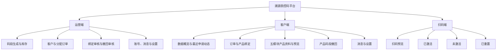
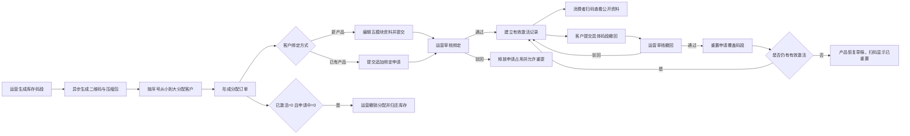
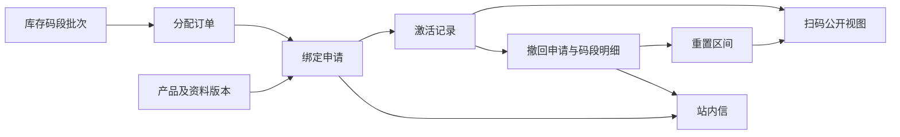
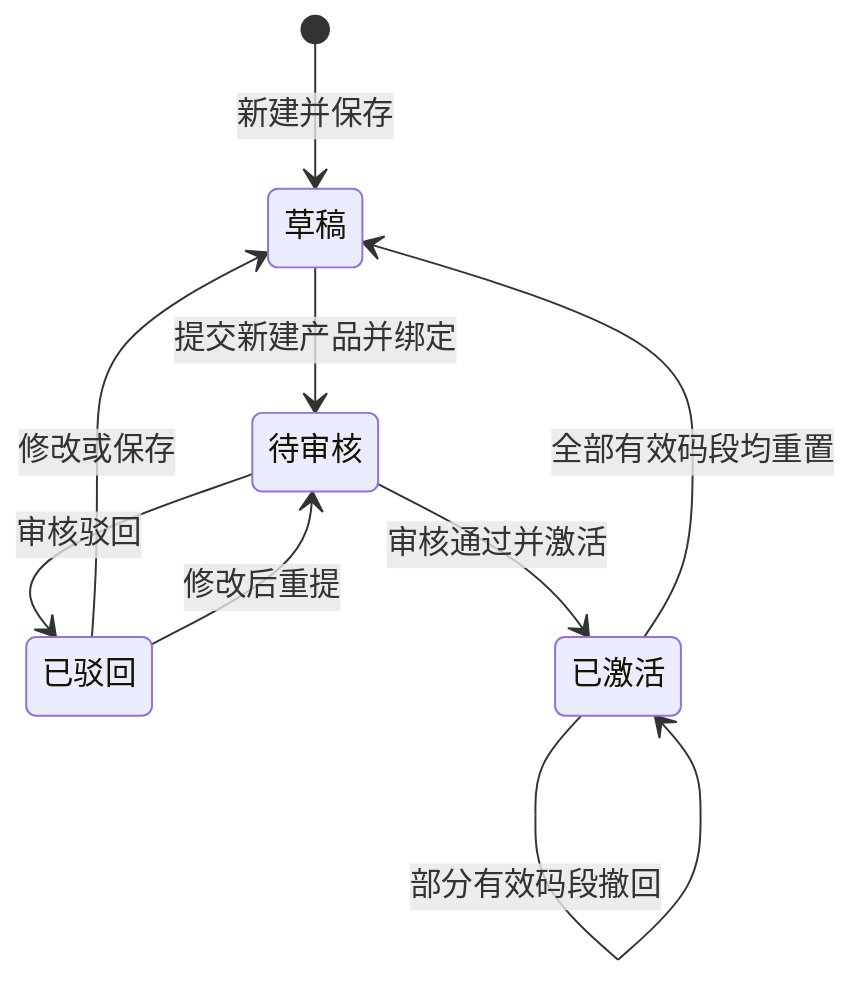
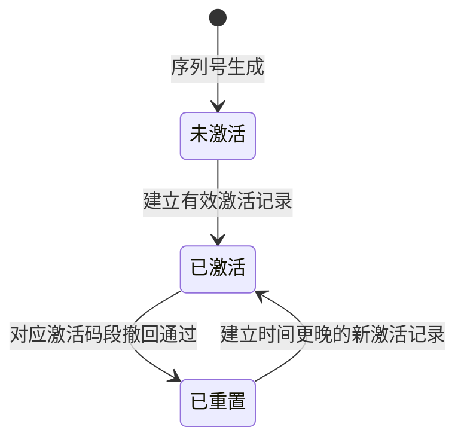

# 溯源质控码平台产品说明书

> 从码段生成到消费者扫码展示的业务与产品基线

- 文档版本  V1.1（当前系统同步版，2026-08-23 修订）
- 编制日期  2026-08-23
- 适用端  运营端系统 / 客户端系统 / 扫码端系统
- 需求依据  当前可运行系统 + 页面批注 + 信息收集稿 + 功能清单

---

## 0. 文档说明

### 0.1 编制目的

本文档以当前可运行系统、逐页需求说明和开发文档为事实基线，将来源文件中的业务描述与现有三端功能统一为可供产品、设计、研发、测试共同使用的产品说明，明确产品边界、用户角色、页面交互、业务规则、数据对象、验收标准及待确认问题。

### 0.2 需求解释原则

- 《溯源码功能清单.xlsx》作为系统功能和交互基线。
- 《副本溯源码信息收集20260720.docx》作为业务流程、产品类型和内容字段补充。
- 来源文件与当前已确认系统行为冲突时，以当前可运行系统和逐页需求说明为准，并在“待确认事项”中保留尚未形成系统规则的内容。

### 0.3 术语

| 术语 | 定义 |
| --- | --- |
| 溯源质控码 | 带唯一连续序列号的二维码，用于关联并展示某一产品的溯源与质控信息。 |
| 库存码段批次 | 平台一次生成的一组连续唯一序列号及二维码集合，生成后先进入平台库存，不直接归属客户。 |
| 分配订单 | 运营人员从库存中按序号从小到大取未分配码并分配给一个客户的码段记录，可由一个或多个连续片段组成，是客户后续绑定产品和激活码量的业务载体。 |
| 订单码量 | 分配订单的码量总和，等于该订单可被激活或申请占用的最大码量。 |
| 激活 | 将指定订单的剩余可用码与已审核产品建立关联，使扫码端可展示该产品。 |
| 预览码 | 基于已保存产品信息生成的测试二维码，不占订单码量、无有效期、可重复生成。 |
| 撤销分配 | 在整笔分配订单尚无已激活码量且无绑定申请中码量时，由运营端取消该分配并将码段归还来源库存。 |
| 产品撤回 | 客户针对一个或多个具体有效激活码段申请解除产品关联；审核通过后仅重置申请覆盖的码段。 |
| 当前绑定状态 | 根据绑定申请、有效激活和产品撤回记录派生的实时状态，与绑定审核结果分别保存和展示。 |
| 重置码 | 产品撤回审核通过后解除关联的具体码；扫码端显示已重置状态。 |
| 自定义字段 | 客户在标准字段之外自行新增的文字、图片或 PDF 信息项。 |

## 1. 产品介绍

溯源质控码平台由运营端系统、客户端系统和扫码端系统组成，面向运营人员、品牌/生产企业和终端消费者。平台通过“生成平台库存码段 - 分配客户形成订单 - 产品资料录入与预览 - 绑定申请与审核激活 - 消费者扫码展示 - 按激活码段撤回并重置”的闭环，将产品、企业、生产、质量与追溯信息绑定到唯一二维码，并以订单码量、已激活、绑定申请中和剩余可用四类码量口径核对订单变化。错误分配在尚未产生激活或待审批占用时，可整单撤销并归还库存；分配订单可以由一个或多个连续码段片段组成，列表和详情需要支持多段展示。

### 1.1 产品目标

- 建立库存批次、分配订单、绑定申请、激活记录和重置明细之间可核对的区间与数量关系，并满足订单码量 = 已激活 + 绑定申请中 + 剩余可用。

- 支持一次生成最多 10,000,000 个二维码，并通过异步任务、部分下载和完整压缩包下载满足百万级生产使用。

- 让客户按标准模块完成资料采集，并通过预览码在提交前自检展示效果。

- 让运营方在审核通过时一次完成订单选择、数量校验和码段激活。

- 让消费者无需注册，通过微信扫码查看实际已填写且已激活的信息。

- 支持按具体订单激活码段发起产品撤回，保留审核历史并同步更新当前绑定状态和扫码状态。

### 1.2 产品范围

本期系统范围

- 运营端系统：码段生成、码段库存、客户列表与详情、分配订单台账、绑定审核、撤回审核、运营账号管理、站内信和个人设置。

- 客户端系统：数据概览、订单台账与绑定申请、产品资料编辑、预览码、提交审核、按码段撤回申请、站内信和个人设置。

- 扫码端系统：预览码、已激活码、未激活码和已重置码展示，支持动态内容模块、图片/PDF 查看及单码查询次数记录。当前交付形态为移动端网页原型。

外部流程或本期未定义范围

- 合同、在线下单、在线付款、开票。

- 二维码印刷、包装贴码、快递物流。

- 防伪刮涂层、验真次数限制、窜货预警。

- 消费者注册、会员、营销、电商交易和客服。

- 供应链多级主体协同、物联网自动采集、区块链存证。

### 1.3 核心价值

- 对运营方：平台库存、客户分配、绑定激活、撤销分配和产品撤回均有明确区间与数量记录，可跨库存、客户和订单上下文追溯。

- 对客户：资料可分步保存、展示可提前预览、各订单余量清晰。

- 对消费者：微信扫码即查，未填写内容自动隐藏，信息结构清晰。

## 2. 用户画像与权限

### 2.1 运营方人员

运营人员在运营端系统维护运营账号和客户资料、生成库存码段、向客户分配连续码段、核对四类订单码量、处理绑定审核和产品撤回审核，并查看业务记录。对于已激活和绑定申请中数量均为 0 的错误分配，可在库存详情、客户详情或订单详情整单撤销。客户和产品采用搜索匹配选择，列表筛选可重置，高影响操作需要二次确认和审计记录。当前系统中所有运营账号业务权限一致。

### 2.2 客户管理员/产品资料人员

客户人员使用运营端分配的账号登录客户端系统，在数据概览和订单台账查看订单码量、已激活、绑定申请中和剩余可用，维护五类产品资料，上传图片/PDF，预览、保存草稿并提交绑定审核。产品激活后，可从仍有剩余可用的订单发起追加绑定；需要解除关联时，可在订单详情针对单条激活码段撤回，或在撤回申请页勾选同一产品的多个有效码段，并通过站内信查看处理结果。

### 2.3 消费者

消费者扫描产品上的溯源质控码后进入扫码端系统，无需注册登录。扫码端根据单码状态展示产品公开资料或未激活、已重置提示；未填写字段和空模块不展示，图片可放大，PDF 可在线预览。

### 2.4 权限矩阵

| 能力 | 运营方 | 客户 | 消费者 |
| --- | --- | --- | --- |
| 管理运营账号 | 可操作 | 不可见 | 不可见 |
| 创建/禁用客户账号 | 可操作 | 不可见 | 不可见 |
| 生成平台库存码段并下载 | 可操作 | 不可见 | 不可见 |
| 将库存码段分配给客户 | 可操作 | 查看本账号有效订单与四类码量 | 不可见 |
| 撤销错误分配 | 已激活和申请中均为 0 时可操作 | 不可操作 | 不可见 |
| 新建产品资料 | 不独立新建 | 可从本账号有效订单发起 | 不可见 |
| 编辑草稿产品 | 不可操作 | 可操作本账号草稿 | 不可见 |
| 编辑产品资料 | 可在审核或已激活上下文受限编辑并审计 | 草稿/已驳回可编辑，其他状态按入口受限 | 不可见 |
| 提交绑定审核 | 不代客户提交 | 可操作本账号订单和产品 | 不可见 |
| 审核并激活 | 可操作 | 不可操作 | 不可见 |
| 发起产品码段撤回 | 不代客户发起 | 可申请本账号产品的有效激活码段 | 不可见 |
| 审批撤回 | 可操作 | 仅查看进度 | 不可见 |
| 查看扫码内容 | 可预览 | 可预览 | 可扫码查看 |
| 发起追加绑定 | 可直接绑定 | 可申请本账号已激活产品 | 不可见 |
| 处理绑定审核 | 可操作 | 仅查看进度 | 不可见 |

## 3. 场景故事

### 3.1 订单建档与码段交付

运营人员先在生成码段页填写生成数量、宽度、高度和备注，并检查带序列号的二维码样式预览。系统创建连续唯一库存码段及异步生成任务，完成后可按自定义数量部分下载，或下载完整压缩包。运营人员再从库存按序号从小到大选择未分配码并分配给启用客户，单笔分配可由一个或多个连续片段组成，系统据此创建分配订单；分配错误且尚无激活或待审批占用时，可填写原因整单撤销，码段回到来源库存。

### 3.2 客户录入、预览与提交

客户资料人员登录后查看各订单剩余码量，新建产品并依次填写产品信息、企业信息、生产单位、产品质量和生产追溯模块。信息可保存为草稿；每个模块支持标准字段和自定义字段。客户生成不占额度的预览码，用微信反复扫码检查字段、图片和 PDF 展示，确认无误后提交审核，提交后内容只读。

### 3.3 审核与激活

客户可以从订单发起“新建产品并绑定”或“已有产品追加绑定”。运营人员在绑定审核列表检查产品资料、订单、数量和具体连续码段，审核通过后原子化写入激活记录并更新产品与订单数量；审核驳回后释放申请占用，客户可修改重提。审核结果作为历史保留，后续撤回只改变当前绑定状态，不改写原审核结论。

### 3.4 消费者扫码与撤回

消费者扫描已激活二维码后进入扫码端系统，查看有内容的产品、企业、生产、质量和追溯模块。正式查询按单码累加次数。客户需要下线某次绑定时，从订单详情直接撤回该条激活码段；需要同时处理多个绑定时，从撤回申请页勾选同一产品的多个有效码段。运营审核通过后仅重置申请覆盖的区间，其他有效码段继续展示产品信息。

## 4. 产品整体结构与业务流程

### 4.1 功能结构图

### 4.2 主业务流程

### 4.3 核心数据流

### 4.4 状态模型

产品状态

溯源码状态

## 5. 功能说明与交互流程

### 5.1 运营方后台

运营方后台采用“后台管理类 + 工作台类”页面模式，桌面端优先，核心是表格、筛选、表单、批量任务和数量核对。

#### 5.1.1 登录

- 独立登录入口，仅支持账号和密码。

- 不支持手机验证码或微信扫码登录。

- 登录前校验必填；失败时统一提示账号或密码错误，避免暴露账号是否存在。

- 禁用账号不得登录；成功后进入运营方后台首页或默认列表页。

- 建议：连续失败触发验证码/临时锁定，具体阈值待安全评审。

#### 5.1.2 运营账号管理

##### 页面综述

- 列表字段：姓名、账号、状态、创建时间、最近更新时间。

- 筛选：账号/姓名模糊搜索、状态下拉筛选。

- 当前基线：所有运营账号权限相同。

##### 操作

- 新建运营账号（弹窗）：姓名、账号、初始密码必填；账号唯一。

- 编辑（弹窗）：仅修改姓名，账号不可修改。

- 重置密码：二次确认后恢复为初始密码；是否强制首次登录修改待确认。

- 禁用/启用：切换后即时生效；不允许禁用当前唯一可用运营账号（建议规则）。

#### 5.1.3 客户列表

##### 列表与筛选

- 筛选：客户名称、账号状态。

- 列表字段：客户名称、账号、联系电话、状态、订单码量、已激活、绑定申请中、剩余可用和操作。

- 数量关系：订单码量 = 已激活 + 绑定申请中 + 剩余可用；异常时显示风险提示并禁止新增激活或绑定。

##### 新建/编辑

- 新建客户账号（弹窗/抽屉）字段：客户名称、账号、初始密码、联系电话、营业执照、法人身份证。

- 营业执照和法人身份证支持图片上传；是否支持 PDF 待确认。

- 账号唯一；客户名称是否唯一待确认。

- 编辑可修改基本信息，不允许在此调整码段额度。

- 重置密码与启用/禁用均需二次确认；禁用后客户无法登录，但历史码扫码展示是否继续有效待确认。

#### 5.1.4 生成码段

##### 页面类型

采用单页生成：填写数量、宽度、高度和备注 → 查看带序列号的二维码预览与中文大写数量预览 → 提交异步生成任务 → 查看生成结果与下载操作。生成结果先进入平台库存，不在本页选择客户，也不直接创建客户订单；从库存页再次进入时必须打开新的空白生成态，不沿用上次生成结果。

##### 步骤与规则

- 生成数量为正整数，单次范围为 1–10,000,000；页面同步预览连续序列号范围，并在输入区下方显示中文大写数量预览。

- 二维码宽度和高度独立填写，均为 8–300 mm；预览二维码下方必须显示对应序列号。

- 提交后先进入明确的生成加载状态，展示任务进度；任务运行中不得重复提交同一请求。

- 大批量生成应进入异步任务；任务运行中不可重复提交同一请求。

- 成功后建立库存码段批次，并提供“部分下载”和“下载完整压缩包”两个独立按钮。

- 部分下载仅填写下载数量，从当前码段起始序号开始，不选择起始序号；业务上不设置固定下载上限，但不得超过当前批次总量。

- 完整下载不限制业务码量；百万级文件必须由后端异步打包并通过对象存储签名地址下载。

- 压缩包至少包含 `codes/`、`manifest.csv` 和 `README.txt`，不要求 `batch.json`；`codes/` 内每个二维码为独立 SVG 文件并显示序列号。

- 生成失败时保留参数并允许安全重试，不得重复占用序列号。

##### 数据一致性

- 库存批次、连续号段和生成任务应在同一业务事务或可补偿流程中落库。

- 序列号全平台唯一；正式系统由数据库或统一号段服务分配，前端不得自行决定最终号段。

- 完整压缩包中的二维码数量必须等于库存批次生成数量；部分包数量必须等于用户填写的下载数量。

#### 5.1.5 码段库存与客户分配

##### 库存列表与详情

- 库存列表字段包括码段范围、生成数量、已分配数量、剩余可用数量、生成时间和分配状态；默认按生成时间倒序。

- 分配状态为派生值：有效分配量为 0 时“未分配”，有分配且仍有剩余时“部分分配”，无剩余时“已分配”。

- 库存详情展示批次信息、空闲区间和全部分配记录；操作列冻结并使用独立底色，其他列可横向滚动。
- 分配订单的本次分配码段可由一个或多个连续片段组成，列表和详情需要支持紧凑摘要与完整展开。

##### 分配与撤销

- 只能将当前可用的未分配码按序号从小到大分配给启用客户，单笔分配可由一个或多个连续片段组成，且总数量不得超过当前可用库存。

- 分配成功后创建分配订单，记录来源库存、客户、码段、数量、备注、分配时间和操作人；分配动作本身不发送站内信。

- 撤销分配只针对整笔订单，不支持拆分；入口位于库存码段详情、客户详情和订单详情。

- 仅当订单已激活数量和绑定申请中数量均为 0 时展示并允许撤销；必须填写原因，后端在事务内重新校验。

- 撤销成功后订单变为“已撤销”，未处理绑定申请同步撤回，码段回到来源库存并重新参与空闲区间计算。

#### 5.1.6 订单台账

##### 订单列表

- 筛选：客户名称、订单号或备注；搜索框右侧提供重置，分配时间可在表头选择日期范围。

- 字段：订单号、客户名称、分配时间、序列号范围、订单码量、已激活、绑定申请中、剩余可用和操作；已撤销订单不作为有效订单展示。

- 默认按分配时间倒序；数量列右对齐并提供合计。无特定排列规则的其他列表也默认按对应业务时间倒序。

- 导出台账导出当前筛选范围为 Excel；导出内容和页面筛选条件一致。

##### 订单详情

- 运营端基本信息展示订单号、客户名称、分配时间、操作人、序列号范围和订单备注；订单码量、已激活、绑定申请中、剩余可用在序列号范围下方同排展示。

- 绑定记录展示产品名称、产品批次、产品大类、绑定码段、数量、申请时间、审核状态、处理时间和操作；支持按产品、批次、大类、状态和日期筛选。

- 数量校验：有效激活区间并集数量等于订单已激活；待审批绑定区间并集数量等于绑定申请中；剩余可用由订单码量扣减前两项得到。

- 从库存详情或客户详情进入订单详情时，返回操作保持来源上下文；符合撤销条件时页面右上角提供“撤销分配”。

#### 5.1.7 产品资料审核

- 产品资料审核并入绑定审核流程：新建产品并绑定申请包含五模块资料，已有产品追加绑定申请复用已激活产品资料。

- 审核前完整预览产品、企业、生产单位、产品质量、生产追溯五个模块和附件；产品大类和子类仅为后台管理字段，不在扫码端展示。

- 运营方可在审核上下文查看和受限编辑产品资料，已激活产品修改必须记录修改人、修改时间和修改内容。

- 驳回原因必填；新建产品进入已驳回状态，客户端允许修改后重提，申请码段同时释放，并发送包含产品名称和批次的站内信。

- 通过时使用申请已固化的订单、数量和连续码段，不在审核阶段重新选择其他订单；后端仍需重新校验归属、产品状态和码段可用性。

- 产品状态、申请审核状态、激活记录、订单码量和通知必须原子更新或通过可靠事件保证一致，失败时不得部分成功。

#### 5.1.8 绑定审核

列表字段：客户名称、订单号、产品名称、产品批次、申请数量、申请时间、审核状态、当前绑定状态和操作；首行仅展示客户名称、订单号、产品名称、重置和高级筛选，展开高级筛选后显示产品批次、产品大类、申请时间、审核状态和当前绑定状态；不展示申请编号。操作列冻结并使用独立底色，其他列可横向滚动。

客户从订单台账为已激活产品发起追加绑定申请；产品按名称或批次搜索匹配并自动带出批次，申请数量不得大于订单剩余可用。

绑定审核通过后将申请占用的具体连续码段转为有效激活记录；审核驳回后释放占用数量并填写原因。审核通过记录在后续撤回后仍保留“已通过”的历史结果。

审核状态包括草稿、待审批、已通过、已驳回、已撤回；当前绑定状态根据申请、有效激活和撤回记录派生为待激活、未绑定、已激活、撤回申请中、部分撤回、已撤回等。两列分别展示并分别支持筛选。

#### 5.1.9 撤回审核

- 列表字段：产品名称、产品批次、撤回码段、撤回数量、客户名称、撤回原因、申请时间、状态和操作；不展示申请编号。撤回数量不显示“枚”单位。

- 状态：待审批、已通过、已驳回；支持按客户、产品、状态和时间筛选。

- 多个撤回码段在单元格中默认展示首段和“+N”摘要，可点击展开查看全部码段。

- 审批通过：二次确认影响码量；逐条重新核验并只重置申请中精确匹配的激活范围，同步更新订单已激活、产品有效码量和当前绑定状态，并通知客户。

- 审批驳回：驳回原因必填，产品保持已激活，通知客户。

- 已重置码段或已有待审批撤回占用的码段不可重复申请；同一产品的其他有效码段仍可按规则发起撤回。

#### 5.1.10 站内信管理

- 查看系统向各客户发送的通知记录。
- 首行仅展示消息标题、内容摘要、删除、重置和高级筛选；删除按钮固定放在重置按钮前面，高级筛选按钮在其右侧，展开后仅在下方显示剩余筛选项。

- 字段：消息类型、接收客户、摘要、关联业务记录编号、发送时间、是否已读。

- 消息类型至少包括：产品审核通过/驳回、追加绑定通过/驳回、撤回通过/驳回。运营端不展示客户提交申请本身的站内信。

- 本期为系统消息记录，不包含运营人员手工群发能力。

#### 5.1.11 个人设置

- 修改当前登录密码，必须校验当前密码。

- 新密码需二次输入一致；密码强度规则待安全评审。

- 修改成功后是否使其他会话失效待确认。

### 5.2 客户后台

客户后台采用“后台管理类 + 分步向导类”模式，强调资料分模块录入、草稿保存、预览与状态反馈。

#### 5.2.1 登录

- 与运营方后台使用不同入口。

- 使用运营方分配的账号和密码登录。

- 禁用客户账号不得登录；登录错误提示遵循统一安全策略。

#### 5.2.2 数据概览

- 指标：有效订单数量、订单码量、已激活、绑定申请中、剩余可用。

- 产品状态统计：草稿、待审核、已激活等数量。

- “最近申请动态”展示当前客户最近的绑定或撤回申请，最多 10 条，不展示时间；每条展示业务类型、产品/订单和数量等必要信息，点击进入对应业务记录。

- 未读消息数量可点击跳转站内信列表。

- 数据口径仅限当前客户账号，不允许跨客户查询。

#### 5.2.3 订单台账与追加绑定

订单台账展示订单号、分配时间、序列号范围、订单码量、已激活、绑定申请中、剩余可用和操作；订单号、序列号范围、分配时间和重置按钮同排展示，不设置高级筛选折叠。订单详情采用独立内页展示。

有剩余额度的订单提供绑定入口，客户可选择“已有已激活产品追加绑定”或“新建产品并绑定”；输入产品名称或批次即可匹配，选择后自动带出产品批次。

订单仍有连续剩余可用区间时保留绑定入口；同一订单、产品和批次已有待审批申请时禁止重复提交。申请提交时固化订单、产品、批次、数量和具体连续码段，并立即计入绑定申请中。

客户端订单详情不重复展示客户名称、分配状态和分配操作人；产品绑定记录提供与运营端一致的产品名称、批次、大类、状态和日期筛选，操作列冻结并允许其他列横向滚动。

从订单绑定记录发起“撤回产品”时只针对当前单条订单激活码段，不显示多选；弹窗字段与提交绑定审核时尽量一致，展示订单号、撤回码段、数量、产品名称、产品批次和撤回原因。

#### 5.2.4 产品信息

- 当前产品资料以订单绑定记录、最近申请动态和业务消息为主要入口，不单独形成脱离订单上下文的产品台账。

- 新建产品必须从本人有效且有连续剩余码量的订单发起，并同时形成“新建产品并绑定”草稿或申请。

- 已有产品追加绑定只允许选择当前客户名下已激活产品，产品名称和批次由选择结果带出。

- 草稿和已驳回产品允许编辑、预览并提交审核；待审核内容只读；已激活产品可查看、预览、追加绑定或对具体激活码段发起撤回。

#### 5.2.5 多模块产品信息填写

##### 全局交互

- 页面使用步骤导航或左侧锚点：产品信息、企业信息、生产单位、产品质量信息、生产追溯信息。

- 支持模块级和全局保存草稿；离开存在未保存内容时提示。

- 标准字段未填写时扫码端不展示；整个模块无有效内容时扫码端隐藏对应 Tab。

- 自定义字段包含字段名称、内容类型（文字/图片/PDF）、内容值；新增后按表单顺序固定展示，不提供拖动排序或手柄调整。

- 标准单文件字段最多 1 个文件，其他标准媒体字段和自定义媒体字段最多 10 个文件；文件大小上限按字段和后端存储策略校验。

- 产品图片支持长图，不限制图片宽高尺寸，只限制文件大小；扫码展示按原始宽高比自适应，不裁剪、不拉伸，图片后不保留多余留白。

##### 产品信息模块

- 产品大类：文字，运营管理字段，不向消费者展示。

- 产品子类：文字，运营管理字段，不向消费者展示。

- 产品名称：文字。

- 产品品牌：文字、图片。

- 产品商标：文字、图片。

- 产品图片：图片为主，来源文件写有“文字、图片”，文字用途待确认。

- 产品介绍、产品规格、产品产地、产品批次、储存条件、执行标准：文字。

- 产品生产日期、产品保质期：建议使用日期/期限结构化组件，实际口径待确认。

- 支持自由新增多个字段。

##### 企业信息模块

- 公司名称、公司地址、公司介绍、公司电话：文字。

- 营业执照：图片、PDF。

- 资质证明：生产许可、体系认证、荣誉证书等，支持文字、图片、PDF。

- 生产环境：文字、图片。

- 支持自由新增多个字段。

##### 生产单位模块

- 生产单位、生产地址：文字。

- 生产环境、独特工艺流程、关键生产设备：文字、图片。

- 资质证件、生产许可证书及认证证书：文字、图片、PDF。

- 支持自由新增多个字段。

##### 产品质量信息模块

- 产品荣誉证、产品认证证书、实地验证证书：文字、图片、PDF。

- 产品检测报告：文字、图片、PDF；业务要求为同批次六个月以内报告。

- 系统是否自动校验“同批次”和“六个月以内”待确认；若无结构化报告日期，本期只能由审核人员人工判断。

- 支持自由新增多个字段。

##### 生产追溯信息模块

- 不预设业务字段，客户通过自定义字段自由新增追溯条目。

- 支持文字、图片、PDF。

- 自定义追溯条目按新增顺序固定展示，不提供拖动调序。

#### 5.2.6 保存草稿与提交审核

- 保存草稿不要求所有字段完整，但字段格式和附件状态必须有效。

- 提交审核执行完整校验；必填字段清单目前未在来源中定义，需在评审中确认。

- 提交后产品字段变为只读，并生成提交记录。

- 审核结果通过站内信通知，标题和内容明确产品批次；驳回后客户端显示已退回，允许修改后重新提交。

#### 5.2.7 预览码管理

- 已保存产品均可生成预览码，无需先提交审核。

- 预览码不占订单码量、无有效期、可多次重新生成。

- 修改并保存产品信息后，预览码展示最新已保存内容；是否保持同一码地址待确认。

- 扫码预览效果使用微信打开与正式扫码端一致的展示页面，并明显标识“预览”。

#### 5.2.8 撤回申请

- 撤回只能引用当前客户产品的具体有效激活记录，不再默认全量撤回整个产品。

- 从撤回申请页发起时，可选择同一产品并勾选一个或多个有效激活码段；从订单详情发起时只处理当前单条码段。

- 筛选区一排展示产品名称、产品批次、申请时间、申请状态和重置；本页筛选项不设置“高级筛选”折叠。

- 表单和列表展示产品名称、产品批次、撤回码段、撤回数量、撤回原因、申请时间、申请状态和处理说明；不展示申请编号或单独的订单信息字段，撤回数量不显示“枚”单位。

- 一个申请包含多个撤回码段时，码段列默认展示首段和“+N”摘要；点击“+N”打开弹窗查看全部码段及各段数量，客户端与运营端使用同一交互。

- 已重置或已有待审批撤回的码段不可重复选择；没有可撤回码段时禁用提交。

#### 5.2.9 站内信与个人设置

- 消息列表展示产品审核、追加绑定和撤回处理结果，未读消息高亮；产品相关消息明确产品名称与批次，并支持批量标记已读、全部标为已读和删除。

- 首行筛选区只放消息标题和内容摘要，控件向左对齐；重置按钮后接高级筛选按钮，标记为已读和全部标为已读按钮固定在高级筛选右侧，删除按钮放在重置按钮前。点击高级筛选时，仅在第二行展开接收方、发送时间和消息类型等剩余筛选项，上方按钮不移动。

- 列表布局适当加宽消息标题和内容摘要列，收窄接收时间和消息类型列；表头、内容和操作按钮必须在同一列表宽度内完整显示。

- 个人设置支持校验当前密码后修改登录密码。

### 5.3 扫码展示端

扫码端采用“移动端类 + 内容详情类”页面模式，不提供登录注册。

#### 5.3.1 扫码识别与状态处理

- 用户扫描二维码后进入扫码端系统；当前系统以移动端网页实现预览码、已激活、未激活和已重置四类展示状态。

- 序列号不存在：建议显示“未查询到该溯源码”，并记录异常请求。

- 未激活码：显示“该码暂未激活”。

- 已激活码：展示关联产品内容。

- 已重置码：按来源要求显示“信息已更新”；文案含义和后续跳转需确认。

- 预览码：展示最新已保存内容并标识预览，不计入正式订单码量。

#### 5.3.2 页面结构

- 顶部使用统一品牌横幅，不使用产品首图替代；产品身份摘要展示产品名称、当前序列号和查询次数或预览提示。

- 动态导航 Tab：产品信息、企业信息、生产单位、产品质量信息、生产追溯信息。

- 模块无有效内容时 Tab 自动隐藏；字段未填写时字段行自动隐藏。

- 产品大类和产品子类不对消费者展示。

- 图片支持点击放大、左右切换；PDF 支持在线预览或安全下载。

- 页面不设置冻结区域；标题、产品摘要、查询/预览信息、资料标签、品牌横幅和后续内容均按页面顺序正常上下滚动。

- 产品图片按原始宽高比完整展示，长图高度随内容自适应，图片结束后立即衔接下一项内容。

#### 5.3.3 扫码记录

- 每次正式扫码记录扫码时间，并对当前码扫码次数原子加一。

- 每个码单独计数；预览码、未激活码和已重置码访问不计入正式扫码次数。

- 当前来源仅要求时间和次数，不默认采集地理位置、手机号或微信身份。

- 建议提供隐私政策和必要的数据最小化说明。

## 6. 核心业务规则

### 6.1 订单与码量

- 每次二维码生成成功创建一个平台库存码段批次；只有从库存向客户分配连续码段时才创建分配订单。

- 序列号在全平台唯一；库存阶段归属唯一库存批次，分配后归属一笔有效分配订单和一个客户。

- 任一订单满足：订单码量 = 已激活 + 绑定申请中 + 剩余可用。

- 首次激活只能消耗同一客户订单的剩余可用；待审批绑定数量先计入绑定申请中，审核通过后转为已激活，驳回后释放为剩余可用。

- 同一激活请求必须具备幂等标识，防止重复点击重复扣减。

- 订单空闲范围必须扣除有效激活区间和待审批绑定区间；一次绑定仍需取得一段足够长的连续空闲区间，不得拼接离散区间。库存向客户分配时则按序号从小到大取未分配码，允许一笔分配形成多个连续片段。

- 撤销分配只允许整单执行，且要求已激活和绑定申请中均为 0；撤销后分配码段返回来源库存。

### 6.2 产品、审核与激活

- 客户只能访问本账号产品；运营方可访问全部客户产品。

- 客户提交后内容只读；审核驳回后客户端显示已退回，允许修改并重新提交。

- 新建产品并绑定审核通过与首次激活为一个原子业务动作；已有产品追加绑定审批通过与激活记录写入同样保持原子性。

- 运营方可直接编辑已激活产品，但建议记录不可篡改的审计日志。

- 产品撤回以具体有效激活记录和码段区间为对象；部分撤回后仍有有效激活时产品保持已激活，全部有效码段均重置后产品恢复草稿。

- 绑定审核结果与当前绑定状态为两个维度：审核历史不因后续撤回改写，当前绑定状态按有效激活、待审批撤回和重置明细实时派生。

### 6.3 动态内容展示

- 单字段无值则隐藏该字段。

- 模块内所有标准字段和自定义字段均无有效值时隐藏模块 Tab。

- 文字、图片、PDF 需统一使用有效性判断；上传失败或处理中不视为有效内容。

- 内容排序遵循标准字段预置顺序，自定义字段按新增顺序追加；页面不提供拖动、手柄或自定义排序入口。

- 没有特定排列顺序的业务列表默认按对应时间字段倒序，最新记录在前；当前页面不提供用户主动排序控件。

### 6.4 附件

- 允许类型：图片、PDF；标准单文件字段最多 1 个文件，其他媒体字段最多 10 个文件，具体扩展名、MIME 和文件大小上限由接口契约确定。

- 图片宽高尺寸不设业务限制，支持长图；上传和展示不得因固定容器高度裁剪图片或在图片后形成无意义留白。

- 上传必须校验文件类型与内容签名，禁止可执行文件伪装。

- 建议使用对象存储私有桶，通过受控临时链接预览。

- 删除已引用附件时需二次确认并保留审计记录。

### 6.5 通知

- 站内信是由业务状态成功变更自动生成的系统信件，不提供人工新建、编辑或手动补发入口。通知写入必须与业务结果建立可靠事件关联；消息写入失败可补发，但不得回滚已完成的核心业务。

- 绑定审核通过：运营审核通过后生成发送给客户的结果通知，标题模板为“{产品名称}（批次：{产品批次}）绑定审核已通过”，摘要至少包含“订单号：{订单号}、绑定数量：{数量}、绑定码段：{首段}（+N）”。

- 绑定审核驳回：运营驳回后生成结果通知，标题模板为“{产品名称}（批次：{产品批次}）绑定审核未通过”，摘要包含“订单号：{订单号}、申请数量：{数量}、驳回原因：{原因}”。

- 追加绑定通过/驳回沿用上述标题和摘要规则，并明确这是追加绑定结果；新建产品绑定与已有产品追加绑定均须能从消息跳转到对应业务记录。

- 撤回审核通过：运营审核通过后生成通知，标题模板为“{产品名称}（批次：{产品批次}）撤回申请已通过”，摘要包含“撤回数量：{数量}、撤回码段：{首段}（+N）、处理时间：{时间}”。

- 撤回审核驳回：运营驳回后生成通知，标题模板为“{产品名称}（批次：{产品批次}）撤回申请未通过”，摘要包含“撤回数量：{数量}、撤回码段：{首段}（+N）、驳回原因：{原因}”。

- 运营端直接绑定成功时生成绑定成功通知；码段生成、码段分配、保存草稿、提交申请、查询、阅读和删除消息均不生成站内信。

- 每封消息必须关联客户，并按场景关联产品、产品批次、订单或撤回申请记录，支持从标题/摘要或详情跳转至对应业务记录；列表不展示申请编号或申请号。

## 7. 数据模型建议

| 实体 | 关键字段 | 主要关系 |
| --- | --- | --- |
| 运营账号 | 账号、姓名、密码摘要、状态、登录信息 | 创建客户、订单、审核和审批记录 |
| 客户账号 | 客户名称、账号、联系电话、证照、状态 | 拥有订单、产品、消息 |
| 库存码段批次 | 批次号、连续序列范围、数量、宽度、高度、生成状态、压缩包 | 包含平台生成的二维码并产生空闲区间 |
| 分配订单 | 订单号、来源库存、客户、连续码段、订单码量、分配/撤销信息 | 包含绑定申请和激活记录 |
| 溯源码 | 序列号、二维码地址、库存批次、当前解析状态 | 由有效激活和重置记录解析当前公开产品 |
| 产品 | 客户、大类、子类、名称、批次、状态、版本 | 包含五个内容模块 |
| 内容字段 | 模块、字段名、类型、值、新增顺序、是否标准字段 | 归属产品版本 |
| 附件 | 文件名、类型、大小、存储键、状态 | 被内容字段或客户证照引用 |
| 审核记录 | 产品版本、结论、原因、审核人、时间 | 通过时关联激活批次 |
| 激活记录 | 订单、产品、批次、数量、连续码段、激活时间、操作人、状态 | 消耗订单剩余可用，并增加订单已激活 |
| 撤回申请 | 申请记录 ID、产品、申请数量、原因、状态、审批意见 | 包含一个或多个撤回码段明细；记录 ID 用于内部关联，不作为列表展示字段 |
| 撤回码段明细 | 撤回申请、激活记录、订单、连续码段、数量 | 审核通过时精确生成重置区间 |
| 站内信 | 类型、客户、摘要、详情、业务关联、已读状态 | 由业务事件产生 |
| 扫码记录 | 溯源码、扫码时间、请求标识 | 聚合得到每码扫码次数 |
| 生成/下载任务 | 任务号、参数、进度、结果文件、摘要、错误 | 成功时生成库存码段或下载包 |
| 绑定申请 | 客户、订单、产品、批次、具体码段、申请数量、审核状态、时间、处理说明 | 审核通过后转为激活记录；驳回或撤回后释放占用码量 |

## 8. 设计风格

### 8.1 场景识别

- 运营方/客户后台：企业级后台管理与复杂工作台。

- 产品录入：分步流程/向导。

- 扫码端系统：移动端单码状态与公开内容详情。

- 当前可运行原型已形成后台与扫码端视觉基线，以下说明用于约束后续生产化实现。

### 8.2 布局要求

- 后台：顶部产品栏 + 左侧模块导航 + 主内容区；表格和表单以高效扫描为主，不使用装饰性大卡片。

- 产品录入：固定步骤导航、主编辑区、底部保存/提交操作栏；长页面支持锚点定位和错误汇总。

- 扫码端：单列内容流，品牌横幅、标题、产品摘要、查询信息和资料标签按页面顺序排列并随页面正常上下滚动，图片与证书可放大查看。

- 桌面端基准宽度建议 1280px 以上；扫码端覆盖常见微信小程序屏幕宽度。

### 8.3 视觉与配色建议

- 风格：克制、可信、清晰，突出“质量、来源、验证”而非营销氛围。

- 主色：深青绿 #0F766E，用于主按钮、选中态和关键链接；白字对比度满足 WCAG AA。

- 深色：#115E59，用于悬停和强调。

- 强调色：琥珀 #B45309，用于待审核、提醒和关键数量。

- 成功：#15803D；错误：#B91C1C；信息：#1D4ED8。

- 正文：#1F2937；次级文字：#4B5563；边框：#D1D5DB；页面背景：#F8FAFC。

- 颜色只表达状态和操作层级，不单独依赖颜色传递信息，应同时提供文字或图标。

### 8.4 组件与交互

- 图标使用 Lucide 或组件库同一套线性图标，按钮图标需有提示文本或 Tooltip。

- 表格状态使用“文字 + 标签”，数量列固定宽度并右对齐。

- 搜索框明确搜索对象，枚举字段使用下拉筛选，日期使用范围选择；筛选条件可组合并提供统一重置。

- 表格底部统一展示总条数、上一页/下一页、页码和每页条数选择；每页条数选项数字不得被控件遮挡。

- 宽表允许横向滚动，关键操作列固定在右侧并使用独立底色提示冻结状态；操作按钮保持单行排列。

- 页面标题、字段名和操作项下不添加无必要的解释小字；业务规则通过字段、状态、校验和反馈表达。

- 删除、禁用、重置、激活、撤回审核等不可逆或高影响操作必须二次确认。

- 加载、成功、失败、空数据、无权限和网络中断均有明确反馈。

- 表单错误就近显示，提交失败时自动定位首个错误字段。

## 9. 技术方案建议

### 9.1 场景判断

本产品属于企业级管理系统，当前交付为使用浏览器本地存储模拟数据持久化和跨端同步的高保真前端原型。生产系统仍需服务端数据库、对象存储、任务队列和接口替换本地模拟实现；以下技术方案为生产化建议。

### 9.2 推荐技术栈

运营方与客户后台

- React 18 + TypeScript 5 + Vite。

- Ant Design 5；复杂表格可补充 TanStack Table 8。

- React Router 6、TanStack Query、Zustand 或 Redux Toolkit。

- React Hook Form + Zod 处理复杂表单和分步校验。

微信小程序

- Taro 3 + React + TypeScript，或原生微信小程序。

- 图片预览使用微信原生能力；PDF 使用业务域名下的安全预览页。

后端与数据

- Java 21 + Spring Boot 3，模块化单体优先，后续按码生成/扫码查询压力拆分服务。

- PostgreSQL 保存账号、订单、产品、状态和审计数据。

- Redis 用于热点扫码内容缓存、幂等键和短期任务状态。

- S3 兼容对象存储保存二维码压缩包、图片和 PDF。

- RabbitMQ/Kafka 或可靠任务队列处理大批量二维码生成、打包和消息补发。

部署与质量

- Docker 容器化；Nginx/网关统一鉴权、限流和静态资源策略。

- OpenAPI 3 接口文档；JUnit、前端单测、Playwright 端到端测试。

- Prometheus + Grafana 监控，集中日志记录生成失败、激活异常和扫码错误。

### 9.3 架构原则

- 二维码只承载不可猜测或防遍历的公开标识，不直接暴露数据库主键和敏感信息。

- 扫码读链路与后台写链路隔离；已发布产品形成可缓存的展示快照。

- 激活和撤回使用数据库事务、行锁/乐观锁及幂等键保证码量一致。

- 产品内容采用“标准字段 + 自定义字段”模型，同时保留产品版本和发布快照。

- 所有账号密码仅保存强哈希；附件上传进行类型校验、病毒扫描和访问控制。

## 10. 非功能需求

### 10.1 性能与容量（建议基线）

- 扫码落地页在正常网络下接口 P95 响应不高于 1 秒，首屏可用时间不高于 2 秒。

- 后台普通列表和详情接口 P95 响应不高于 2 秒。

- 单批业务上限为 10,000,000 个二维码；百万级生成和完整下载必须采用分片生成、流式打包和异步任务，并通过压测确定并发任务数和完成时限。

- 二维码生成任务记录总数、完成数、失败数、进度、失败原因和重试次数；完整包生成后记录文件大小、SHA-256 和过期时间。

- 扫码次数累加必须支持并发，不允许丢计数或负数。

### 10.2 可用性与恢复（建议基线）

- 生产服务月可用性目标 99.9%，计划维护除外。

- 数据库定期备份并验证恢复；RPO/RTO 在运维评审中确认。

- 二维码压缩包和业务附件设定生命周期、备份和误删恢复策略。

### 10.3 安全与隐私

- 运营方与客户数据严格按租户隔离，所有写操作校验对象归属。

- 登录、密码重置、激活、撤回、已激活产品修改等关键操作写审计日志。

- 上传文件做后缀、MIME、内容签名和恶意内容检查。

- 小程序公开接口限流、防遍历，不返回营业执照/法人身份证等后台证照原件。

- 当前不默认采集消费者身份或地理位置；新增采集前必须完成必要性评估和隐私告知。

### 10.4 兼容与可访问性

- 后台支持主流 Chromium 内核浏览器近两个大版本。

- 小程序覆盖微信当前主流基础库版本，最低版本待确认。

- 文字和背景对比度满足 WCAG AA；状态不能仅依赖颜色。

## 11. 建议优先级与版本范围

优先级用于排期建议，不代表 P1 功能被移出来源需求。

| 优先级 | 范围 | 说明 |
| --- | --- | --- |
| P0 | 三端登录/访问、客户列表、库存码段生成与下载、客户分配、四类订单码量、产品五模块、草稿/提交、预览码、绑定审核与激活、扫码展示、产品码段撤回、撤销分配、站内信 | 形成运营端、客户端和扫码端职责清晰的完整业务闭环。 |
| P1 | 运营账号完整管理、复杂筛选、台账 Excel 导出、附件在线预览优化、审计查询、任务进度与失败重试体验 | 提升运营效率、可维护性和异常处理能力。 |
| P2 | 在线支付/物流、防伪、窜货、消费者运营、供应链协同、物联网采集 | 来源文件未形成系统需求，需另行立项。 |

## 12. 关键验收标准

### 12.1 码段生成与订单

- 给定合法数量、宽度、高度和备注，生成成功后库存批次数量、连续序列范围和完整压缩包二维码数完全一致。

- 同一序列号全平台唯一；分配前归属一个库存批次，分配后不得同时落入两笔有效订单。

- 生成期间显示加载进度且不可重复提交；生成失败不得留下可被误用的部分码，允许从明确状态幂等重试。

- 二维码预览和实际文件下方均显示对应序列号；部分下载从批次起点输出指定数量，完整下载输出全部二维码。

- 分配只能使用连续空闲区间；撤销满足条件的分配后，订单失效且码段重新计入来源库存空闲范围。

### 12.2 产品录入与预览

- 草稿可分次保存，重新进入后内容、附件和自定义字段顺序一致。

- 预览码不改变订单的已激活、绑定申请中或剩余可用数量，可重复生成并查看最新已保存内容。

- 未填写字段不显示，空模块不生成扫码端 Tab。

### 12.3 审核与激活

- 驳回必须填写原因，产品进入已驳回状态，客户端显示已退回并允许修改重提，客户收到包含产品批次的消息。

- 新建产品绑定或追加绑定数量超过剩余可用，或不存在足够长的连续空闲区间时操作被拒绝且任何数量不变。

- 审核通过后产品状态、激活批次、码状态、订单数量和消息记录一致。

- 重复提交同一激活请求只产生一次激活结果。

### 12.4 撤回

- 客户只能对本账号产品的有效激活码段发起撤回；订单详情入口只提交当前单条码段，撤回申请页允许选择同一产品的多个码段。

- 已重置或已被待审批申请占用的码段不能重复选择，其他有效码段不受影响。

- 审批通过后仅精确匹配的申请码段进入重置状态，并同步更新订单数量和当前绑定状态；审批驳回不改变激活关系和数量。

### 12.5 扫码展示

- 已激活码展示正确产品版本；未激活码、重置码、无效码显示各自约定提示。

- 每次正式扫码只对当前码计数，其他码不受影响；扫码时间可在后台数据中追溯。

- 图片可放大，PDF 可预览；失效附件有明确占位，不导致页面空白或崩溃。

- 页面不设置冻结区域；标题、产品摘要、查询/预览信息、资料标签和品牌横幅均顺着页面正常上下滚动，长图完整展示且图片后无多余留白。

### 12.6 权限与安全

- 客户不能读取、修改其他客户的订单、产品、附件和消息。

- 禁用账号无法登录；密码在接口、日志和数据库中不以明文出现。

- 激活、撤回、重置密码和已激活产品编辑均有操作人和时间记录。

## 13. 待确认事项

| 编号 | 待确认问题 | 影响 |
| --- | --- | --- |
| Q01 | 客户账号由客户自助注册，还是仅由运营方创建？当前功能清单为运营方创建。 | 登录/注册流程、实名认证、审核。 |
| Q02 | 购买、订单付款、印刷和邮递是否全部在线下完成？系统是否需要订单金额/付款状态/物流字段？ | 订单模型和系统范围。 |
| Q03 | 二维码编码规则、序列长度、校验位、防遍历策略和样式模板明细是什么？ | 码生成、安全和印刷。 |
| Q04 | 当前单次业务上限已定为 10,000,000；典型订单规模、峰值并发任务、目标完成时限和压缩包保留期分别是多少？ | 性能、存储和任务架构。 |
| Q05 | 当前状态模型允许已重置码在产生时间更晚的新激活后恢复为已激活；正式系统是否限制只能绑定原产品或允许绑定其他产品？ | 码量台账、复用权限和审计。 |
| Q06 | 重置码提示“信息已更新”的业务含义是否准确，是否需要展示客服入口或新信息？ | 消费者理解与合规。 |
| Q07 | 客户账号被禁用后，其已激活码是否继续正常展示？ | 账号状态与公开内容。 |
| Q08 | 已激活产品被运营方修改后是否立即对外生效，是否需要二次审核和版本留档？ | 发布、审计和风险控制。 |
| Q09 | 产品提交审核的完整必填字段、字段长度，以及不同图片/PDF 字段的单文件大小限制是什么？当前数量规则为单文件字段 1 个、其他媒体字段最多 10 个。 | 表单校验、存储和验收。 |
| Q10 | “检测报告同批次六个月以内”由系统自动校验还是审核人员人工判断？ | 字段结构和审核规则。 |
| Q11 | 预览码重新生成后是否保持同一地址、旧预览地址是否继续有效？预览扫码已确定不计正式扫码次数。 | 预览码生命周期。 |
| Q12 | 客户证照已支持图片或 PDF；法人身份证是否必须区分正反面，并在后台列表或预览中脱敏展示？ | 附件规则与隐私。 |
| Q13 | 运营方是否确实不区分角色权限，是否至少需要超级管理员避免全部账号被禁用？ | RBAC 和账号安全。 |
| Q14 | 产品大类/子类是自由文本还是字典，五类产品是否需要不同字段模板？ | 数据标准化和录入体验。 |
| Q15 | 当前一次绑定仅使用一笔订单中的一段连续空闲区间，未来是否存在跨订单合并绑定需求？ | 激活交互和批次模型。 |
| Q16 | 站内信是否需要短信、邮件或微信订阅消息同步通知？ | 通知渠道与合规。 |
| Q17 | 扫码端是否需要展示“首次扫码/多次扫码”风险提示、扫码地点或设备信息？ | 防伪能力、隐私和数据量。 |

## 附录 A：需求追踪矩阵

| ID | 端 | 一级功能 | 二级功能/要求 | 来源 |
| --- | --- | --- | --- | --- |
| F001 | 运营方后台 | 登录 | 账号密码登录，独立入口 | Excel 2 |
| F002 | 运营方后台 | 运营方账号管理 | 账号列表与筛选 | Excel 3 |
| F003 | 运营方后台 | 运营方账号管理 | 新建运营账号 | Excel 4 |
| F004 | 运营方后台 | 运营方账号管理 | 编辑姓名 | Excel 5 |
| F005 | 运营方后台 | 运营方账号管理 | 重置初始密码并二次确认 | Excel 6 |
| F006 | 运营方后台 | 运营方账号管理 | 禁用/启用 | Excel 7 |
| F007 | 运营方后台 | 客户列表 | 客户名称、账号、状态及四类码量字段 | Excel 8 |
| F008 | 运营方后台 | 客户列表 | 新建客户并上传证照 | Excel 9；Word 用户注册信息 |
| F009 | 运营方后台 | 客户列表 | 编辑客户基本信息 | Excel 10 |
| F010 | 运营方后台 | 客户列表 | 重置客户密码 | Excel 11 |
| F011 | 运营方后台 | 客户列表 | 启用或禁用客户 | Excel 12 |
| F012 | 运营方后台 | 二维码生成 | 选择样式与尺寸 | Excel 13；Word 溯源码生成 |
| F013 | 运营方后台 | 二维码生成 | 输入 1–10,000,000 的库存码段生成数量 | Excel 14；当前原型 |
| F014 | 运营方后台 | 二维码生成 | 异步生成连续二维码库存，部分下载或完整下载压缩包 | Excel 15；Word 溯源码生成；当前原型 |
| F015 | 运营方后台 | 码段库存 | 库存批次、空闲区间、分配进度与客户分配 | 当前原型 |
| F016 | 运营方后台 | 订单码量台账 | 序列号范围与激活记录 | Excel 17 |
| F017 | 运营方后台 | 订单码量台账 | 导出 Excel | Excel 18 |
| F018 | 运营方后台 | 产品审核 | 全客户产品列表与筛选，不展示码量列 | Excel 19 |
| F019 | 运营方后台 | 产品审核 | 查看或编辑任意客户产品 | Excel 20；Word 管理端 |
| F020 | 运营方后台 | 产品审核 | 审核并完成首次码段激活 | Excel 21；Word 管理端 |
| F021 | 运营方后台 | 撤回审核 | 撤回审核列表 | Excel 22 |
| F022 | 运营方后台 | 撤回申请管理 | 审批通过并精确重置申请码段 | Excel 23；Word 撤回描述；当前原型 |
| F023 | 运营方后台 | 撤回申请管理 | 审批驳回并通知 | Excel 24 |
| F024 | 运营方后台 | 站内信管理 | 查看全部通知记录 | Excel 25 |
| F025 | 运营方后台 | 个人设置 | 验证当前密码后修改 | Excel 26 |
| F026 | 客户后台 | 登录 | 分配账号密码独立登录 | Excel 27 |
| F027 | 客户后台 | 数据概览 | 有效订单及四类码量状态指标 | Excel 28；当前原型 |
| F028 | 客户后台 | 数据概览 | 最近申请动态最多 10 条，点击进入对应业务记录 | 当前原型 |
| F029 | 客户后台 | 数据概览 | 未读消息入口 | Excel 30 |
| F030 | 客户后台 | 产品信息 | 当前客户产品列表，不展示码量列 | Excel 31 |
| F031 | 客户后台 | 产品信息 | 新建产品 | Excel 32 |
| F032 | 客户后台 | 产品信息 | 产品信息模块与自定义字段 | Excel 33；Word 产品信息 |
| F033 | 客户后台 | 产品信息 | 企业信息模块与自定义字段 | Excel 34；Word 企业信息 |
| F034 | 客户后台 | 产品信息 | 生产单位模块与自定义字段 | Excel 35；Word 生产单位 |
| F035 | 客户后台 | 产品信息 | 产品质量模块与自定义字段 | Excel 36；Word 产品质量信息 |
| F036 | 客户后台 | 产品信息 | 生产追溯自定义模块 | Excel 37；Word 生产追溯信息 |
| F037 | 客户后台 | 产品信息 | 保存草稿 | Excel 38 |
| F038 | 客户后台 | 产品信息 | 提交审核后只读 | Excel 39 |
| F039 | 客户后台 | 预览码管理 | 生成不占额度、无有效期预览码 | Excel 40；Word 预览码疑问 |
| F040 | 客户后台 | 预览码管理 | 微信扫码预览效果 | Excel 41 |
| F041 | 客户后台 | 预览码管理 | 无限次修改并重新生成 | Excel 42 |
| F042 | 客户后台 | 撤回申请 | 按具体有效激活码段发起单条或多码段撤回 | Excel 43；当前原型 |
| F043 | 客户后台 | 撤回申请 | 查看撤回码段、数量、申请进度和驳回原因 | Excel 44；当前原型 |
| F044 | 客户后台 | 站内信 | 消息列表及未读高亮 | Excel 45 |
| F045 | 客户后台 | 站内信 | 消息详情 | Excel 46 |
| F046 | 客户后台 | 个人设置 | 验证当前密码后修改 | Excel 47 |
| F047 | 扫码端 | 扫码落地页 | 扫码打开移动端页面，无需登录 | Excel 48 |
| F048 | 扫码小程序 | 扫码落地页 | 按已填模块动态显示 Tab | Excel 49；Word 未上传不显示 |
| F049 | 扫码小程序 | 扫码落地页 | 每码记录扫码时间与次数 | Excel 50；Word 产品扫码记录 |
| F050 | 扫码小程序 | 扫码落地页 | 未激活/已重置空状态 | Excel 51 |
| F051 | 扫码小程序 | 内容展示 | 产品信息按已填字段展示 | Excel 52；Word 产品信息 |
| F052 | 扫码小程序 | 内容展示 | 企业信息、图片放大、PDF 预览 | Excel 53；Word 企业信息 |
| F053 | 扫码小程序 | 内容展示 | 生产单位信息与附件展示 | Excel 54；Word 生产单位 |
| F054 | 扫码小程序 | 内容展示 | 产品质量信息与附件展示 | Excel 55；Word 产品质量信息 |
| F055 | 扫码小程序 | 内容展示 | 生产追溯自定义内容展示 | Excel 56；Word 生产追溯信息 |
| F056 | 客户后台 | 订单台账 | 为已激活产品发起追加绑定申请 | 当前原型 |
| F057 | 运营方后台 | 绑定审核 | 独立列表、筛选、通过与驳回 | 当前原型 |
| F058 | 运营方后台 | 订单详情 | 新建产品绑定与已有产品追加绑定记录统一展示 | 当前原型 |
| F059 | 双后台 | 站内信 | 产品相关结果通知明确产品批次 | 当前原型 |
| F060 | 运营方后台 | 撤销分配 | 已激活和绑定申请中均为 0 时整单撤销并归还库存 | 当前原型 |
| F061 | 运营方后台 | 绑定审核 | 审核状态与当前绑定状态分列展示和筛选 | 当前原型 |
| F062 | 双后台 | 宽表交互 | 操作列冻结、独立底色，其他列横向滚动 | 当前原型 |
| F063 | 扫码端 | 滚动展示 | 标题、摘要、查询信息、标签和品牌横幅按页面顺序正常上下滚动，不设置冻结区域 | 当前原型 |
| F064 | 三端 | 图片展示 | 支持长图自适应完整展示，图片后不留固定空白 | 当前原型 |
| F065 | 运营方后台 | 二维码压缩包 | `codes/`、`manifest.csv`、`README.txt`，二维码下方包含序列号 | 当前原型与开发规则 |

## 附录 B：来源差异说明

| 主题 | Word 描述 | Excel 功能基线 | 当前处理 |
| --- | --- | --- | --- |
| 客户注册 | “注册客户账号”，并列出注册资料 | 运营方新建客户账号，客户使用分配账号登录 | 采用运营方创建；自助注册列为 Q01。 |
| 购买与付款 | 客户确定数量并完成订单付款 | 平台先生成库存码段，再由运营分配客户形成订单；系统无金额/付款功能 | 视为线下外部流程；是否入系统列为 Q02。 |
| 印制与邮递 | 运营方印制并邮递客户 | 仅生成二维码图片压缩包下载 | 视为外部流程。 |
| 已审核信息修改 | 客户撤回或修改均询问技术成本 | 运营方在允许上下文受限编辑并审计；客户按具体有效激活码段申请撤回 | 采用当前系统规则，并要求审计/版本留痕。 |
| 预览码 | 提出测试码或激活码的技术成本疑问 | 明确预览码不占额度、无有效期、无限次生成 | 采用 Excel 基线。 |
